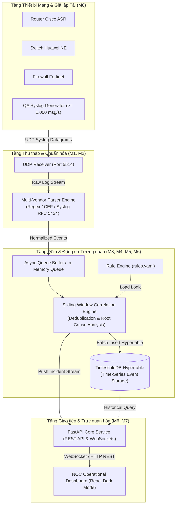

# N4.2 — Hệ thống Thu thập và Phân tích Cảnh báo Mạng Viễn thông
### Telecom Alert Ingestion & Real-Time Correlation System (UTH × VNPT NET)

[](https://www.python.org/)
[](https://fastapi.tiangolo.com/)
[](https://www.timescale.com/)
[](https://react.dev/)
[](https://www.docker.com/)
[](https://nhutp2945-1793259952237.atlassian.net/)
[](LICENSE)

---

## 1. Giới thiệu Đề tài

Dự án **N4.2** là sản phẩm nghiên cứu và phát triển trong khuôn khổ chương trình **Học kỳ Doanh nghiệp (HK26)** giữa **Trường Đại học Giao thông Vận tải TP.HCM (UTH)** và **Trung tâm Điều hành Khai thác Mạng (NOC) — Tổng công ty Hạ tầng mạng VNPT NET**.

Hệ thống được thiết kế nhằm giải quyết bài toán nhức nhối tại các trung tâm vận hành mạng viễn thông: hiện tượng **Bão cảnh báo (Alert Storm)** và **Hội chứng quá tải cảnh báo (Alert Fatigue)** từ hàng ngàn thiết bị chuyển mạch (Switch), định tuyến (Router) và tường lửa (Firewall) đa chủng loại (Cisco, Huawei, Fortinet).

### Mục tiêu kỹ thuật cốt lõi:
- **Thông lượng tiếp nhận (Throughput):** Tiếp nhận dòng log Syslog liên tục qua giao thức UDP cổng 5514 với tải đo kiểm $\ge 1.000\text{ msg/s}$.
- **Chuẩn hóa dữ liệu (Normalization):** Parser Engine nhận diện và bóc tách định dạng log đa hãng thành schema sự kiện chuẩn hóa (Normalized Event Model).
- **Khử trùng và Gom cụm (Deduplication & Correlation):** Sử dụng thuật toán cửa sổ trượt (Sliding Time Window) và luật động (`rules.yaml`) nhằm nén giảm **70% – 80%** lượng cảnh báo rác.
- **Trực quan hóa thời gian thực (Real-Time NOC Dashboard):** Bảng điều khiển React Dark Mode phục vụ kỹ sư trực ca giám sát sự cố mạng theo thời gian thực (độ trễ cập nhật $< 2\text{s}$).

---

## 2. Kiến trúc Hệ thống (System Architecture)



---

## 3. Cấu trúc Dự án (Project Layout)

```text
telecom-alert-correlation-n42/
├── .github/
│   ├── PULL_REQUEST_TEMPLATE.md   # Khung mở PR chuẩn doanh nghiệp
│   └── workflows/
│       └── ci.yml                 # Pipeline kiểm tra chất lượng & bảo mật
├── app/                           # Mã nguồn Backend Core (FastAPI)
│   ├── __init__.py
│   ├── main.py                    # Điểm khởi chạy API Gateway & Routers
│   └── ...                        # Các module M1 - M6 sẽ được phát triển theo Jira
├── docker/                        # Cấu hình container hóa dịch vụ
│   └── Dockerfile
├── docs/                          # Hồ sơ thiết kế kỹ thuật chuẩn VNPT NET
│   ├── ARCHITECTURE_DESIGN.md     # Kiến trúc hệ thống tổng thể
│   ├── DATA_AND_API_DESIGN.md     # Thiết kế cơ sở dữ liệu và REST API
│   ├── PROJECT_CHARTER.md         # Điều lệ dự án & cam kết mục tiêu
│   ├── SYSTEM_REQUIREMENTS...     # Đặc tả yêu cầu kỹ thuật & Use cases
│   └── TECHNICAL_DESIGN_DOC...    # Tài liệu thiết kế kỹ thuật (TDD)
├── tests/                         # Bộ kiểm thử tự động (Unit & Integration Tests)
│   ├── __init__.py
│   └── test_health.py             # Kiểm tra sức khỏe hệ thống baseline
├── tools/                         # Công cụ hỗ trợ DevOps & Kiểm tra an toàn
│   └── check_sensitive.py         # Quét chống rò rỉ credential & IP nhạy cảm
├── .editorconfig                  # Quy chuẩn định dạng mã nguồn nhất quán
├── .gitignore                     # Danh mục loại trừ tệp nháp, cache và môi trường
├── CONTRIBUTING.md                # Quy chuẩn đóng góp mã nguồn & Git Flow
├── docker-compose.yml             # Cấu hình khởi chạy cụm TimescaleDB & Service
├── README.md                      # Tài liệu tổng quan dự án
└── requirements.txt               # Danh mục thư viện phụ thuộc Python
```

---

## 4. Hướng dẫn Khởi chạy Baseline (Getting Started)

### Yêu cầu môi trường:
- **Python**: Phiên bản 3.12 trở lên.
- **Git**: Đã cài đặt Git CLI.
- **Docker & Docker Compose**: (Tùy chọn) để chạy dịch vụ TimescaleDB.

### Các bước cài đặt:

```powershell
# 1. Clone repository
git clone https://github.com/NhutIT-flu/telecom-alert-correlation-n42.git
cd telecom-alert-correlation-n42

# 2. Tạo và kích hoạt môi trường ảo
python -m venv .venv
.\.venv\Scripts\Activate.ps1

# 3. Cài đặt các thư viện phụ thuộc
python -m pip install --upgrade pip
pip install -r requirements.txt

# 4. Kiểm tra an toàn thông tin (Quét IP thật và bảo mật)
python tools/check_sensitive.py

# 5. Khởi chạy Backend API Gateway
python -m uvicorn app.main:app --host 127.0.0.1 --port 8000 --reload
```

- **Health Check**: `GET http://127.0.0.1:8000/api/health`
- **Tài liệu Swagger OpenAPI**: `http://127.0.0.1:8000/docs`
- **Chạy kiểm thử Unit Test**: `python -m unittest discover -s tests -p "test_*.py"`

---

## 5. Quy chuẩn Đóng góp & Phát triển (Git Flow)

Mọi thành viên trong nhóm phát triển bắt buộc tuân thủ chặt chẽ [Quy chuẩn Đóng góp (CONTRIBUTING.md)](CONTRIBUTING.md):

1. **Nhánh phát triển**: Tạo nhánh từ ticket Jira được giao theo mẫu:
   ```bash
   feature/N42-<id>-<mo-ta-ngan>   # Ví dụ: feature/N42-10-syslog-udp-receiver
   ```
2. **Quy tắc Commit (Conventional Commits)**:
   ```bash
   feat: Bổ sung module UDP receiver lắng nghe port 5514 [N42-10]
   fix: Khắc phục lỗi tràn bộ đệm in-memory queue khi tải cao [N42-13]
   test: Bổ sung 5 ca kiểm thử bóc tách định dạng Huawei syslog [N42-12]
   ```
3. **Quy định An toàn Thông tin (RFC 5737)**: Tuyệt đối không hardcode địa chỉ IP thực, mật khẩu, token hệ thống vào code hoặc tài liệu. Mọi địa chỉ IP thử nghiệm bắt buộc thuộc dải mạng tài liệu RFC 5737 (`192.0.2.0/24`, `198.51.100.0/24`, `203.0.113.0/24`).
4. **Quy trình Mở Pull Request**: PR phải điền đầy đủ form theo `.github/PULL_REQUEST_TEMPLATE.md`, pass 100% CI Pipeline và có ít nhất **1 phê duyệt (Approved)** từ Team Leader hoặc QA Lead trước khi được merge vào `main`.

---

## 6. Ban Quản trị & Nhóm Kỹ sư Dự án

| STT | Họ và Tên | MSSV | Vai trò Trách nhiệm | Module Phụ trách |
|:---:|:---|:---:|:---|:---|
| 1 | **Phạm Minh Nhựt** | `082205017237` | **Team Leader / PM & Quản trị Dự án, DevOps** | Quản trị chung, Jira/Confluence, CI/CD, Điều phối |
| 2 | **Nguyễn Duy Minh** | `083205002424` | **Backend Engineer 3 (BE3)** | M5 (Luật tương quan), M6 (Correlation Engine & API) |
| 3 | **Ngô Châu Kiệt** | `083205002376` | **QA Lead** | M8 (QA Tooling, Đo tải 1.000 msg/s, Test Suites) |
| 4 | **Phạm Hoàng Long** | `0822065010353` | **Backend Engineer 1 (BE1)** | M1 (Syslog UDP Ingestion), M2 (Multi-Vendor Parser) |
| 5 | **Phạm Tấn Thành** | `082205009270` | **Backend Engineer 2 (BE2)** | M3 (Queue Buffer), M4 (TimescaleDB Hypertable DDL) |
| 6 | **Lê Khắc Huy** | `082205014597` | **Frontend Engineer (FE)** | M7 (NOC Web Operations Dashboard) |

---
*Dự án thuộc chương trình Học kỳ Doanh nghiệp UTH × VNPT NET. Mọi quyền sở hữu trí tuệ và bảo mật tuân thủ thỏa thuận liên kết đào tạo.*
