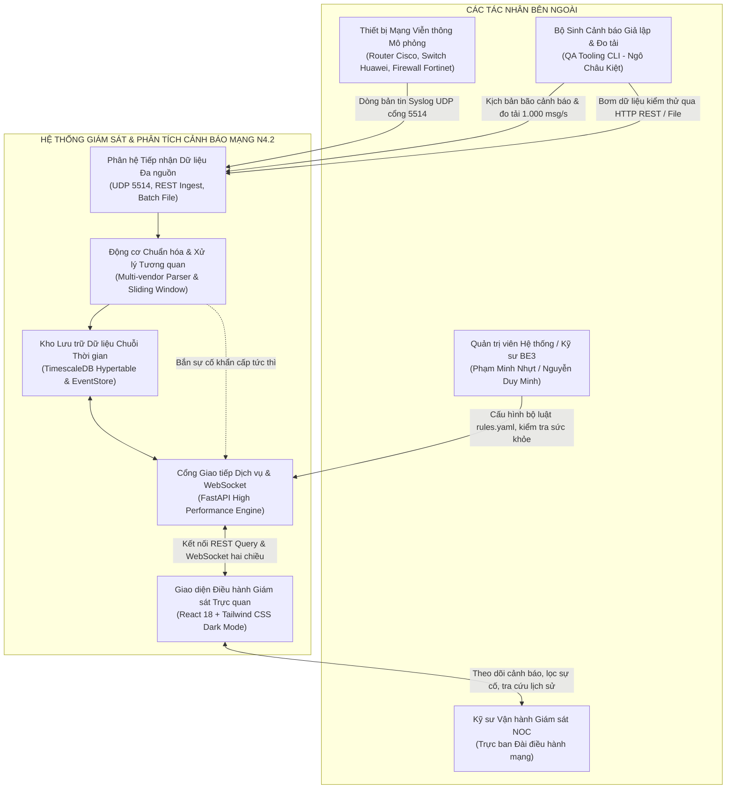
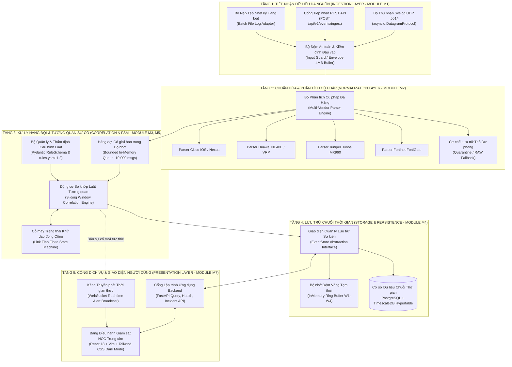
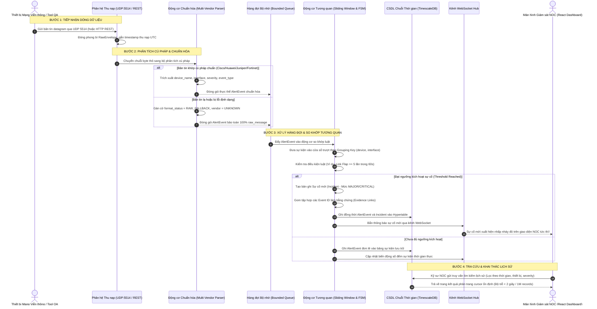
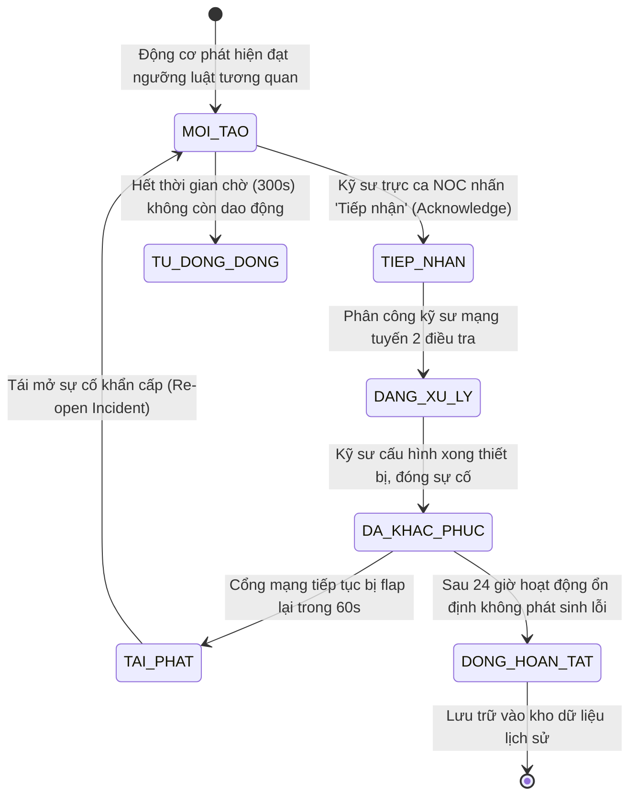
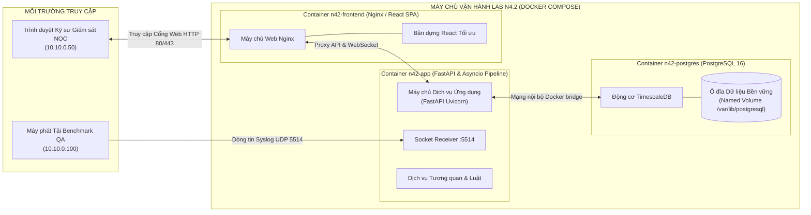

# TÀI LIỆU THIẾT KẾ KIẾN TRÚC VÀ CÁC PHÂN HỆ THÀNH PHẦN HỆ THỐNG
## (SYSTEM ARCHITECTURE DESIGN & COMPONENT SPECIFICATION — N4.2)

> **Mã văn bản:** `VNPT-NET-N42-ADD-2026-V2.0`  
> **Dự án:** N4.2 — Hệ thống thu thập và phân tích tương quan cảnh báo từ Router, Switch và Firewall  
> **Đơn vị chủ trì:** Trung tâm Điều hành Khai thác Mạng VNPT NET (VNPT NOC)  
> **Cơ sở đào tạo:** Trường ĐH Giao thông Vận tải TP.HCM (UTH) — Học kỳ Doanh nghiệp  
> **Chủ nhiệm Kỹ thuật / PM & DevOps:** **Phạm Minh Nhựt**  
> **Chủ nhiệm QA & Kiểm thử:** **Ngô Châu Kiệt**  
> **Kỹ sư Phân hệ Backend:** **Phạm Hoàng Long (BE1)**, **Phạm Tấn Thành (BE2)**, **Nguyễn Duy Minh (BE3)**  
> **Kỹ sư Giao diện Frontend:** **Lê Khắc Huy (FE)**  
> **Tài liệu liên kết:** `SYSTEM_REQUIREMENTS_AND_USE_CASES.md`, `DATA_AND_API_DESIGN.md`, `TEST_CASE_SPECIFICATION.md`, `DECISIONS.md`.

---

## 1. NGUYÊN TẮC THIẾT KẾ CỐT LÕI (CORE ARCHITECTURAL PRINCIPLES)

1. **Bảo toàn Dữ liệu Gốc Tuyệt đối (Raw Preservation):**  
   Mọi bản tin cảnh báo từ thiết bị mạng gửi về (Syslog UDP, REST Ingest, File nhật ký) đều được giữ nguyên vẹn 100% trong trường `raw_message`. Quá trình chuẩn hóa chỉ bổ sung các trường trích xuất, tuyệt đối không ghi đè làm mất vết dấu vết phục vụ hậu kiểm an toàn thông tin.

2. **Xử lý Bất đồng bộ & Kiểm soát Bộ đệm (Asynchronous & Bounded Buffering):**  
   Toàn bộ luồng thu nạp sử dụng cơ chế xử lý phi phong bế (Non-blocking I/O) trên nền tảng `asyncio`. Thiết lập giới hạn kích thước hàng đợi trong bộ nhớ (Bounded Queue: 4MB socket buffer, 10.000 events queue) để chống tràn bộ nhớ (Out-Of-Memory - OOM) và kiểm soát áp lực ngược (Backpressure) khi xảy ra bão cảnh báo viễn thông.

3. **Phân rã Độc lập & Tính Định chuẩn (Loose Coupling & Determinism):**  
   Các phân hệ Thu thập (M1), Chuẩn hóa (M2), Tương quan (M5/M6), Lưu trữ (M4) và Hiển thị (M7) hoạt động độc lập qua các hợp đồng giao tiếp chuẩn hóa (`AlertEvent`, `Incident`, `Pydantic Schema`). Động cơ tương quan cho ra kết quả nhất quán trên cùng một kịch bản phát tải.

4. **Cách ly Môi trường Thử nghiệm An toàn (Isolated Lab Environment):**  
   Hệ thống vận hành độc lập trên môi trường máy chủ Lab; chỉ sử dụng dải địa chỉ mạng nội bộ mô phỏng RFC 1918 (`10.10.0.0/16`) và RFC 5737 (`203.0.113.0/24`). Tuyệt đối không can thiệp, gửi lệnh cấu hình hay tác động ngược lại thiết bị mạng viễn thông thật của VNPT NET.

---

## 2. NGỮ CẢNH HỆ THỐNG VÀ CÁC BÊN LIÊN QUAN (SYSTEM CONTEXT DIAGRAM)

Sơ đồ ngữ cảnh thể hiện luồng giao tiếp giữa Hệ thống N4.2 với các tác nhân bên ngoài:

---

## 3. KIẾN TRÚC PHÂN TẦNG VÀ THÀNH PHẦN CHỨC NĂNG (CONTAINER & COMPONENT ARCHITECTURE)

Toàn bộ hệ thống được phân rã thành 5 phân tầng chức năng rõ rệt:

---

## 4. BẢNG ĐẶC TẢ TRÁCH NHIỆM VÀ HIỆN TRẠNG CÁC THÀNH PHẦN KIẾN TRÚC

Bảng đối chiếu toàn diện trách nhiệm kỹ thuật, kỹ sư phụ trách chính và lộ trình triển khai chi tiết cho từng thành phần trong hệ thống:

| Phân hệ / Thành phần | Tên kỹ thuật chuẩn | Kỹ sư phụ trách (Owner) | Trách nhiệm kỹ thuật & Nghiệp vụ chi tiết | Hợp đồng giao tiếp (Contract) | Hiện trạng mã nguồn & Kế hoạch Sprint |
| :--- | :--- | :---: | :--- | :--- | :--- |
| **Phân hệ Thu nhận Syslog UDP** | `UDP Datagram Receiver` | **Phạm Hoàng Long (BE1)** | Mở Socket lắng nghe cổng UDP `5514`. Tiếp nhận các gói tin datagram thô từ router/switch. Nới rộng bộ đệm nhận `SO_RCVBUF = 4MB` để triệt tiêu tỷ lệ rớt gói khi bão lưu lượng. Đóng gói phong bì `RawEnvelope` kèm timestamp vi giây. | `asyncio.DatagramProtocol` Port: `5514` Struct: `RawEnvelope` | Đang hoàn thiện trong **Sprint 1** (`N42-13`, `N42-32`). Baseline W1 đã sẵn sàng khung. |
| **Cổng Tiếp nhận REST API** | `FastAPI REST Ingest Adapter` | **Phạm Hoàng Long (BE1)** | Cung cấp endpoint HTTP tiếp nhận cảnh báo từ ứng dụng bên thứ 3 và hệ thống giám sát khác. Thẩm định schema dữ liệu đầu vào bằng Pydantic. Xử lý trả mã lỗi chuẩn `201 Created`, `400 Bad Request`, `422 Unprocessable`. | `POST /api/v1/events/ingest` Body: `JSON` Header: `Content-Type: app/json` | Đang triển khai trong **Sprint 1** (`N42-14`). |
| **Bộ Tiếp nhận Tệp Nhật ký** | `Batch File Log Adapter` | **Phạm Hoàng Long (BE1)** | Đọc tệp tin nhật ký dung lượng lớn từ ổ đĩa theo cơ chế phát dòng (streaming line-by-line). Giữ nguyên số dòng để đối soát lỗi. Báo cáo tổng số dòng nạp thành công và danh sách dòng lỗi dị dạng mà không làm sập luồng nạp. | CLI Command: `python -m app.importer` Hỗ trợ format `.log`, `.txt` | Lên kế hoạch triển khai tại **Sprint 2** (`N42-22`). |
| **Động cơ Phân tích Cú pháp Đa Hãng** | `Multi-Vendor Parser Engine` | **Phạm Tấn Thành (BE2)** | Bóc tách tự động các mẫu bản tin khác biệt: Cisco IOS (`LINK-3-UPDOWN`), Cisco Nexus (`%IP-4-DUPADDR`), Huawei NE40E (`POWER_SUPPLY_FAILED`), Juniper (`BGP_PEER_DOWN`), Fortinet (`action=deny`). Ánh xạ mức độ nghiêm trọng về 5 thang chuẩn: `CRITICAL`, `MAJOR`, `WARNING`, `INFO`, `DEBUG`. Chống tấn công ReDoS. | Class: `BaseNormalizer` Entity: `AlertEvent` Mapping: `RFC 3164 / 5424` | Đang triển khai trong **Sprint 1 & Sprint 2** (`N42-15`, `N42-23..25`). |
| **Cơ chế Lưu trữ Thô Dự phòng** | `Quarantine & RAW Fallback` | **Phạm Tấn Thành (BE2)** | Đảm bảo tính toàn vẹn 100%: Khi gặp bản tin lạ, chuỗi nhị phân hỏng hoặc không có mã PRI chuẩn, hệ thống tự động đánh dấu cờ `format_status: RAW_FALLBACK`, gán `vendor: UNKNOWN` và bảo toàn trọn vẹn chuỗi gốc vào CSDL phục vụ hậu kiểm. | Trường: `raw_message` Trạng thái: `UNKNOWN` | Triển khai trong **Sprint 2** (`N42-18`). |
| **Hàng đợi Có giới hạn Bộ nhớ** | `Bounded In-Memory Queue` | **Phạm Tấn Thành (BE2)** | Vùng đệm trung chuyển giữa tầng Thu thập và tầng Phân tích cú pháp/Tương quan. Giới hạn dung lượng tối đa 10.000 bản tin. Kích hoạt cơ chế áp lực ngược (Backpressure) và bộ đếm cảnh báo drop khi dung lượng vượt quá 85%. | Struct: `asyncio.Queue(maxsize=10000)` Queue Depth Metrics | Triển khai trong **Sprint 2** (`N42-28`). |
| **Động cơ Tương quan Sự cố** | `Correlation & Rule Engine` | **Nguyễn Duy Minh (BE3)** | Áp dụng thuật toán cửa sổ trượt thời gian thực (Sliding Window deque) để phát hiện mối liên hệ giữa các cảnh báo riêng lẻ: Gom ít nhất 5 lần đổi trạng thái UP/DOWN trong 60 giây trên cùng cổng mạng thành 1 sự cố gốc (Link Flap). Giảm thiểu tối thiểu 70% số lượng cảnh báo hiển thị trên màn hình NOC. | Module: `correlation_engine` Khóa gom: `(device, interface)` Cửa sổ: `window_seconds` | Đang khởi động trong **Sprint 1 & Sprint 3** (`N42-17`, `N42-44`). |
| **Cỗ máy Trạng thái Khử dao động** | `Link Flap Finite State Machine` | **Nguyễn Duy Minh (BE3)** | Quản lý trạng thái giao diện mạng theo mô hình FSM chuẩn: `NORMAL -> MONITORING -> FLAPPING -> SUPPRESSED -> AUTO_RESOLVED`. Tự động cô lập cảnh báo phụ khi cổng dao động vượt ngưỡng 10 lần/phút để chống bão giao diện. | FSM State Table Timeout: `300 seconds` | Triển khai trong **Sprint 3** (`N42-44`). |
| **Bộ Quản lý Cấu hình Luật** | `Rules Manager & Validator` | **Nguyễn Duy Minh (BE3)** | Nạp và thẩm định bộ luật từ tệp `rules.yaml` tuân thủ tiêu chuẩn YAML 1.2. Kiểm tra chặt chẽ schema Pydantic, bắt lỗi ký tự Tab, kiểm soát ngưỡng biên `threshold >= 1`, `window >= 1s`. Cung cấp tính năng nạp lại không gián đoạn dịch vụ (Atomic Hot-Reload) và tự động khôi phục bản cũ nếu lỗi. | Tệp: `rules.yaml` API: `POST /api/v1/rules/reload` Schema: `RuleSchema` | Đang chuẩn bị trong **Sprint 1 & Sprint 4** (`N42-17`, `N42-46`). |
| **Bộ Quản lý Lưu trữ Sự kiện** | `EventStore Abstraction Layer` | **Phạm Tấn Thành (BE2)** | Cung cấp giao diện trừu tượng che giấu tầng CSDL thực tế. Cho phép chuyển đổi mượt mà giữa bộ lưu đệm RAM ở giai đoạn đầu sang CSDL TimescaleDB ở giai đoạn sau mà không ảnh hưởng tới code nghiệp vụ của các thành viên khác. | Interface: `EventStore` Methods: `add()`, `add_many()`, `get_by_id()`, `query()` | Đang triển khai trong **Sprint 1** (`N42-15`, `N42-16`). |
| **Kho Lưu trữ Chuỗi Thời gian** | `TimescaleDB Repository` | **Phạm Tấn Thành (BE2)** | Triển khai CSDL PostgreSQL 16 mở rộng TimescaleDB. Phân vùng bảng dữ liệu thành các đoạn siêu bảng (Hypertable chunks 1 ngày/chunk). Đánh chỉ mục tối ưu (B-Tree + Composite Index) trên `(received_at, device_name, severity)`. Đảm bảo truy vấn 1 triệu bản ghi dưới 2 giây. | CSDL: `PostgreSQL 16` Extension: `timescaledb` Bảng: `alert_events`, `incidents` | Đang dựng DDL trong **Sprint 1 & Sprint 2** (`N42-16`, `N42-31`). |
| **Cổng Lập trình Dịch vụ Backend** | `FastAPI Service Gateway` | **Phạm Hoàng Long (BE1)** | Cung cấp hệ thống REST API truy vấn dữ liệu sự kiện, quản lý sự cố, phân trang cursor ổn định, báo cáo sức khỏe hệ thống `/api/health`. Chống tấn công SQL Injection bằng truy vấn tham số hóa. | Swagger OpenAPI Docs Endpoints: `/api/v1/events`, `/api/v1/incidents` | Đã có endpoint `/api/health`. Mở rộng các API tại **Sprint 2 & Sprint 3** (`N42-19`). |
| **Kênh Truyền phát Thời gian thực** | `WebSocket Real-time Broadcast Hub` | **Lê Khắc Huy (FE)** | Duy trì kết nối hai chiều liên tục giữa trình duyệt của Kỹ sư NOC và máy chủ Backend. Phát sóng tức thì các sự cố khẩn cấp mức `CRITICAL` và `MAJOR` ngay khi Động cơ tương quan phát hiện, không bắt người dùng phải tải lại trang. | Protocol: `WebSocket (ws://)` Endpoint: `/ws/alerts` Format: JSON Event Stream | Bắt đầu kết nối tại **Sprint 3** (`N42-34`). |
| **Giao diện Giám sát NOC Trung tâm** | `React NOC Dashboard UI` | **Lê Khắc Huy (FE)** | Xây dựng màn hình điều hành NOC chuẩn Dark Mode VNPT. Hiển thị 4 thẻ chỉ số KPI tổng quan, dòng sự kiện thời gian thực (Live Event Feed), bộ lọc đa tiêu chí, màn hình phân tích nguyên nhân gốc sự cố (Root Cause Explorer) và chức năng xuất báo cáo ca trực. | Framework: `React 18` Build: `Vite` Style: `Tailwind CSS` Icons: `Lucide React` | Khởi tạo khung giao diện tại **Sprint 1 & Sprint 2** (`N42-19`, `N42-20`). |
| **Bộ Sinh Cảnh báo Giả lập & Đo tải** | `QA Benchmark & Load Generator` | **Ngô Châu Kiệt (QA Lead)** | Xây dựng công cụ CLI tự động phát dòng dữ liệu mô phỏng theo 8 kịch bản chuẩn KB-01..08. Điều khiển tốc độ phát chính xác từ 200, 500 đến 1.000 msg/s. Gắn timestamp vi giây để đo đạc và báo cáo phân vị trễ $P_{50}, P_{99}$ và tỷ lệ mất gói UDP $0.00\%$. | Script: `tools/load_runner.py` Giao thức: `UDP / REST` Tải đỉnh: `1.500 msg/s` | Đang viết kịch bản tại **Sprint 1 & Sprint 2** (`N42-11`, `N42-12`, `N42-47`). |
| **Hạ tầng Tự động hóa CI/CD & Quản trị** | `DevOps Pipeline & Governance` | **Phạm Minh Nhựt (PM/Lead)** | Thiết lập đường ống CI/CD GitHub Actions: tự động quét mã độc và rò rỉ secret bằng `check_sensitive.py`, chạy linter `flake8` và kiểm thử tự động `pytest`. Vận hành bảng Jira Scrum, đồng bộ 5 luồng Automation 2 chiều giữa Git và Jira. | GitHub Actions CI Jira Cloud Automation Branch Protection: `main` | Đã hoàn tất kết nối Jira-Git, cấu hình bảo vệ nhánh `main` và 5 luồng tự động. |

---

## 5. BIỂU ĐỒ TUẦN TỰ DÒNG DỮ LIỆU CẢNH BÁO (END-TO-END SEQUENCE DIAGRAM)

Biểu đồ mô tả chi tiết đường đi của một bản tin cảnh báo từ lúc phát sinh trên thiết bị mạng viễn thông cho đến khi hiển thị cảnh báo đỏ trên màn hình NOC Dashboard:

---

## 6. MÔ HÌNH VÒNG ĐỜI XỬ LÝ SỰ CỐ VIỄN THÔNG (INCIDENT LIFECYCLE FSM)

Sự cố mạng sau khi được Động cơ tương quan phát hiện sẽ vận hành theo cỗ máy trạng thái chuẩn ITIL v4:

---

## 7. MÔ HÌNH TRIỂN KHAI VẬN HÀNH TRÊN MÁY CHỦ LAB (DEPLOYMENT ARCHITECTURE)

Hệ thống được đóng gói hoàn chỉnh bằng Docker Compose triển khai trên máy chủ kiểm thử:

---

## 8. PHÊ DUYỆT BẢN THIẾT KẾ KIẾN TRÚC

| Vai trò | Họ và tên | Chữ ký điện tử | Trạng thái |
| :--- | :--- | :---: | :---: |
| **Project Manager & DevOps Lead** | **Phạm Minh Nhựt** | *(Đã ký duyệt)* | Phê duyệt chính thức |
| **QA Lead / Chủ nhiệm Kiểm thử** | **Ngô Châu Kiệt** | *(Đã ký duyệt)* | Xác nhận tiêu chuẩn đo tải |
| **Đại diện Nhóm Backend (BE1/BE2/BE3)** | **Phạm Hoàng Long / Phạm Tấn Thành / Nguyễn Duy Minh** | *(Đã đồng thuận)* | Cam kết triển khai theo Sprint |
| **Đại diện Nhóm Frontend (FE)** | **Lê Khắc Huy** | *(Đã đồng thuận)* | Cam kết hợp đồng API Dashboard |
| **Cố vấn Chuyên môn Doanh nghiệp** | Ban Cố vấn Kỹ thuật VNPT NOC | *(Chờ nghiệm thu W13)* | Đăng ký hồ sơ nghiệm thu |
