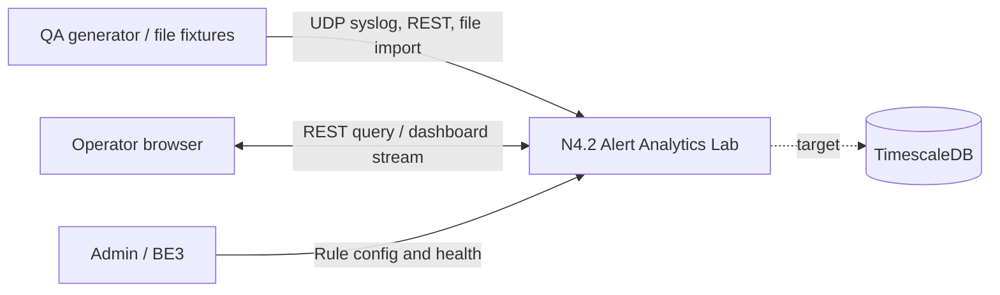
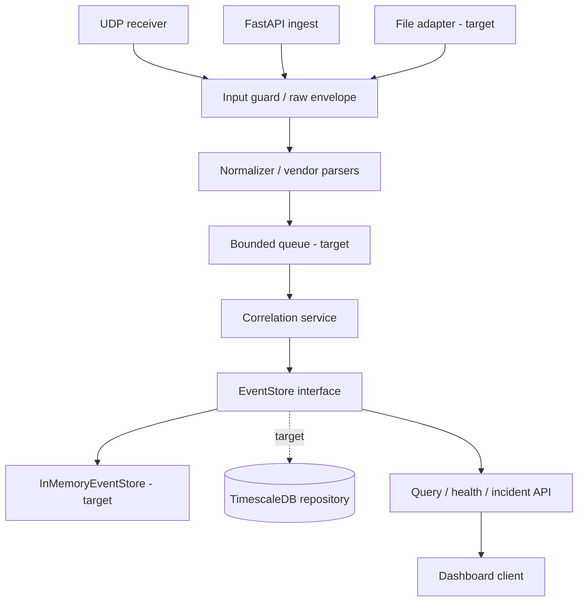
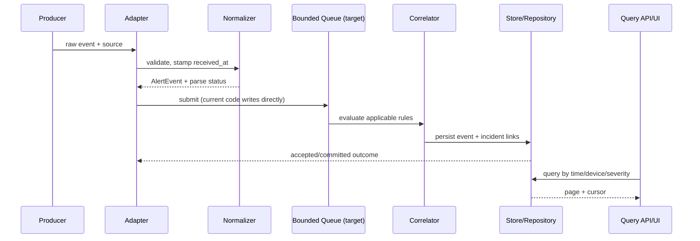
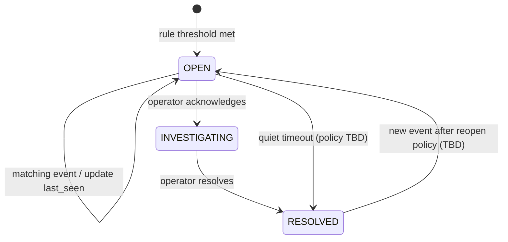
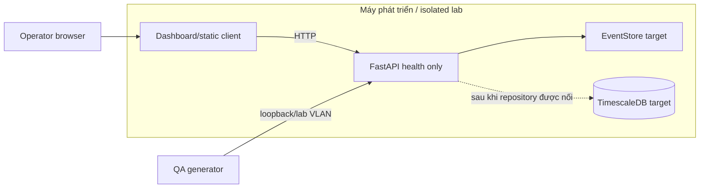

# THIẾT KẾ KIẾN TRÚC VÀ THÀNH PHẦN — N4.2

**Mã:** N42-ADD · **Baseline:** 03/11/2026 · **Trạng thái:** Thiết kế mục tiêu, phân biệt với hiện trạng code.  
Liên kết: `SYSTEM_REQUIREMENTS_AND_USE_CASES.md`, `DATA_AND_API_DESIGN.md`, `TECHNICAL_DESIGN_DOCUMENT.md`, `DECISIONS.md`.

## 1. Nguyên tắc

- Không ghi thiết kế tương lai như capability đã chạy.
- Giữ raw input; xử lý deterministic và replay được; KPI phải có định nghĩa/evidence.
- Dùng bounded memory, backpressure và error path tường minh.
- Parser không phụ thuộc DB/UI; UI đọc qua API; mặc định lab cách ly, không tác động thiết bị.

## 2. System context

Sơ đồ dưới đây là kiến trúc mục tiêu; chỉ health endpoint có trong baseline code W1.

Đây là kiến trúc mục tiêu. Baseline code W1 chỉ có FastAPI health endpoint; hiện chưa tiếp nhận/lưu event. Không cấu hình thiết bị hoặc gửi remediation.

## 3. Container và tầng logic

| Thành phần | Trách nhiệm | Hiện trạng |
|---|---|---|
| UDP receiver | Nhận raw datagram và chuyển pipeline | Chưa triển khai |
| REST ingest | Validate raw, chuyển pipeline, trả trạng thái | Chưa triển khai |
| File adapter | Đọc từng record, giữ line error | Chưa thấy trong code |
| Normalizer | Parse vendor/format và fallback RAW | Chưa triển khai |
| Correlation | Gom event theo điều kiện/window, tạo incident | Chưa triển khai |
| EventStore | Lưu và truy vấn event | Chưa triển khai |
| DB repository | Persist event/incident/rule | Chưa triển khai; SQL bootstrap chỉ bật extension |
| API/UI | Query và hiển thị | Chỉ có `GET /api/health`; dashboard chưa triển khai |

## 4. Ingest path target

1. Adapter ghi source, received timestamp UTC và receive monotonic timestamp để đo latency.
2. Áp giới hạn byte, decode/validate; UDP không có retry end-to-end.
3. Normalizer giữ raw, parse time/device/vendor/severity/mnemonic/interface; ghi parse status. Parse lỗi không làm mất event.
4. Tạo event ID; idempotency theo producer ID nếu có. Fingerprint không thay primary ID.
5. Submit bounded queue. Queue đầy: policy riêng theo transport (TCP/API backpressure hoặc reject; UDP drop có counter hoặc spool); không dùng queue unbounded.
6. Persist theo batch transaction; ack semantics phải nói rõ `accepted` hay `durable`. Phát UI update sau commit.

## 5. Correlation và query path

- Partition theo rule/grouping key; loại event ngoài window; dedupe theo ID; áp precedence rõ để tránh event bị gán nhiều incident vô tình.
- Incident giữ `rule_key/version`, matched evidence, first/last seen, severity, event references.
- Cần chốt late-event watermark, incident merge/split, resolve timeout và multi-rule collision.
- Query API dùng filter có index, timeout và stable cursor. UI stream có buffer giới hạn; khi reconnect, lấy snapshot theo cursor để bù gap/duplicate.
- UI/API mất kết nối không được làm mất event đã persist.

### Sequence: ingest đến khi query được

### Incident lifecycle (target)

Timeout, reopen and transition audit rules are unresolved until an ADR settles them; diagram is a proposed lifecycle, not current behavior.

### Dashboard information architecture (target)

1. **Overview:** time window, ingest health, event rate, open incidents, parse errors, drop counters.
2. **Event Explorer:** filter by time/device/vendor/severity/source; paginated rows; detail panel separates normalized fields from raw.
3. **Incident Explorer:** status/severity/device filters; incident detail shows rule/version, timeline, matched evidence and child events.
4. **QA/Diagnostics (restricted):** active rule version, service health, benchmark/scenario run metadata; no destructive controls in operator view.

UI states: loading, empty, partial dependency failure, stale stream, permission denied, and request error. Severity must have text/icon in addition to color; tables need keyboard navigation and explicit timezone.

## 6. Triển khai và phân vùng

Compose và DB chỉ được ghi là đã vận hành nếu README/commit xác nhận đúng service/profile. Không expose API/DB public; giới hạn bind/ports. `10.10.0.0/16` là lab private; `203.0.113.0/24` chỉ dành cho ví dụ tài liệu.

## 7. Failure handling và observability

| Tình huống | Hành vi | Metric/log cần có |
|---|---|---|
| Malformed input | API trả lỗi; UDP đếm parse failure, giữ raw trong giới hạn | parse_failures theo source/format |
| Queue full | Áp policy transport, không âm thầm bỏ | queue_depth/full, dropped_datagrams |
| DB timeout | Retry giới hạn/backoff, idempotency, readiness fail | db_errors, retries, write_latency |
| Rule invalid | Cô lập version lỗi, event vẫn standalone | rule_eval_errors, active_version |
| UI disconnect | Reconnect + snapshot/cursor recovery | reconnect_count, stream_lag |
| Shutdown | Ngừng nhận, drain queue, flush, đóng DB | drain_seconds, unflushed_count |

## 8. Bảo mật

Chỉ synthetic data; secrets qua env, không commit. Raw logs không render thành HTML; giới hạn kích thước/retention. Authentication, authorization và TLS chưa có trong app baseline; chạy isolated lab. CORS `*` chỉ dành cho development và cần đóng trước khi expose ra mạng nhóm.

## 9. Các lát cắt triển khai

1. Baseline W1: FastAPI liveness endpoint; các ticket xây ingestion, parser, store và query từ đầu.
2. Persistence: EventStore interface → repository/migrations → retry/restart persistence.
3. Correlation: rule schema/version → deterministic evaluator → incidents/evidence.
4. Operator: filter/page → API contract → UI/export.
5. Acceptance: scenario fixtures → load harness → clean install/handover evidence.

Mỗi lát cắt cập nhật RTM, decision log, API contract và AC; status chỉ nâng khi có evidence.
