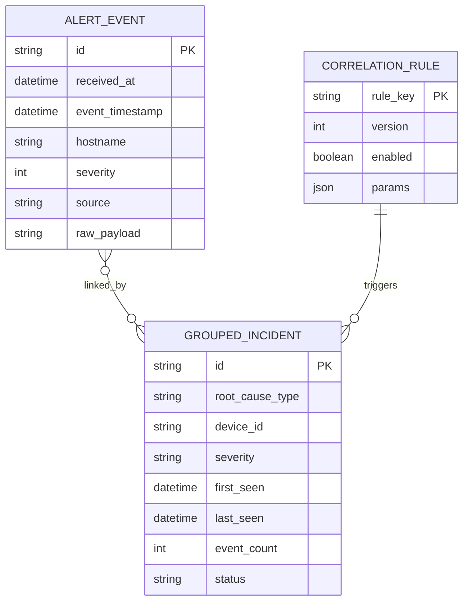

# THIẾT KẾ DỮ LIỆU VÀ API — N4.2

**Mã:** N42-DAD · **Baseline:** 03/11/2026 · **Trạng thái:** Hợp đồng thiết kế, phân biệt hiện trạng và target.  
Nguồn đối chiếu: `app/`, `n42-ai-kit/docs/INTERFACES.md`, `docker/init-db.sql`. Hợp đồng event/API đang là đề xuất; SQL bootstrap chỉ bật extension và runtime chưa nối PostgreSQL.

## 1. Mô hình miền

ERD dưới đây là mô hình khái niệm mục tiêu. Tên field event còn ở trạng thái đề xuất v0.9 trong `n42-ai-kit/docs/INTERFACES.md`; chưa có model/DDL tương ứng trong code.

Quan hệ event–incident có thể nhiều-nhiều nếu nhiều rule cùng match. Baseline W1 chưa có model hoặc bảng nghiệp vụ; cần chốt cardinality và bảng nối trước persistence.

## 2. Trạng thái hợp đồng event

Nhánh W1 chưa có model event hoặc bảng nghiệp vụ. Hợp đồng `AlertEvent` trong `n42-ai-kit/docs/INTERFACES.md` là đề xuất v0.9, cần TL/BE1/BE2/BE3 chốt qua Jira/decision log trước khi các module phụ thuộc cùng triển khai. Không coi tên field, enum hoặc DDL ở đây là schema đã đóng băng.

## 3. Schema đích

| Bảng | Cột chính | Ràng buộc/index đề xuất |
|---|---|---|
| `alert_events` | ID; received/event time; device ID/type; severity/source/format; raw/content; vendor/mnemonic/interface/IP; metadata JSONB; parse status; schema version | hypertable theo received time; index time+device và time+severity; enum/check; giới hạn raw |
| `correlation_rules` | rule key, name, version, enabled, params JSONB, created/updated | validate JSON schema/range trước publish; version bất biến |
| `grouped_incidents` | ID, rule key/version, device, root cause, severity, first/last seen, event count, status, summary, evidence JSONB | index status+last_seen, device+last_seen |
| `incident_events` | incident ID, event ID, relation type, matched time | composite unique, FK, index event ID |

TimescaleDB unique constraint cần tương thích partition key/extension version; xác nhận trong migration trước khi chốt. Chưa bật retention/compression tự động khi chưa có quyết định lưu trữ và thử restore. Không xem chunk 7 ngày/retention 90 ngày là baseline được duyệt.

### Data lifecycle

- Raw phục vụ đối soát, giới hạn kích thước và quyền truy cập.
- Normalized fields thường truy vấn để thành cột có kiểu; JSON chỉ cho extension vendor.
- Incident lưu evidence đủ tái lập; cập nhật event count/time nhất quán.
- Rule publish theo version mới, có rollback.
- Retention/backup/restore còn mở; quyết định phải nêu dung lượng, RPO/RTO và bằng chứng thử.

## 4. API hiện hành

Base URL khi chạy local `http://127.0.0.1:8000`, prefix `/api`.

| Method/path | Request | Response/giới hạn hiện tại |
|---|---|---|
| `GET /api/health` | none | `status`, `service`, `version`; liveness của process |

Baseline W1 trên nhánh chính có liveness. Ở commit `671a7fd` của N42-14, `POST /api/v1/events/ingest` nhận `raw_message` vào RAM và trả `201`. Cùng commit vẫn trả thành công khi queue đầy và bản tin bị bỏ. Ca hồi quy N42-14 yêu cầu HTTP `503`, queue giữ nguyên và không trả ID cho bản tin bị từ chối.

## 5. API target đề xuất

### 5.1 Ingest

OpenAPI `1.0.0-review.2` đề xuất `POST /api/v1/events` dùng `Idempotency-Key` và trả `201` sau khi ghi event và receipt thành công. Phương án `202` cho route RAM chuyển tiếp chờ quyết định N42-62. Với File Import N42-22, route đích `POST /api/v1/imports` đề xuất trả `202` sau khi lưu file và metadata. Đối chiếu số dòng sau khi job hoàn tất.

Lỗi: 400 malformed JSON; 413 payload quá lớn; 422 schema/format sai; 429 rate limit; 503 queue/DB unavailable. UDP không có HTTP ack nên generator đối soát ID/counters.

### 5.2 Query

OpenAPI review.2 đề xuất `GET /api/v1/events` với `from/to` bắt buộc và bộ lọc `hostname`. Bản thiết kế trước đó nêu `device_id`; N42-62 cần xác nhận tham số trước khi N42-67 triển khai API và N42-34 tích hợp Dashboard. Response đề xuất `{items,next_cursor,has_more}` dùng `EventView`. N42-39 phụ trách thống kê. N42-46 theo dõi truy vấn incident và quyền xem evidence.

### 5.3 Health và metrics

Liveness chỉ xác nhận process; readiness kiểm tra dependency thiết yếu. Metrics tách received/parsed/persisted/correlated/dropped, queue depth và latency. Không trả host/env/secrets/raw trên public health.

### 5.4 Rule management

Admin-only endpoints validate schema, version, ranges; dry-run fixtures; audit actor/time/diff. Không cho phép code tùy ý hoặc regex không giới hạn. AuthZ hiện chưa có nên đây là target, không expose ra ngoài lab.

## 6. Lộ trình từ baseline W1

| Hạng mục | Hiện trạng | Ticket/đầu ra cần có |
|---|---|---|
| AlertEvent và RawEvent | Chưa có model trong code; hợp đồng đang là đề xuất | Chốt schema, thêm model và fixture |
| EventStore | Chưa triển khai | Interface + in-memory store, sau đó repository/migration theo mốc |
| Ingest/query API | Chỉ có health | OpenAPI, validation, filter/paging theo Jira |
| Correlation | Chưa triển khai | Rule/window/evidence cùng test kịch bản |
| Database | Extension only, chưa có bảng/seed | Migration version hóa; không thêm dữ liệu thật |

## 7. Versioning và compatibility

Version API `/api/v1`; breaking changes cần migration note và phối hợp FE. Event có schema version; giữ raw để reprocess. Thay contract cập nhật model, SQL/migration, OpenAPI, fixtures, RTM, acceptance evidence và `DECISIONS.md` trong cùng work item.
