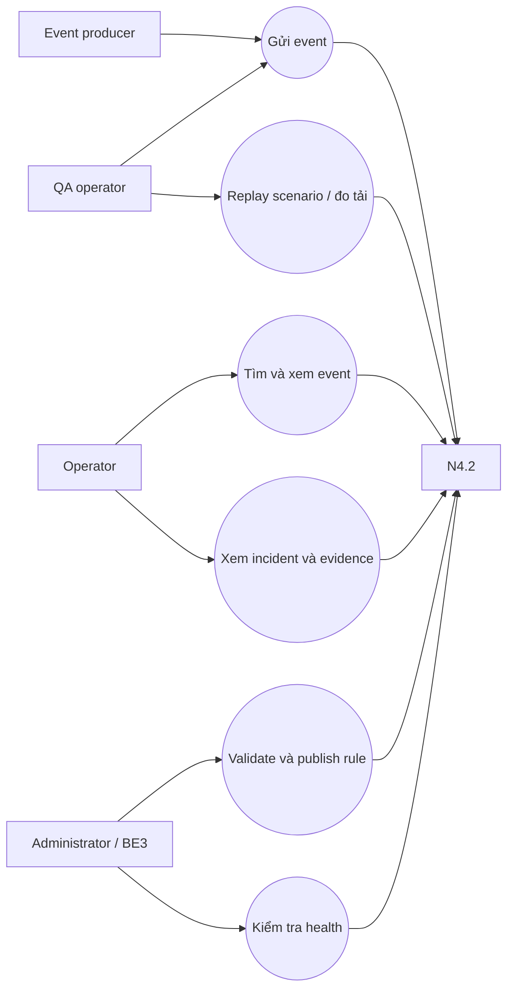

# ĐẶC TẢ YÊU CẦU VÀ CA SỬ DỤNG — N4.2

**Mã:** N42-SRS · **Baseline:** 03/11/2026 · **Trạng thái:** Bản làm việc cần xác nhận với mentor/PM.  
**Nguồn điều khiển:** `PROJECT_CHARTER.md`, `ACCEPTANCE_CRITERIA.md`, `DOCUMENT_CONTROL.md`; khi khác nhau, ưu tiên các tài liệu điều khiển và quyết định mới nhất trong `DECISIONS.md`.

## 1. Mục đích, phạm vi và giới hạn

N4.2 là dự án doanh nghiệp phối hợp UTH × VNPT NET, hướng tới hỗ trợ quy trình giám sát và phân tích cảnh báo mạng của VNPT. Sản phẩm xử lý log đa nguồn, chuẩn hóa về event chung, lưu/truy vấn, gom cảnh báo liên quan thành incident và cung cấp thông tin cho operator. Trong giai đoạn phát triển/kiểm chứng hiện tại, hệ thống chạy ở môi trường lab với dữ liệu giả lập; việc kết nối dữ liệu hoặc thiết bị sản xuất chỉ thực hiện khi VNPT phê duyệt phạm vi, an toàn thông tin và kế hoạch triển khai.

**Trong phạm vi:** syslog UDP; REST ingest; nhập file log; chuẩn hóa các mẫu RFC3164 và một tập mẫu vendor được chọn; lưu event; tìm kiếm/lọc/thống kê; grouping và correlation; dashboard; dữ liệu giả lập; kiểm thử; hướng dẫn dựng/bàn giao.

**Ngoài phạm vi baseline hiện tại:** tự động khắc phục thiết bị; HA đa vùng/24×7; SSO và multi-tenant; ML root cause; lưu vô thời hạn. Kết nối production hoặc SNMP thực tế là bước triển khai doanh nghiệp cần được VNPT thẩm định/phê duyệt riêng, không thuộc môi trường kiểm thử hiện tại. Mở rộng cần quyết định phạm vi và nghiệm thu.

### Giả định cần xác nhận

- Format file, encoding, rotation/archive, giới hạn kích thước cần được chốt.
- Bộ log có nhãn do nhóm chọn, không đại diện mọi firmware/vendor.
- KPI là tiêu chí thử trên môi trường đã mô tả, không phải SLA production.
- Lưu UTC; UI có thể trình bày theo timezone người dùng.

## 2. Vai trò nghiệp vụ

| Actor | Mục tiêu | Quyền baseline |
|---|---|---|
| Operator | Theo dõi event, tìm kiếm, xem incident và event con | Đọc; acknowledge/resolve chỉ khi được chốt và có lưu trạng thái |
| Administrator | Kiểm tra service, cấu hình/nạp luật | Quản trị cấu hình lab, không quản lý thiết bị |
| Producer | Gửi syslog/API hoặc cung cấp file | Ghi nhận dữ liệu |
| QA/Generator | Phát scenario tái lập, đối soát và đo tải | Chỉ dùng lab và dữ liệu giả lập |

Code hiện chưa có authentication/authorization; chỉ chạy localhost/lab cách ly, không public Internet.

### Use-case tổng quan

## 3. Yêu cầu chức năng

| ID | Yêu cầu và quy tắc đầu ra | Ưu tiên | Owner |
|---|---|---|---|
| FR-01 | Nhận syslog UDP; một datagram hợp lệ tạo tối đa một event, ghi source/received time | Must | BE1 |
| FR-02 | REST ingest nhận raw message, trả event chuẩn hóa hoặc lỗi rõ ràng | Must | BE1/BE2 |
| FR-03 | File import đọc từng record, giữ source và báo cáo dòng lỗi; idempotency cần chốt | Should | BE1/QA |
| FR-04 | Parser chuẩn hóa, xác định format/vendor/severity, giữ raw message | Must | BE2 |
| FR-05 | Parse lỗi không làm mất raw; đánh dấu `UNKNOWN`/`RAW`, đưa vào kiểm tra | Must | BE2 |
| FR-06 | Lưu event; chế độ bền vững chỉ ack sau khi có bằng chứng commit | Must | BE2 |
| FR-07 | Lọc theo thời gian/thiết bị/severity; phân trang và sắp xếp ổn định | Must | BE2/FE |
| FR-08 | Thống kê event theo time window, severity/vendor/device nhất quán | Should | BE2/FE |
| FR-09 | Luật correlation có mã/điều kiện/cửa sổ; incident liên kết event và evidence | Must | BE3 |
| FR-10 | Xem lifecycle incident; mutation chỉ khi có audit trail | Should | BE3/FE |
| FR-11 | Dashboard hiển thị health, KPI, event và incident; thể hiện trạng thái xử lý | Must | FE |
| FR-12 | Health/diagnostics báo receiver/store/DB/counters; không lộ secret/raw | Must | BE1/BE2 |
| FR-13 | Replay deterministic theo scenario/seed, expected outcome và correlation ID | Must | QA |
| FR-14 | Export phản ánh filter hiện tại, escape input, có giới hạn | Should | FE/BE |
| FR-15 | Validate và version rule; reload nguyên tử, rollback nếu lỗi | Must | BE3 |

## 4. Quy tắc nghiệp vụ

1. Giữ nguyên raw; không ghi normalized fields đè raw.
2. `received_at` là thời điểm nhận; `event_time` lấy từ log nếu parse được; nếu fallback thì lưu nguồn/độ tin cậy.
3. Severity chuẩn: `CRITICAL`, `MAJOR`, `WARNING`, `INFO`, `DEBUG`, `UNKNOWN`; mapping có fixtures có nhãn, không suy numeric PRI đơn giản là severity chuẩn.
4. Link Flap: ≥5 lần đổi UP/DOWN trên cùng device/interface trong 60 giây.
5. Detection = TP/(TP+FN); báo FP riêng. W12 ≥70% checkpoint; W13 ≥90% trên 8–10 scenario đóng băng.
6. Noise reduction theo `ACCEPTANCE_CRITERIA.md`; mỗi event tính một lần, đối soát incident và standalone.
7. Load final W13: 1.000 msg/s trong 1 giờ; checkpoint 10 phút không thay nghiệm thu cuối.

## 5. Ca sử dụng

### UC-01 — Nhận và chuẩn hóa cảnh báo

**Actor:** producer. **Tiền điều kiện:** service khỏe, format trong phạm vi. **Luồng chính:** gửi datagram/request → ghi source/received time → giới hạn kích thước/validate encoding → parse → tạo ID → lưu → cập nhật metrics → trả ack/result. **Ngoại lệ:** payload rỗng/quá lớn trả lỗi; parser không nhận dạng được thì giữ raw + `UNKNOWN`; DB lỗi không được trả thành công bền vững, phải đo/log lỗi và retry/policy rõ. **Hậu điều kiện:** event truy được bằng ID hoặc lỗi đối soát được.

### UC-02 — Tìm kiếm và điều tra event

**Actor:** operator. Đặt time range/filter → validate limit/cursor → query có index → trả trang ổn định → mở normalized/raw. Khoảng thời gian sai trả 422; filter không hợp lệ chỉ rõ field; kết quả rỗng vẫn đúng schema. Latency gắn với bộ dữ liệu và cấu hình máy đã ghi.

### UC-03 — Phát hiện/nhóm incident

**Actor:** correlation engine/operator. Chọn rule version → xác định grouping key → loại event ngoài window → xử lý duplicate → đánh giá condition → tạo/cập nhật incident → gắn event IDs và matched evidence → lưu → UI đọc incident. Event đến trễ, merge/split, resolve timeout và nhiều rule cùng match cần policy quyết định; không mặc định engine hiện tại đã xử lý.

### UC-04 — QA replay và load

Chọn scenario/version/seed → lưu input IDs và expected labels → phát tốc độ xác định → thu sent/accepted/persisted/dropped IDs và timestamps → tính TP/FP/FN, latency, CPU/RAM → lưu report cùng commit/config. Generator nghẽn phải phân biệt với SUT; thiếu đối soát ID không được xem là pass.

### UC-05 — Cấu hình luật

Validate schema/range → dry-run fixtures → publish version nguyên tử → lưu actor/time/diff → rollback nếu health/error vượt ngưỡng. Bản code hiện trả danh sách rule tĩnh, UC này là target.

## 6. Yêu cầu phi chức năng

| ID | Mục tiêu | Cách chứng minh |
|---|---|---|
| NFR-01 | ≥1.000 msg/s liên tục 1 giờ ở W13 | generator và receiver đối soát ID; cấu hình/máy/commit |
| NFR-02 | P50 <50ms, P99 <200ms | định nghĩa điểm đầu/cuối; timestamp đầy đủ; report phân vị |
| NFR-03 | 0.00% observed drops | sent/received/persisted counters; ghi giới hạn đo UDP |
| NFR-04 | CPU ≤60%/4 core, RAM ≤1.5GB | ghi quota, phạm vi metric, warm-up, tool |
| NFR-05 | parser ≥200 cases/format và query 1M dưới 2s theo AC | fixtures/dataset, cấu hình, expected/actual |
| NFR-06 | dữ liệu giả lập, không credential/IP thật, giới hạn truy cập | secret scan, rà source/config, isolated lab |
| NFR-07 | Khôi phục sau restart theo persistence target | restart/restore drill và đối soát ID |
| NFR-08 | Bounded memory và có saturation policy | queue depth, drop/error/backpressure evidence |

Các con số KPI là mục tiêu nghiệm thu của đề tài, không phải tuyên bố production SLA.

## 7. Hiện trạng và traceability

Đặc tả này là yêu cầu target, không phải trạng thái hoàn thành. Xem `README.md`, `ARCHITECTURE_DESIGN.md` để biết capability đang chạy; theo dõi FR → module → AC → test tại `REQUIREMENTS_TRACEABILITY_MATRIX.md`. Gaps cần owner và Jira milestone.
