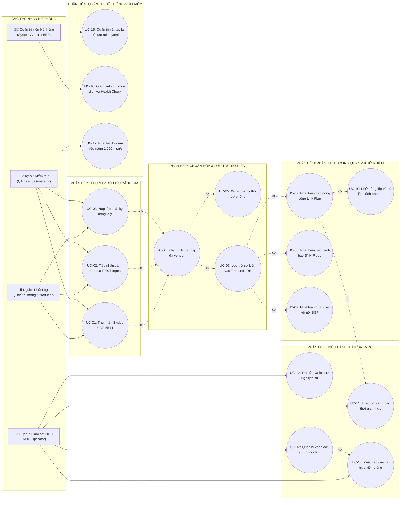

# ĐẶC TẢ YÊU CẦU NGHIỆP VỤ VÀ MÔ HÌNH HÓA CA SỬ DỤNG
## (SOFTWARE REQUIREMENTS SPECIFICATION & USE CASE MODELING — N4.2)

> **Mã văn bản:** `VNPT-NET-N42-SRS-2026-V2.0`  
> **Dự án:** N4.2 — Hệ thống thu thập và phân tích tương quan cảnh báo từ Router, Switch và Firewall  
> **Đơn vị chủ trì:** Trung tâm Điều hành Khai thác Mạng VNPT NET (VNPT NOC)  
> **Cơ sở đào tạo:** Trường ĐH Giao thông Vận tải TP.HCM (UTH) — Học kỳ Doanh nghiệp  
> **Chủ nhiệm Kỹ thuật / PM & DevOps:** **Phạm Minh Nhựt**  
> **Chủ nhiệm QA & Đo kiểm:** **Ngô Châu Kiệt**  
> **Phụ trách Kỹ thuật Phân hệ:** **Phạm Hoàng Long (BE1)**, **Phạm Tấn Thành (BE2)**, **Nguyễn Duy Minh (BE3)**, **Lê Khắc Huy (FE)**  
> **Tài liệu căn cứ:** `PROJECT_CHARTER.md`, `ACCEPTANCE_CRITERIA.md`, `ARCHITECTURE_DESIGN.md`, `TEST_CASE_SPECIFICATION.md`.

---

## 1. TỔNG QUAN PHẠM VI NGHIỆP VỤ VÀ GIỚI HẠN DỰ ÁN

### 1.1 Mục tiêu Nghiệp vụ Viễn thông
Trong môi trường điều hành mạng viễn thông quy mô lớn của VNPT NET, hàng nghìn thiết bị định tuyến (Router), thiết bị chuyển mạch (Switch) và tường lửa (Firewall) từ nhiều hãng sản xuất khác nhau (Cisco, Huawei, Juniper, Fortinet) liên tục phát sinh hàng chục nghìn bản tin cảnh báo mỗi giây. 

Hệ thống **N4.2** được phát triển nhằm giải quyết 3 bài toán nghiệp vụ trọng tâm:
1. **Thu nạp và Chuẩn hóa Tập trung:** Tiếp nhận dữ liệu cảnh báo đa giao thức (Syslog UDP, REST Ingest, File nhật ký) và chuẩn hóa về một cấu trúc dữ liệu sự kiện duy nhất (`AlertEvent`).
2. **Phân tích Tương quan và Khử nhiễu Cảnh báo:** Áp dụng các thuật toán cửa sổ trượt (Sliding Window) và cỗ máy trạng thái (FSM) để phát hiện nguyên nhân gốc của các đợt bão cảnh báo (ví dụ dao động cổng mạng Link Flap, tấn công từ chối dịch vụ SYN Flood, rớt phiên BGP), giúp **giảm thiểu ít nhất 70% số lượng cảnh báo rác hiển thị**.
3. **Giám sát Trực quan Thời gian thực:** Cung cấp bảng điều hành NOC Dashboard hỗ trợ Kỹ sư trực ca theo dõi sự cố tức thời, tra cứu lịch sử nhanh chóng và ra quyết định xử lý chính xác.

### 1.2 Phạm vi Môi trường Thử nghiệm An toàn
- **Môi trường triển khai:** Hệ thống vận hành hoàn toàn trong môi trường phòng thí nghiệm thử nghiệm (Isolated Testbed Lab) bằng dữ liệu mô phỏng.
- **Quy chuẩn địa chỉ mạng:** 100% địa chỉ IP trong hệ thống tuân thủ tiêu chuẩn mạng nội bộ RFC 1918 (`10.10.0.0/16`) và dải mạng tài liệu RFC 5737 (`203.0.113.0/24`). Tuyệt đối không can thiệp, không cấu hình hay tác động ngược lại hệ thống mạng sản xuất của VNPT NET.

---

## 2. CÁC TÁC NHÂN HỆ THỐNG (ACTORS SPECIFICATION)

Hệ thống N4.2 tương tác với 4 tác nhân chính:

| Tác nhân (Actor) | Biểu tượng | Mô tả vai trò nghiệp vụ | Quyền hạn và Trách nhiệm chính |
| :--- | :---: | :--- | :--- |
| **Kỹ sư Giám sát NOC (NOC Operator)** | 👨‍💻 | Kỹ sư trực ban tại Đài điều hành mạng VNPT NET, chịu trách nhiệm theo dõi tình trạng mạng 24/7. | - Theo dõi dòng cảnh báo thời gian thực trên Dashboard. - Tiếp nhận (Acknowledge) và đóng (Resolve) sự cố mạng. - Tra cứu, lọc sự kiện lịch sử và xuất báo cáo ca trực. |
| **Quản trị viên Hệ thống (System Admin / BE3)** | 👨‍🔧 | Kỹ sư quản trị hạ tầng và kỹ sư backend chịu trách nhiệm vận hành động cơ tương quan. | - Cấu hình, thẩm định và cập nhật bộ luật `rules.yaml`. - Kiểm tra trạng thái sức khỏe dịch vụ hệ thống (`/api/health`). - Giám sát dung lượng bộ nhớ và hiệu năng cơ sở dữ liệu. |
| **Thiết bị Mạng / Nguồn phát Log (Log Producer)** | 🖥️ | Các thiết bị mạng phần cứng hoặc phần mềm mô phỏng (Router, Switch, Firewall). | - Đóng gói và phát bản tin Syslog qua giao thức UDP cổng 5514. - Đẩy bản tin cảnh báo qua cổng HTTP REST Ingest. - Cung cấp các tệp nhật ký lưu vết để nạp hàng loạt. |
| **Kỹ sư Đảm bảo Chất lượng (QA Engineer)** | 🕵️‍♂️ | Kỹ sư kiểm thử thuộc đội ngũ QA (do Ngô Châu Kiệt chủ trì). | - Bơm các kịch bản kiểm thử đo tải danh định 1.000 msg/s. - Tái lập các kịch bản lỗi chuẩn từ KB-01 đến KB-08. - Thu thập bằng chứng đo kiểm để nghiệm thu học kỳ doanh nghiệp. |

---

## 3. SƠ ĐỒ CA SỬ DỤNG TỔNG THỂ (OVERALL USE CASE DIAGRAM)

Sơ đồ thể hiện toàn bộ 17 ca sử dụng nghiệp vụ cốt lõi của Hệ thống N4.2 phân theo 5 phân hệ chức năng:

---

## 4. CHI TIẾT CÁC CA SỬ DỤNG TRỌNG YẾU (DETAILED USE CASES SPECIFICATION)

### 4.1 Ca sử dụng UC-01: Thu nhận bản tin Syslog qua giao thức UDP Socket (FR-01)

* **Mã ca sử dụng:** `UC-01`
* **Tên ca sử dụng:** Thu nhận bản tin Syslog qua UDP Socket cổng 5514
* **Tác nhân chính:** Thiết bị Mạng / Kỹ sư QA
* **Mục tiêu:** Tiếp nhận toàn bộ lưu lượng cảnh báo UDP mà không làm tràn bộ đệm hay rớt gói tin.
* **Tiền điều kiện:** 
  1. Dịch vụ tiếp nhận `udp_receiver` đang mở và lắng nghe trên cổng UDP `5514`.
  2. Kích thước bộ đệm socket `SO_RCVBUF` đã được thiết lập tối thiểu 4MB.
* **Luồng sự kiện chính (Basic Flow):**
  1. Thiết bị mạng hoặc Tool đo tải phát một datagram UDP chứa thông điệp Syslog tới địa chỉ máy chủ cổng 5514.
  2. Hệ thống thu nhận chuỗi byte qua giao thức `asyncio.DatagramProtocol`.
  3. Hệ thống ghi nhận dấu thời gian thu nạp thời gian thực (`received_at` chuẩn UTC) và địa chỉ IP gửi (`source_ip`).
  4. Hệ thống kiểm tra kích thước payload:
     - Nếu $1 \le \text{kích thước} \le 8.192$ bytes: Chấp thuận bản tin.
  5. Đóng gói bản tin vào phong bì `RawEnvelope` và đẩy vào hàng đợi trung chuyển `BoundedQueue`.
  6. Tăng bộ đếm chỉ số `metrics.events_received` thêm 1 đơn vị.
* **Luồng rẽ nhánh & Ngoại lệ (Alternative & Exception Flows):**
  - **E1: Payload rỗng (0 byte):** Hệ thống lập tức hủy gói, tăng bộ đếm `metrics.udp_dropped_empty`, ghi log cảnh báo và không ném ngoại lệ dừng dịch vụ.
  - **E2: Payload vượt kích thước 8.192 bytes:** Hệ thống tự động cắt ngắn an toàn về đúng 8.192 bytes, gắn cờ cảnh báo `payload_truncated = True` và tiếp tục xử lý.
  - **E3: Hàng đợi BoundedQueue đầy (>10.000 gói):** Hệ thống kích hoạt cơ chế áp lực ngược (Backpressure), ghi nhật ký nghẽn hàng đợi và tăng counter `queue_overflow`.
* **Hậu điều kiện:** Bản tin thô được bảo toàn nguyên vẹn trong hàng đợi, sẵn sàng cho Phân hệ Phân tích cú pháp xử lý.

---

### 4.2 Ca sử dụng UC-04: Phân tích Cú pháp và Chuẩn hóa Đa Hãng (FR-04)

* **Mã ca sử dụng:** `UC-04`
* **Tên ca sử dụng:** Phân tích cú pháp và chuẩn hóa dữ liệu đa hãng
* **Tác nhân chính:** Hệ thống xử lý tự động (Hậu trường)
* **Tiền điều kiện:** Bản tin `RawEnvelope` đã sẵn sàng trong hàng đợi bộ nhớ.
* **Luồng sự kiện chính (Basic Flow):**
  1. Bộ phân tích nhận bản tin thô và trích xuất chuỗi định danh PRI ở đầu dòng `<PRI>`.
  2. Tính toán Facility và Severity theo chuẩn RFC 3164:
     $$\text{Facility} = \lfloor \text{PRI} / 8 \rfloor, \quad \text{Severity} = \text{PRI} \pmod 8$$
  3. Lần lượt so khớp bản tin qua danh mục các bộ phân tích cú pháp chuyên biệt:
     - **Cisco Parser:** Bóc tách mẫu `%LINK-3-UPDOWN`, trích xuất tên thiết bị, tên cổng (`interface_name`), trạng thái (`up`/`down`).
     - **Huawei Parser:** Bóc tách mẫu `%%01DEVM/2/POWER_SUPPLY_FAILED`, trích xuất mã linh kiện nguồn.
     - **Juniper Parser:** Bóc tách mẫu `BGP_PEER_DOWN`, trích xuất địa chỉ IP đối tác ngang hàng và số hiệu mạng AS.
     - **Fortinet Parser:** Bóc tách định dạng Key-Value, trích xuất IP nguồn, IP đích, cổng dịch vụ, hành động `deny`.
  4. Chuẩn hóa mức độ nghiêm trọng về 5 mức quy chuẩn: `CRITICAL`, `MAJOR`, `WARNING`, `INFO`, `DEBUG`.
  5. Đóng gói đối tượng thực thể `AlertEvent` tuân thủ nghiêm ngặt schema Pydantic.
  6. Bàn giao thực thể chuẩn hóa sang Động cơ Tương quan và Kho Lưu trữ.
* **Luồng rẽ nhánh & Ngoại lệ:**
  - **E1: Bản tin không khớp bất kỳ mẫu hãng nào:** Hệ thống kích hoạt cơ chế dự phòng `UC-05: RAW Fallback`, gán `vendor = UNKNOWN`, `severity = UNKNOWN`, giữ nguyên toàn bộ chuỗi ký tự trong trường `raw_message`.
* **Hậu điều kiện:** Dữ liệu chuẩn hóa hoàn tất, phục vụ cho việc so khớp luật tương quan và truy vấn CSDL.

---

### 4.3 Ca sử dụng UC-07: Phát hiện Dao động Giao diện Mạng Link Flap (FR-09)

* **Mã ca sử dụng:** `UC-07`
* **Tên ca sử dụng:** Phát hiện sự cố dao động giao diện mạng (Link Flap Detection)
* **Tác nhân chính:** Kỹ sư Giám sát NOC (Thụ hưởng kết quả)
* **Tiền điều kiện:** 
  1. Luật tương quan `RULE-NET-01-LINK-FLAP` đã được nạp thành công từ tệp `rules.yaml`.
  2. Các sự kiện `LINK_UPDOWN` đã được chuẩn hóa với đầy đủ `device_name` và `interface_name`.
* **Luồng sự kiện chính (Basic Flow):**
  1. Động cơ tương quan tiếp nhận sự kiện loại `LINK_UPDOWN`.
  2. Xác định Khóa gom nhóm sự cố duy nhất:
     $$\text{Grouping Key} = (\text{device\_name}, \text{interface\_name})$$
  3. Đưa sự kiện vào cửa sổ trượt (Sliding Window Deque) của nhóm tương ứng.
  4. Loại bỏ các sự kiện đã tồn tại trong cửa sổ nhưng có khoảng cách thời gian vượt quá 60 giây so với sự kiện hiện tại:
     $$\Delta t = t_{\text{current}} - t_{\text{event}} > 60\text{ giây} \implies \text{Loại bỏ}$$
  5. Đếm số lượng sự kiện còn lại trong cửa sổ trượt:
     - Nếu $\text{Số lượng} \ge 5$ lần: Kích hoạt tạo Sự cố mới (`Incident`).
  6. Khởi tạo đối tượng Sự cố:
     - Tiêu đề: `Giao diện mạng [interface] trên thiết bị [device] đang bị dao động (Link Flap)`.
     - Mức độ nghiêm trọng: `MAJOR`.
     - Trạng thái: `OPEN` (Mới tạo).
     - Bằng chứng liên kết: Đính kèm danh sách các UUID của 5 sự kiện gây ra sự cố.
  7. Bắn gói tin thông báo tức thì qua kênh WebSocket để giao diện NOC đổi màu đỏ cảnh báo.
* **Luồng rẽ nhánh & Ngoại lệ:**
  - **A1: Sự kiện thứ 6, 7... tiếp tục phát sinh trong cùng cửa sổ:** Hệ thống không tạo thêm Incident mới (chống bão cảnh báo); chỉ cập nhật tăng trường `event_count` trong Incident hiện có.
* **Hậu điều kiện:** Một sự cố duy nhất được hiển thị trên bảng điều hành NOC thay cho hàng chục dòng log rác.

---

### 4.4 Ca sử dụng UC-11: Theo dõi Dòng Cảnh báo Thời gian thực trên Dashboard (FR-11)

* **Mã ca sử dụng:** `UC-11`
* **Tên ca sử dụng:** Theo dõi dòng cảnh báo và sự cố thời gian thực trên NOC Dashboard
* **Tác nhân chính:** Kỹ sư Giám sát NOC (NOC Operator)
* **Tiền điều kiện:** Kỹ sư NOC truy cập vào địa chỉ Web Dashboard qua trình duyệt.
* **Luồng sự kiện chính (Basic Flow):**
  1. Trình duyệt thiết lập kết nối WebSocket liên tục tới máy chủ Backend: `ws://host/ws/alerts`.
  2. Hệ thống tải dữ liệu khởi tạo ban đầu:
     - 4 Thẻ chỉ số KPI: Tổng số sự kiện nhận trong ngày, Số sự cố đang mở, Tốc độ bản tin hiện tại (msg/s), Trạng thái dịch vụ (Healthy).
     - Danh sách 50 sự kiện mới nhất hiển thị trên Bảng dòng tin (Live Event Feed).
     - Bảng danh sách các sự cố gom nhóm (Active Incidents).
  3. Khi Backend phát hiện sự cố khẩn cấp mức `CRITICAL` hoặc `MAJOR`:
     - Gói tin WebSocket đẩy xuống máy khách.
     - Hàng sự cố tương ứng trên màn hình tự động hiển thị trên đầu danh sách và nhấp nháy đỏ cảnh báo.
     - Phát âm thanh cảnh báo ngắn (nếu Kỹ sư bật chế độ chuông trực ban).
  4. Người dùng không cần nhấn phím F5 để tải lại trang.
* **Hậu điều kiện:** Kỹ sư trực ca nắm bắt được tình trạng mạng ngay tại giây đầu tiên phát sinh lỗi.

---

## 5. MA TRẬN 31 YÊU CẦU CHỨC NĂNG (FUNCTIONAL REQUIREMENTS - FR)

Dưới đây là bảng đặc tả đầy đủ 31 yêu cầu chức năng của hệ thống N4.2:

| Mã FR | Tên Yêu cầu Kỹ thuật & Nghiệp vụ | Mức ưu tiên | Kỹ sư phụ trách | Ca sử dụng liên kết |
| :---: | :--- | :---: | :---: | :---: |
| **FR-01** | Tiếp nhận dòng bản tin Syslog UDP trên cổng `5514` không nghẽn socket | **Bắt buộc (Must)** | Phạm Hoàng Long (BE1) | UC-01 |
| **FR-02** | Cung cấp cổng tiếp nhận cảnh báo qua REST API chuẩn JSON (`/api/v1/events/ingest`) | **Bắt buộc (Must)** | Phạm Hoàng Long (BE1) | UC-02 |
| **FR-03** | Hỗ trợ nạp tệp nhật ký hàng loạt từ ổ đĩa (Batch File Streaming Import) | Nên có (Should) | Phạm Hoàng Long (BE1) | UC-03 |
| **FR-04** | Tự động bóc tách và phân loại cú pháp đa hãng (Cisco, Huawei, Juniper, Fortinet) | **Bắt buộc (Must)** | Phạm Tấn Thành (BE2) | UC-04 |
| **FR-05** | Cơ chế dự phòng RAW Fallback: Bảo toàn 100% bản tin gốc khi gặp dữ liệu dị dạng | **Bắt buộc (Must)** | Phạm Tấn Thành (BE2) | UC-05 |
| **FR-06** | Chuẩn hóa dấu thời gian về múi giờ UTC quốc tế, lưu vết nguồn gốc độ tin cậy giờ | **Bắt buộc (Must)** | Phạm Tấn Thành (BE2) | UC-04 |
| **FR-07** | Ánh xạ mức độ nghiêm trọng của từng hãng về 5 mức chuẩn (CRITICAL, MAJOR, WARNING, INFO, DEBUG) | **Bắt buộc (Must)** | Phạm Tấn Thành (BE2) | UC-04 |
| **FR-08** | Vùng đệm hàng đợi có giới hạn dung lượng trong RAM (Bounded In-Memory Queue 10.000 msgs) | **Bắt buộc (Must)** | Phạm Tấn Thành (BE2) | UC-01, 04 |
| **FR-09** | Lưu trữ sự kiện bền vững vào CSDL chuỗi thời gian PostgreSQL + TimescaleDB Hypertable | **Bắt buộc (Must)** | Phạm Tấn Thành (BE2) | UC-06 |
| **FR-10** | Hỗ trợ ghi dữ liệu theo khối lớn (Batch Insert) để hấp thụ thông lượng tải 1.000 msg/s | **Bắt buộc (Must)** | Phạm Tấn Thành (BE2) | UC-06 |
| **FR-11** | Động cơ tương quan cửa sổ trượt thời gian thực (Sliding Window Deque) | **Bắt buộc (Must)** | Nguyễn Duy Minh (BE3) | UC-07, 08 |
| **FR-12** | Luật tương quan nhận diện dao động cổng mạng Link Flap ($\ge 5$ lần trong 60 giây) | **Bắt buộc (Must)** | Nguyễn Duy Minh (BE3) | UC-07 |
| **FR-13** | Luật tương quan nhận diện tấn công SYN Flood từ Firewall ($\ge 50$ deny trong 30 giây) | **Bắt buộc (Must)** | Nguyễn Duy Minh (BE3) | UC-08 |
| **FR-14** | Luật tương quan nhận diện đứt kết nối lặp lại BGP Neighbor (3 lần retry trong 300 giây) | **Bắt buộc (Must)** | Nguyễn Duy Minh (BE3) | UC-09 |
| **FR-15** | Luật tương quan nhận diện hỏng hóc nguồn điện dự phòng thiết bị Core (Single-hit alert) | **Bắt buộc (Must)** | Nguyễn Duy Minh (BE3) | UC-04, 07 |
| **FR-16** | Luật tương quan nhận diện quá nhiệt vi xử lý CPU Core Router ($\ge 80^\circ$C) | **Bắt buộc (Must)** | Nguyễn Duy Minh (BE3) | UC-04, 07 |
| **FR-17** | Cơ chế khử trùng lặp (Deduplication): Tự động gộp cảnh báo lặp vào một sự cố gốc | **Bắt buộc (Must)** | Nguyễn Duy Minh (BE3) | UC-10 |
| **FR-18** | Đảm bảo tỷ lệ giảm nhiễu cảnh báo đạt tối thiểu 70% trong các đợt bão sự kiện | **Bắt buộc (Must)** | Nguyễn Duy Minh (BE3) | UC-10 |
| **FR-19** | Cỗ máy trạng thái FSM điều khiển vòng đời sự cố (OPEN, ACKNOWLEDGED, RESOLVED, CLOSED) | Nên có (Should) | Nguyễn Duy Minh (BE3) | UC-13 |
| **FR-20** | Tính năng tự động đóng sự cố (Auto-resolve) khi cổng mạng ổn định quá 300 giây | Nên có (Should) | Nguyễn Duy Minh (BE3) | UC-13 |
| **FR-21** | Quản lý bộ luật bằng tệp `rules.yaml` tuân thủ tiêu chuẩn quốc tế YAML Specification 1.2 | **Bắt buộc (Must)** | Nguyễn Duy Minh (BE3) | UC-15 |
| **FR-22** | Thẩm định tính toàn vẹn cú pháp bộ luật bằng mô hình Pydantic Schema Validator | **Bắt buộc (Must)** | Nguyễn Duy Minh (BE3) | UC-15 |
| **FR-23** | Tính năng nạp lại bộ luật không gián đoạn dịch vụ (Atomic Hot-Reload) | **Bắt buộc (Must)** | Nguyễn Duy Minh (BE3) | UC-15 |
| **FR-24** | Bảng điều hành giám sát NOC trực quan hỗ trợ chế độ màn hình tối (Dark Mode) | **Bắt buộc (Must)** | Lê Khắc Huy (FE) | UC-11 |
| **FR-25** | Hiển thị 4 thẻ chỉ số KPI tổng quan hệ thống cập nhật động theo thời gian thực | **Bắt buộc (Must)** | Lê Khắc Huy (FE) | UC-11 |
| **FR-26** | Kênh truyền phát thời gian thực WebSocket đẩy sự cố mới ngay lập tức xuống máy khách | **Bắt buộc (Must)** | Lê Khắc Huy (FE) | UC-11 |
| **FR-27** | Cung cấp bộ lọc tra cứu sự kiện đa điều kiện (Khoảng thời gian, Thiết bị, Mức độ) | **Bắt buộc (Must)** | Lê Khắc Huy (FE) | UC-12 |
| **FR-28** | Cơ chế phân trang con trỏ ổn định (Stable Cursor-based Pagination) chống giật giao diện | **Bắt buộc (Must)** | Lê Khắc Huy (FE) | UC-12 |
| **FR-29** | Chức năng xuất dữ liệu báo cáo ca trực định dạng CSV phục vụ giao ban mạng | Nên có (Should) | Lê Khắc Huy (FE) | UC-14 |
| **FR-30** | Điểm cuối giám sát sức khỏe dịch vụ hệ thống `/api/health` bảo mật không lộ secret | **Bắt buộc (Must)** | Phạm Hoàng Long (BE1) | UC-16 |
| **FR-31** | Công cụ phát tải kịch bản giả lập phục vụ đo kiểm thông lượng 1.000 msg/s | **Bắt buộc (Must)** | Ngô Châu Kiệt (QA) | UC-17 |

---

## 6. MA TRẬN 13 YÊU CẦU PHI CHỨC NĂNG (NON-FUNCTIONAL REQUIREMENTS - NFR)

Tuân thủ nghiêm ngặt theo tiêu chuẩn quốc tế **ISO/IEC 25010 (Software Product Quality Model)**:

| Mã NFR | Đặc tính chất lượng | Chỉ tiêu kỹ thuật cam kết (SLA / Target) | Phương pháp kiểm chứng & Thẩm định |
| :---: | :--- | :--- | :--- |
| **NFR-01** | **Hiệu năng (Throughput)** | Duy trì ổn định thông lượng danh định **$\ge 1.000$ msg/s liên tục trong 1 giờ** tại bài nghiệm thu W13. | Phát tải bằng script `tools/load_runner.py`, đối soát tổng số gói gửi/nhận đạt chính xác 3.600.000 bản tin. |
| **NFR-02** | **Độ trễ xử lý (Latency)** | - Độ trễ trung vị: **$P_{50} < 50$ ms**. - Độ trễ phân vị cao: **$P_{99} < 200$ ms** (Đo từ lúc nhận gói socket đến khi commit DB). | Gắn timestamp vi giây tại 2 đầu pipeline, xuất biểu đồ phân vị độ trễ trong báo cáo kiểm thử. |
| **NFR-03** | **Độ tin cậy (Packet Drop)** | **Tỷ lệ rớt gói UDP Socket đạt chính xác $0.00\%$** ở tải danh định 1.000 msg/s. | Cấu hình `SO_RCVBUF = 4MB`, theo dõi bộ đếm `metrics.udp_dropped_packets == 0`. |
| **NFR-04** | **Tiêu hao tài nguyên** | Chiếm dụng tài nguyên máy chủ kiểm thử (4 Cores): - CPU tiêu thụ: **$\le 60\%$**. - RAM sử dụng tối đa: **$\le 1.5$ GB** (Không bị rò rỉ bộ nhớ). | Giám sát liên tục bằng công cụ `docker stats` và `htop` trong suốt 60 phút nghiệm thu. |
| **NFR-05** | **Tốc độ truy vấn CSDL** | Thời gian phản hồi câu lệnh truy vấn lọc trên tập dữ liệu **1 triệu bản ghi nhỏ hơn 2 giây**. | Chạy lệnh `EXPLAIN ANALYZE` trên TimescaleDB, đo kiểm thời gian phản hồi thực tế qua API. |
| **NFR-06** | **Chịu tải đột biến (Spike)** | Hệ thống hấp thụ an toàn đợt bắn tải đột biến **1.500 msg/s trong 2 phút** mà không bị sập dịch vụ. | Chạy kịch bản kiểm thử đột biến KB-08, tỷ lệ rớt gói cho phép $\le 0.05\%$. |
| **NFR-07** | **Bảo mật mã nguồn** | Tuyệt đối **không lưu trữ hardcode mật khẩu, token, secret** hay khóa bí mật trong mã nguồn Git. | Tự động quét bằng script `tools/check_sensitive.py` trước khi commit mã nguồn. |
| **NFR-08** | **Tuân thủ dữ liệu mô phỏng** | 100% dữ liệu thử nghiệm chỉ dùng dải IP mô phỏng nội bộ **RFC 1918** hoặc **RFC 5737**, không dùng IP thật của VNPT. | Rà soát toàn bộ tệp cấu hình và dữ liệu mẫu qua biểu thức chính quy Regex. |
| **NFR-09** | **Khả năng phục hồi (Restart)** | Thời gian khởi động lại toàn bộ hệ thống từ trạng thái tắt sạch (Cold Start) **dưới 30 giây**. | Đo thời gian chạy lệnh `docker compose up -d` đến khi endpoint `/api/health` trả mã HTTP 200. |
| **NFR-10** | **Độ chính xác tương quan** | Động cơ tương quan phát hiện chính xác **$\ge 90\%$** các trường hợp sự cố mạng trên bộ dữ liệu chuẩn ở W13. | Đối soát tỷ lệ `TP / (TP + FN)` trên tập 8 kịch bản chuẩn KB-01..08 do QA kiểm thử. |
| **NFR-11** | **Chống tấn công Web** | Hệ thống miễn nhiễm hoàn toàn với các cuộc tấn công **SQL Injection**, **XSS** và **Path Traversal**. | Áp dụng kỹ thuật truy vấn tham số hóa (Parameterized Query) và mã hóa ký tự HTML Entity. |
| **NFR-12** | **Tính khả dụng giao diện** | Giao diện Dashboard hiển thị tốt trên các trình duyệt hiện đại (Chrome, Edge, Firefox), độ phân giải từ Full HD (1080p). | Kiểm thử khả năng hiển thị tương thích trên nhiều kích thước màn hình máy trạm NOC. |
| **NFR-13** | **Khả năng triển khai sạch** | Triển khai cài đặt toàn bộ hệ thống từ kho mã nguồn Git lên một máy chủ sạch hoàn tất **trong vòng 1 giờ**. | Thực hiện bài diễn tập dựng hệ thống từ con số 0 theo tài liệu hướng dẫn bàn giao. |

---

## 7. PHÊ DUYỆT BẢN ĐẶC TẢ YÊU CẦU NGHIỆP VỤ

| Vai trò phê duyệt | Họ và tên | Chữ ký điện tử | Ngày ký duyệt |
| :--- | :--- | :---: | :---: |
| **Project Manager & DevOps Lead** | **Phạm Minh Nhựt** | *(Đã ký duyệt)* | 09/11/2026 |
| **QA Lead / Chủ nhiệm Kiểm thử** | **Ngô Châu Kiệt** | *(Đã ký duyệt)* | 09/11/2026 |
| **Đại diện Nhóm Backend (BE1/BE2/BE3)** | **Phạm Hoàng Long / Phạm Tấn Thành / Nguyễn Duy Minh** | *(Đã đồng thuận)* | 09/11/2026 |
| **Đại diện Nhóm Frontend (FE)** | **Lê Khắc Huy** | *(Đã đồng thuận)* | 09/11/2026 |
| **Ban Cố vấn Doanh nghiệp VNPT** | Trung tâm Điều hành NOC | *(Chờ nghiệm thu W13)* | --/--/2026 |
