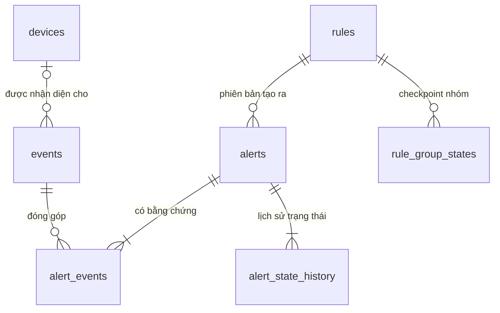

# Thiết kế chi tiết database syslog và cảnh báo đa hãng

Ngày: 2026-11-19. Trạng thái: đề xuất, chưa tạo database/chạy migration. Yêu cầu nghiệp vụ: [spec.md](spec.md). Phần trạng thái và lịch sử cập nhật theo [thiết kế vòng đời 002](../002-alert-lifecycle/lifecycle-design.md).

Phần điều phối/cấu hình/checkpoint cập nhật theo [thiết kế module 003](../003-rule-dispatch-correlation/engine-design.md). `rules.definition.parameters` là cấu trúc tham số riêng thống nhất; không tạo thêm cột parameters trùng dữ liệu. Các rule được biên soạn ở file bản đầu, DB giữ snapshot công bố bất biến để truy vết.

**Cập nhật vận hành**: 2026-11-20 — đồng bộ hợp đồng 005, coverage/retry và cold-load theo constitution 2.0.0.

## 1. Mô hình và các giả định

Dùng 5 bảng nền: `devices`, `events`, `rules`, `alerts`, `alert_events`; feature 002 bổ sung `alert_state_history`, feature 003 bổ sung `rule_group_states`, 7 bảng dữ liệu/correlation; 005 bổ sung `pipeline_runtime_status`, tổng cộng 8 bảng chung đề xuất. Mọi hãng lưu chung trong `events`; phần thay đổi theo hãng đặt ở JSONB. Một sự kiện có thể tham gia nhiều cảnh báo. `alerts.id` chính là định danh sự cố, chưa cần `incidents` riêng.



Một event có thể chưa xác định thiết bị; một cảnh báo đã commit phải có ít nhất một event. Không đặt `device_id` trực tiếp trên alert vì một cảnh báo có thể liên quan nhiều thiết bị.

## 2. Quy ước chung

- PK là khóa chính, FK là khóa ngoại. NULL nghĩa là chưa biết/không áp dụng, không thay bằng chuỗi rỗng hoặc 0.
- UUID cho đối tượng quản lý/cảnh báo; BIGINT identity cho số lượng lớn sự kiện và khóa bảng nối gọn hơn.
- TIMESTAMPTZ lưu thời điểm tuyệt đối; kết nối dùng UTC, UI đổi sang Asia/Saigon. Vẫn giữ chuỗi thời gian log vì kiểu này không lưu nguyên biểu diễn/múi giờ nguồn.
- INET chứa IPv4/IPv6 dạng host address. TEXT trạng thái kèm CHECK thay enum riêng lúc yêu cầu còn thay đổi.
- JSONB bắt buộc là object, thường mặc định `{}`; không thực thi nội dung JSON như SQL hoặc mã chương trình.
- Không sửa đầu vào gốc. Trạng thái, timestamp và id phía hệ thống không được tin trực tiếp từ JSON người gửi.
- Tất cả FK dùng ON DELETE RESTRICT; không xóa dây chuyền lịch sử mặc định.

## 3. `devices` — danh mục thiết bị

Mỗi dòng đại diện thiết bị quản lý ổn định; đổi IP/hostname không đổi id.

| Cột | Kiểu | Ràng buộc / mặc định | Vai trò |
|---|---|---|---|
| `id` | UUID | PK | Liên kết nội bộ ổn định. |
| `device_code` | TEXT | NOT NULL, UNIQUE, không rỗng | Mã quản lý, ví dụ `LAB-R1`. |
| `display_name` | TEXT | NOT NULL, không rỗng | Tên dễ đọc trên giao diện. |
| `hostname` | TEXT | NULL được | Hostname cấu hình trong danh mục. |
| `management_ip` | INET | NULL được | Địa chỉ quản trị chính, không mặc định là địa chỉ gửi syslog. |
| `vendor` | TEXT | NULL được | Mã hãng như `cisco`, `juniper`; mở rộng giá trị không cần thêm bảng hãng. |
| `os_family` | TEXT | NULL được | `ios`, `ios_xr`, `junos` hoặc họ OS khác. |
| `device_type` | TEXT | NULL hoặc router/switch/firewall | Vai trò thiết bị. |
| `is_active` | BOOLEAN | NOT NULL, true | Còn sử dụng trong danh mục; không phải trạng thái up/down mạng. |
| `created_at` | TIMESTAMPTZ | NOT NULL, thời gian tạo | Lúc khai báo thiết bị. |
| `updated_at` | TIMESTAMPTZ | NOT NULL | Lần sửa gần nhất; dịch vụ phải cập nhật khi sửa. |

**Lý do và giới hạn**:

- Hostname/IP không unique toàn hệ thống: có relay, NAT và miền mạng trùng địa chỉ. Nhận diện mơ hồ phải để event chưa có device_id, không chọn dòng đầu tiên.
- Chỉ giữ một địa chỉ quản trị chính. Nếu cần nhiều địa chỉ hoặc VRF, bổ sung bảng địa chỉ có phạm vi; không nhồi chuỗi nhiều IP vào một cột.
- Ngừng dùng đặt is_active=false; không xóa thiết bị có lịch sử. Không lưu mật khẩu/token/private key.

## 4. `events` — kho syslog chung

Một dòng là một lần tiếp nhận. Không unique theo raw/hash vì hai log giống nhau có thể là sự kiện lặp thật.

### 4.1. Nguồn và đầu vào gốc

| Cột | Kiểu | Ràng buộc / mặc định | Vai trò |
|---|---|---|---|
| `id` | BIGINT GENERATED ALWAYS AS IDENTITY | PK | Định danh event; hỗ trợ phân trang ổn định. |
| `device_id` | UUID | NULL được, FK devices.id | Thiết bị đã nhận diện; không bắt buộc để lưu raw. |
| `ingest_source` | TEXT | NOT NULL, udp/api/file | Kênh tiếp nhận. |
| `sender_ip` | INET | NULL được | Bên gửi trực tiếp, có thể là relay hoặc máy tải file. |
| `source_metadata` | JSONB | NOT NULL, object, {} | Mã đợt nhập, tên file/số dòng, căn cứ nhận diện và ngữ cảnh thời gian. |
| `raw_message` | TEXT | NOT NULL | Nguyên văn đầu vào khi giải mã hợp lệ; nếu lỗi byte thì chỉ là bản escape để hiển thị. |
| `raw_bytes` | BYTEA | NULL được | Chỉ lưu khi TEXT không thể bảo toàn đầu vào; là bằng chứng gốc cho trường hợp giải mã lỗi. |
| `received_at` | TIMESTAMPTZ | NOT NULL, lúc nhận | Thời gian hệ thống ghi nhận, không do nguồn tự đặt. |
| `correlation_scope` | TEXT | NOT NULL | `live` cho nguồn trực tiếp; `replay:<UUID>` cho dữ liệu lịch sử ngay khi tiếp nhận, kể cả khi chỉ để tra cứu. Dịch vụ phải gán rõ, không mặc định live cho file. |

Log văn bản thường chỉ lưu raw_message, không nhân đôi bằng BYTEA. Giải mã lỗi phải giữ raw_bytes và trạng thái lỗi; không bỏ byte gốc sau khi tạo bản hiển thị. Đầu vào JSON chỉ có field đã xử lý thì giữ nguyên JSON đã nhận ở raw_message và ghi `source_metadata.raw_kind=normalized_json`; không gọi đó là syslog gốc thiết bị nếu nguồn không cung cấp. Không dùng JSONB thay raw vì nó thay đổi biểu diễn JSON.

source_metadata chỉ chứa ngữ cảnh đã kiểm tra, không chứa credential hoặc đường dẫn file trên máy người gửi. device_id/scope/trạng thái tự khai từ nguồn phải được kiểm tra trước sử dụng.

### 4.2. Thời gian và dữ liệu chuẩn hóa

| Cột | Kiểu | Ràng buộc / mặc định | Vai trò |
|---|---|---|---|
| `event_time_raw` | TEXT | NULL được | Chuỗi thời gian nguyên bản. |
| `event_time` | TIMESTAMPTZ | NULL được | Thời điểm phát sinh sau chuyển đổi có căn cứ. |
| `time_status` | TEXT | NOT NULL, unknown | parsed/inferred/unknown: đủ từ log, bổ sung theo ngữ cảnh, hoặc chưa xác định. |
| `reported_hostname` | TEXT | NULL được | Hostname thực tế trong log, khác tên hiển thị danh mục. |
| `vendor` | TEXT | NULL được | Hãng đã xác định lúc chuẩn hóa. |
| `os_family` | TEXT | NULL được | OS đã xác định lúc chuẩn hóa. |
| `device_type` | TEXT | NULL hoặc router/switch/firewall | Loại đã xác định lúc chuẩn hóa. |
| `syslog_priority` | SMALLINT | NULL hoặc 0..191 | PRI gốc nếu có; facility = PRI / 8 lấy nguyên, severity truyền tải = PRI % 8. |
| `severity` | SMALLINT | NULL hoặc 0..7 | Severity event do parser xác định. Giữ nguồn nếu khác severity trong PRI. |
| `process_name` | TEXT | NULL được | Tiến trình phát log. |
| `process_id` | TEXT | NULL được | Định danh tiến trình theo nguồn; không ép mọi định dạng phải là số. |
| `event_code` | TEXT | NULL được | Mã đầy đủ của hãng, không phải khóa duy nhất của event. |
| `event_type` | TEXT | NULL được | Loại nghiệp vụ chung như interface_state_change. |
| `message` | TEXT | NULL được | Nội dung đã tách header, phục vụ đọc/tìm kiếm. |
| `attributes` | JSONB | NOT NULL, object, {} | Thuộc tính nghiệp vụ thống nhất tên/kiểu. |
| `vendor_fields` | JSONB | NOT NULL, object, {} | Chi tiết định dạng hãng còn lại. |

**Tại sao có vendor/OS/type cả ở devices và events?** devices là danh mục hiện tại; events là snapshot lúc diễn giải log. Nếu sửa danh mục thì lịch sử không đổi theo. Ghi căn cứ tại `source_metadata.identification_source`, như inventory/message/manual.

**Thời gian**: unknown phải đi với event_time=NULL; parsed/inferred phải đi với thời gian khác NULL. Với inferred, ghi rõ năm/múi giờ bổ sung từ đâu trong source_metadata. Không thay event_time thiếu bằng received_at rồi coi là thời gian thiết bị; log lịch sử thiếu ngữ cảnh không đủ điều kiện cho luật cửa sổ.

**Severity**: 0 emergency, 1 alert, 2 critical, 3 error, 4 warning, 5 notice, 6 informational, 7 debug. Số nhỏ nghiêm trọng hơn. Cảnh báo có severity riêng theo luật.

**Ví dụ Cisco IOS**:

```json
{
  "vendor": "cisco",
  "os_family": "ios",
  "event_code": "LINK-3-UPDOWN",
  "event_type": "interface_state_change",
  "severity": 3,
  "attributes": {"interface_name": "FastEthernet0/0", "interface_state": "DOWN", "interface_layer": "physical"},
  "vendor_fields": {"facility": "LINK", "mnemonic": "UPDOWN"}
}
```

Junos dùng event_code và vendor_fields riêng, nhưng nếu cùng hiện tượng thì ánh xạ về cùng event_type và quy ước attributes. Không đổi tên interface Juniper sang kiểu Cisco. `vendor_fields.facility` trong ví dụ Cisco là nhóm thông điệp hãng, khác facility tính từ PRI.

### 4.3. Trạng thái xử lý

| Cột | Kiểu | Ràng buộc / mặc định | Vai trò |
|---|---|---|---|
| `parse_status` | TEXT | NOT NULL, pending | pending/success/partial/failed. |
| `parse_error` | TEXT | NULL được | Thiếu field hoặc lý do lỗi, không chứa stack trace/credential. |
| `parsed_at` | TIMESTAMPTZ | NULL được | Lúc kết thúc chuẩn hóa hiện tại. |
| `correlation_status` | TEXT | NOT NULL, pending | pending/processed/failed/skipped. |
| `correlation_error` | TEXT | NULL được | Lý do lỗi/bỏ qua, ví dụ historical_search_only. |
| `correlated_at` | TIMESTAMPTZ | NULL được | Thời điểm hoàn tất xét hoặc quyết định bỏ qua. |
| `correlation_details` | JSONB object | NOT NULL, {} | Lý do late/correction, độ đầy đủ, diagnostic liên quan rule/alert; không sửa raw/event_time để hợp thức kết quả. |

- Parse success không đồng nghĩa đã xét luật. Processed không đồng nghĩa có cảnh báo: đã xem xét các luật trong lượt đó, kể cả kết quả không thỏa/thiếu field cho một luật.
- Partial chỉ được xét luật có đủ field yêu cầu. Nếu không thể xét bất kỳ luật nào thì skipped kèm lý do; lỗi chuẩn hóa không làm mất raw.
- Pending đi với timestamp kết thúc tương ứng bằng NULL; các trạng thái kết thúc có timestamp khác NULL. Parse partial/failed phải có lý do; correlation failed/skipped phải có lý do. Khi đưa về pending để thử lại phải xóa timestamp/lỗi kết thúc cũ trong cùng giao dịch.
- Chưa thêm trạng thái processing lưu dài hạn: worker đơn sở hữu qua advisory lock theo 003. Lỗi cần can thiệp giữ failed; failed là barrier không cho tiến độ/quiet vượt qua. Bản đầu không có cách ly per-rule.
- Chuẩn hóa lại chỉ áp dụng khi chưa hoàn tất tương quan và chưa có bằng chứng liên kết; giữ nguyên id/raw. Muốn thay field đã tạo cảnh báo cần revision riêng, chưa thuộc MVP.

## 5. `rules` — phiên bản luật

Mỗi dòng là một revision bất biến đã công bố. Hai revision của cùng luật có cùng rule_key, khác version và id; chưa cần thêm bảng rule_versions. Không lưu code thực thi trong bảng. File cấu hình là nguồn biên soạn bản đầu; DB giữ snapshot lịch sử, không chỉnh song song. Tham chiếu code và contract nạp theo feature 003.

| Cột | Kiểu | Ràng buộc / mặc định | Vai trò |
|---|---|---|---|
| `id` | UUID | PK | Đúng revision mà alert tham chiếu. |
| `rule_key` | TEXT | NOT NULL, không rỗng | Định danh logic qua các revision. |
| `version` | INTEGER | NOT NULL, > 0 | Số revision. |
| `name` | TEXT | NOT NULL, không rỗng | Tên nghiệp vụ. |
| `description` | TEXT | NULL được | Giải thích hiện tượng cần phát hiện. |
| `handler_key` | TEXT | NOT NULL | Bộ thực thi được chọn; không phải một instance cho mỗi interface. |
| `handler_revision` | TEXT | NOT NULL | Phiên bản logic phải còn truy xuất được khi theo dõi cảnh báo cũ. |
| `definition` | JSONB | NOT NULL, object | Đăng ký sự kiện, group_by, parameters riêng và recovery; kiểm tra schema handler trước khi bật. |
| `alert_severity` | SMALLINT | NOT NULL, 0..7 | Mức độ alert, độc lập severity từng event. |
| `is_enabled` | BOOLEAN | NOT NULL, false | Có áp dụng cho sự kiện mới không. |
| `created_at` | TIMESTAMPTZ | NOT NULL | Lúc tạo revision. |
| `activated_at` | TIMESTAMPTZ | NULL trước công bố | Mốc kích hoạt đầu tiên, nguồn ranh giới xét bằng chứng của revision; không lấy id làm thứ tự nguồn. |

- UNIQUE(rule_key, version); unique có điều kiện rule_key WHERE is_enabled=true để chỉ một revision đang bật.
- Chỉ sửa is_enabled theo đường công bố; activated_at được gán một lần khi kích hoạt và giữ nguyên khi bật lại. Đổi nội dung hoặc muốn mốc kích hoạt mới thì tạo revision mới. Đổi handler_key/handler_revision, điều kiện/group/severity/tên/mô tả thì thêm revision. CHECK thường không tự kiểm tra bất biến giữa các UPDATE: cần quyền ghi và đường cập nhật kiểm soát.
- Đổi revision đang bật trong cùng giao dịch. Mỗi lượt xét lấy tập revision cố định, không trộn thay đổi giữa chừng. Quyền sở hữu nhóm theo rule_key được ghim revision cũ đến khi alert đóng theo 003; unique theo rule_id không tự chống hai revision cùng tạo alert cho một nhóm logic.
- Không xóa revision có alert tham chiếu; tắt luật không xóa/giải quyết cảnh báo cũ.
- definition không chứa SQL/Python tùy ý. Giới hạn field/phép so sánh/kiểu được hỗ trợ, truy vấn phải tham số hóa.

Ví dụ phần definition trong file bản nháp tắt của handler đếm ít nhất 3 log interface down cùng thiết bị/interface trong 300 giây; chưa phải snapshot đã công bố. Đây là rule đếm sự kiện, khác [LinkFlapRule ở feature 004](../004-link-flap-rule/link-flap-design.md). recovery chưa chọn nên không được bật:

```json
{
  "subscribed_event_types": ["interface_state_change"],
  "group_by": ["device_id", "interface_name"],
  "parameters": {
    "filter": {"interface_state": "DOWN"},
    "window_seconds": 300,
    "threshold_count": 3
  },
  "recovery": null
}
```

Ví dụ handler đếm dùng điều kiện bằng nhau kết hợp AND, đếm event id khác nhau theo event_time trong cùng scope. Mỗi handler có schema parameters riêng, không ép tất cả rule có threshold_count. window_seconds/threshold_count của ví dụ là số nguyên dương; group_by không rỗng/trùng và chỉ chọn field được phép. Group value là scalar khác NULL, giới hạn độ dài theo contract; không dùng toàn bộ message/JSON làm khóa. Event projection của feature 003 đọc interface_name/interface_state một lần từ attributes chuẩn hóa.

Quy ước cửa sổ `(T - 300 giây, T]`: bao gồm T, loại đúng mốc T-300. Thời gian unknown không đủ điều kiện. Sự kiện đến muộn phải giữ thời gian gốc; thuật toán đánh giá lại cửa sổ bị ảnh hưởng và mức trễ được chấp nhận phải chốt ở kế hoạch, chưa tuyên bố đã giải quyết bằng schema.

## 6. `alerts` — cảnh báo và định danh sự cố

Một dòng là một lần cảnh báo của một revision và nhóm. Thiết bị liên quan được truy qua event, không giới hạn một thiết bị/alert.

| Cột | Kiểu | Ràng buộc / mặc định | Vai trò |
|---|---|---|---|
| `id` | UUID | PK | Định danh cảnh báo/sự cố. |
| `rule_id` | UUID | NOT NULL, FK rules.id | Revision đã tạo cảnh báo. |
| `title` | TEXT | NOT NULL, không rỗng | Tóm tắt để người giám sát đọc. |
| `severity` | SMALLINT | NOT NULL, 0..7 | Snapshot alert_severity lúc tạo. |
| `correlation_scope` | TEXT | NOT NULL | live hoặc mã replay tương ứng. |
| `group_values` | JSONB | NOT NULL, object | Giá trị group_by, ví dụ device_id và interface. |
| `signal_status` | TEXT | NOT NULL, active | active/recovered theo bằng chứng syslog. |
| `workflow_status` | TEXT | NOT NULL, new | new/acknowledged/closed theo xác nhận người giám sát. |
| `first_event_at` | TIMESTAMPTZ | NOT NULL | MIN thời gian phát sinh của bằng chứng trigger. |
| `last_event_at` | TIMESTAMPTZ | NOT NULL | MAX thời gian phát sinh của bằng chứng trigger; không cộng log recovery. |
| `created_at` | TIMESTAMPTZ | NOT NULL | Lúc hệ thống tạo alert. |
| `updated_at` | TIMESTAMPTZ | NOT NULL | Lần thêm bằng chứng/đổi trạng thái gần nhất. |
| `recovered_at` | TIMESTAMPTZ | NULL khi active | Lúc hệ thống ghi nhận phục hồi hiện hành. |
| `acknowledged_at`, `acknowledged_by` | TIMESTAMPTZ, TEXT | NULL khi new | Thời gian và người xác nhận đầu tiên. |
| `closed_at`, `closed_by` | TIMESTAMPTZ, TEXT | NULL khi chưa đóng | Thời gian và người xác nhận đóng. |
| `state_version` | BIGINT | NOT NULL, >=1 | Audit revision cho đổi trạng thái hoặc hiệu chỉnh bằng chứng/outcome có ý nghĩa; no-op không tăng. |
| `signal_event_id`, `signal_event_at` | BIGINT, TIMESTAMPTZ | NOT NULL | Bằng chứng quan sát thật gần nhất và thời gian nguồn; timer không ghi đè bằng một event giả. |
| `rule_result` | JSONB object | NOT NULL, {} | Outcome/end_state/effective_at/reason, cờ review của kết quả hiện hành; các kết quả cũ nằm trong history.details. |
| `last_recovery_effective_at` | TIMESTAMPTZ | NULL được | Mốc điều kiện kết thúc còn hợp lệ, timer có thể là last_transition+60; không gọi là timestamp của một log mới. |

- Unique có điều kiện `(rule_id, correlation_scope, group_values) WHERE workflow_status <> 'closed'`; chống hai worker tạo trùng, kể cả recovered chưa đóng. JSONB so sánh giá trị, không phụ thuộc thứ tự key.
- group_values giữ đúng key/kiểu trong group_by, không NULL. Bằng chứng phải cùng scope, group và đúng điều kiện rule. Các ràng buộc liên bảng này cần đường ghi giao dịch kiểm soát; FK/CHECK đơn giản không tự bảo đảm.
- CHECK first_event_at <= last_event_at; updated_at >= created_at. Closed chỉ hợp lệ với recovered và có đủ người/thời gian ACK/CLOSE. Ràng buộc chi tiết, thứ tự log, thao tác lặp và quyền ghi theo feature 002.
- Khi tạo, liên kết đủ các event làm đạt ngưỡng, không chỉ event cuối. Khi bổ sung, cập nhật MIN/MAX thay vì giả định event luôn đến theo thứ tự.
- Cảnh báo chưa đóng cùng khóa được theo dõi tiếp; recovered có thể trở về active trên cùng id và giữ ACK. Chỉ sau closed thì chuỗi mới đủ điều kiện tạo id mới; không dùng lại chu kỳ cũ. Đổi revision không nhập bằng chứng vào alert revision cũ, nhưng revision cũ vẫn phải xét vòng đời đến khi đóng.
- Không lưu event_count riêng: COUNT DISTINCT event_id với evidence_role='trigger' AND is_current=true; không cộng recovery/correction hoặc bằng chứng đã mất hiệu lực. Chỉ cache sau khi đo cần.
- FK không tự bảo đảm alert có ít nhất một event: giao dịch phải tạo alert và bằng chứng cùng lúc, không cho chèn alert trống ngoài đường ghi được kiểm soát.
- Feature 002 thêm lịch sử trạng thái, xác nhận đã thấy và xác nhận đóng; không có người xử lý khắc phục, ticket hoặc lệnh cấu hình thiết bị. Nội dung đầy đủ của alert_state_history nằm trong tài liệu vòng đời 002.

## 7. `alert_events` — bằng chứng nhiều–nhiều

| Cột | Kiểu | Ràng buộc / mặc định | Vai trò |
|---|---|---|---|
| `alert_id` | UUID | NOT NULL, FK alerts.id | Cảnh báo nhận bằng chứng. |
| `event_id` | BIGINT | NOT NULL, FK events.id | Sự kiện đóng góp. |
| `evidence_role` | TEXT | NOT NULL, trigger/recovery/correction | Vai trò bằng chứng phát sinh, kết thúc hoặc hiệu chỉnh. |
| `is_current` | BOOLEAN | NOT NULL, true | Bằng chứng còn hiệu lực cho nhận định hiện hành; hiệu chỉnh không xóa row cũ. |
| `updated_at` | TIMESTAMPTZ | NOT NULL | Lúc thêm hoặc đổi hiệu lực; linked_at giữ lần liên kết đầu. |
| `linked_at` | TIMESTAMPTZ | NOT NULL, lúc ghi | Lúc gắn bằng chứng, khác thời gian event. |

PK ghép (alert_id, event_id, evidence_role), không cần id phụ. Ngăn cùng event/role bị thêm hai lần vào alert, vẫn cho event thuộc nhiều alert. Không thêm rule_id vì đã có qua alerts. FK RESTRICT ở cả hai đầu, không xóa ngầm bằng chứng; các ràng buộc lịch sử/bằng chứng theo feature 002.

Khi correction thay cơ sở nhận định, cập nhật is_current trong cùng giao dịch và lưu diff evidence_added/evidence_invalidated/evidence_reactivated vào history.details. Re-enable cùng cặp/role cập nhật row hiện có, không thêm bản trùng. Không xóa raw/liên kết cũ; FK vẫn bảo vệ cả proof hết hiệu lực cho audit. Sau closed không đổi liên kết/hiệu lực của bản cũ; diagnostic đi vào event.correlation_details.

Ví dụ E1/E2/E3 tạo A1; E2/E4 tạo A2: kho chỉ có 4 event, bảng nối có 5 cặp. Tính số bằng chứng của A1 là 3, không sao chép raw vào alerts.

## 8. Index tối thiểu và giới hạn tìm kiếm

| Index | Mục đích |
|---|---|
| devices(device_code) UNIQUE | Mã quản lý duy nhất. |
| events(received_at DESC, id DESC) | Log mới và phân trang theo thời gian nhận. |
| events(device_id, event_time DESC, id DESC) | Lịch sử thiết bị; hỗ trợ tra FK. |
| events(correlation_scope, event_type, event_time DESC, id DESC) | Sự kiện theo loại/cửa sổ, tách replay. |
| events(id) WHERE parse_status='pending' | Hàng chờ chuẩn hóa. |
| events(received_at, id) WHERE correlation_status='pending' AND parse_status IN ('success','partial') | Hàng chờ xét luật đủ điều kiện. |
| rules(rule_key, version) UNIQUE | Không trùng revision. |
| rules(rule_key) WHERE is_enabled | UNIQUE, chỉ một revision bật. |
| alerts(rule_id, correlation_scope, group_values) WHERE workflow_status<>'closed' | UNIQUE, chống cảnh báo chưa đóng trùng nhóm. |
| alerts(rule_id) | Tra toàn bộ lịch sử luật/FK, kể cả closed. |
| alerts(created_at DESC, id DESC) | Danh sách cảnh báo. |
| alert_events(alert_id, event_id, evidence_role) PK | Xem event và vai trò của alert. |
| alert_events(event_id, alert_id) | Tra alert từ event và hỗ trợ FK. |
| alert_state_history(alert_id, state_version) PK | Timeline chuyển trạng thái có thứ tự. |
| rule_group_states(rule_id, correlation_scope, group_values) PK | Nạp checkpoint đúng revision/đối tượng theo feature 003. |

- Không tự index mọi field/JSONB. Các field mới correlation_details/rule_result/history.details chủ yếu để trace; không mặc định index cả khối. Truy vấn tính bù cần filter đúng group/interface/lớp và event_time, chọn index phù hợp bằng đo thực.
- JSONB không tự làm truy vấn nhanh; index thời gian không bảo đảm mọi tìm kiếm văn bản nhanh. Điều kiện interface/peer của rule cần đường truy vấn thích hợp trước kiểm thử tải.
- Dùng cursor thời gian + id, không chỉ timestamp; quy định riêng nhóm event_time=NULL khi tra log chưa chuẩn hóa.
- Chưa partition hoặc thêm extension. Nếu phân vùng theo thời gian sau này phải xem lại unique key/FK từ bảng nối, không coi là thay đổi trong suốt.

## 9. Thứ tự ghi và giao dịch

### Tiếp nhận và chuẩn hóa

1. Kiểm tra giới hạn đầu vào và ngữ cảnh nguồn. Lưu raw/received_at với parse_status=pending rồi commit.
2. Với kênh có phản hồi, chỉ báo tiếp nhận thành công sau commit. UDP không có xác nhận ứng dụng; mất gói hoặc lỗi trước commit không được schema khắc phục.
3. Nhận event bằng khóa/điều kiện trạng thái, chuẩn hóa rồi cập nhật field/status/parsed_at trong giao dịch. Nếu rollback, raw vẫn còn để tiếp tục.
4. Mỗi đợt nhập lịch sử (file hoặc đầu vào lịch sử qua API) được gán scope replay riêng ngay lúc INSERT, mặc định correlation_status=skipped với lý do historical_search_only và correlated_at lúc quyết định bỏ qua. Muốn đánh giá thì chủ động đưa về pending trong chính scope đó; không truy lẫn live hoặc đợt khác. Chỉ đánh dấu skipped mà vẫn gán live là sai: các log này có thể bị truy làm bằng chứng cho log trực tiếp khác.

### Xét rule và lưu cảnh báo

1. Nhận event chờ xét, lấy registry/revision cố định và áp đệm 3 giây/mốc chốt theo 003. Chưa chốt vẫn pending. Log quá trễ có thể tính bù vùng liên quan; không dùng received_at hoặc event_id làm thứ tự nguồn.
2. Trong cùng giao dịch: tạo/lấy alert chưa đóng, thêm bằng chứng đúng vai trò chưa có, cập nhật MIN/MAX của bằng chứng phát sinh, ghi trạng thái/history theo feature 002, checkpoint nhóm theo feature 003 và đánh dấu đúng event id processed. Chỉ swap cache sau commit. Dùng khóa/upsert theo unique index, không chỉ SELECT chưa có rồi INSERT.
3. Không luật nào thỏa vẫn processed. Lỗi tạm rollback và giữ pending để retry giới hạn. Lỗi logic hoặc hết retry: sau rollback ghi failed/lý do cho event đang xét bằng thao tác riêng khi DB khả dụng, không failed cả các event chưa chạy; dừng tiến độ. Nếu DB không thể ghi failed, giữ pending và health lỗi, không báo đã ghi. Khôi phục failed→pending qua thao tác quản trị có kiểm soát theo 003; không âm thầm bỏ qua failed khi quét pending.
4. PK bảng nối ngăn bằng chứng trùng khi retry cùng event id. Không tuyên bố exactly-once trên đường truyền: gửi lại raw bằng lần nhận mới vẫn là event mới khi chưa có hợp đồng idempotency nguồn.
5. Dùng thứ tự khóa ổn định và retry deadlock. Thuật toán worker, dữ liệu đến muộn, phục hồi cửa sổ và ngữ cảnh replay phải kiểm chứng trong kế hoạch triển khai; trạng thái bảng không tự thay thế thuật toán.

## 10. Lưu giữ và kiểm chứng

- Lab mặc định không tự xóa; theo dõi dung lượng raw/index. Cần chốt thời hạn lưu trước vận hành lâu dài.
- Không cascade xóa bằng chứng. Chính sách archive/xóa log hết hạn chưa thuộc MVP; phải quyết định rõ khả năng truy bằng chứng khi cảnh báo còn được giữ.
- Không sửa bản gốc hoặc dữ liệu chuẩn hóa đã đóng vai trò bằng chứng qua thao tác thường; sự kiện đến trễ là đầu vào mới làm thay đổi dữ liệu dẫn xuất, không sửa event cũ. Bản closed không bị hiệu chỉnh ngầm.
- Bộ kiểm chứng: log hai hãng cùng ý nghĩa; lỗi parser/giải mã; thiếu năm; log lặp thật; một event nhiều alert; đổi danh mục; revision luật; retry; hai worker cùng group; rollback; hai chiều signal/workflow theo feature 002; replay không lẫn live; JSON không có syslog gốc.
- Chưa có SQL migration, dữ liệu production, bảng thực hoặc benchmark. Mốc hiệu năng trong spec là mục tiêu đề xuất, chưa được đo hoặc phê duyệt.

## 11. Lưu kết quả rule và tích hợp hợp đồng chung

Bảy bảng dữ liệu/correlation giữ nguyên; bảng thứ tám pipeline_runtime_status được bổ sung ở mục 13 cho health/coverage và receipt. Checkpoint ở rule_group_states có checkpoint_version, next_check_at và state_payload đủ ngữ cảnh của handler. Cấu hình, thuật toán, payload và điều kiện kết thúc LinkFlap chuyển sang [feature 004](../004-link-flap-rule/link-flap-design.md); dùng bảng chung theo engine 003. Bản đếm down-burst ở mục 5 là ví dụ handler khác.

alert_state_history bổ sung decision_source (syslog/timer/correction/operator), effective_at và details; causal_event_id có thể NULL với timer/operator, nhưng evidence thật và điều kiện khoảng yên vẫn bắt buộc. Action evidence_corrected có thể giữ cặp trạng thái và tăng audit revision khi cơ sở/outcome thực sự đổi. Timer không tạo raw giả; effective_at có thể trước created_at khi phát hiện muộn, recorded_at vẫn là lúc hệ thống ghi.

last_recovery_effective_at thay tên last_recovery_event_at trong bản nháp: mốc này có thể được tính từ deadline, không phải một log recovery mới. rule_result hiện hành giữ outcome/end_state/reason/cờ review, history.details giữ phiên bản trước/sau và diff hiệu lực bằng chứng. Actor/time của ACK/CLOSE giữ nguyên.

Dọn cửa sổ/cache chỉ thu hồi RAM theo chính sách chung và hook handler. Không xóa raw, history, rule snapshot hoặc checkpoint cần khôi phục; mọi event ref trong payload và bằng chứng cũ vẫn phải được bảo vệ trước khi có retention tự động. Cách epoch/effective time, timer/correction và schema đầy đủ nằm trong 002/003; chưa chạy migration.

## 12. Hợp đồng dữ liệu bổ sung ngày 2026-11-20

- Sự kiện interface chuẩn lưu attributes.interface_name (tên chuẩn không tự gộp alias),
  attributes.interface_state (UP/DOWN), attributes.interface_layer (physical/protocol).
  events.id ánh xạ event_id; không có hai field state/interface_state làm hai nguồn chuẩn.
  Adapter chỉ chuyển field cũ khi nhận đầu vào; raw giữ nguyên. Quy tắc nhận/kiểm tra ở
  [005 — integration-design.md](../005-monitoring-integration/integration-design.md).
- correlation_details.retry_audit là danh sách append-only của thao tác failed→pending:
  request_id duy nhất, actor lấy từ danh tính xác thực, reason, recorded_at, lỗi trước và
  registry/revision được giữ. Cùng request_id không ghi lặp; không dùng mảng này như log mỗi retry tự động.
  Ghi audit cùng đổi trạng thái và xóa correlation_error/correlated_at hiện hành.
- Checkpoint state_payload dùng envelope engine/handler có schema theo 003 mục 14;
  baseline, ranh giới và refs vẫn được bảo vệ khi cache recovered bị evict.
  Không thêm bảng riêng theo rule. Registry activation và owner resolution tra rules/alerts,
  không dùng state cache như nguồn chuẩn của workflow.
- failed chưa được đưa lại pending phải chặn worker; restart không tự bỏ barrier.
  Truy vấn startup kiểm tra failed trước khi nhận batch mới. Chi tiết lỗi DB/handler ở 003 mục 13.

## 13. pipeline_runtime_status — sức khỏe và receipt dùng chung

Bảng thứ tám cấp pipeline, không phải state nghiệp vụ rule hoặc syslog giả.
Hợp đồng health do [005](../005-monitoring-integration/integration-design.md) sở hữu;
correlator work receipt theo 003. Không thêm bảng riêng theo thiết bị/interface/hãng.

| Cột | Kiểu / ràng buộc | Vai trò |
|---|---|---|
| component | TEXT NOT NULL, giá trị đã đăng ký | collector/normalizer/correlator hoặc nguồn quan sát đã cấu hình |
| correlation_scope | TEXT NOT NULL | live hoặc scope replay hợp lệ; cùng component tạo PK |
| instance_id | UUID NOT NULL | Writer/owner hiện hành, chuyển qua đường kiểm soát |
| status | TEXT NOT NULL | starting/healthy/degraded/error/stopped; không là trạng thái thiết bị |
| heartbeat_at | TIMESTAMPTZ NOT NULL | Lần báo sức khỏe bằng giờ DB gần nhất |
| coverage_started_at | TIMESTAMPTZ NULL được | Đầu đoạn healthy liên tục; NULL khi không chứng minh được |
| details | JSONB object NOT NULL, {} | Reason, backlog/freshness và inflight receipt của correlator |
| updated_at | TIMESTAMPTZ NOT NULL | Lần ghi row gần nhất |

PK(component,correlation_scope); CHECK coverage_started_at<=heartbeat_at khi có giá trị;
coverage_started_at chỉ khác NULL khi healthy. Healthy vẫn phải qua kiểm tra freshness khi đọc;
heartbeat stale không tự đổi row thành error nhưng người đọc phải coi unsafe.
Không dùng heartbeat như thay thế session lock hoặc làm bằng chứng về trạng thái thiết bị.

Writer service phải có quyền đúng component/scope và instance đang sở hữu. Khi chuyển instance,
giữ receipt chưa hoàn tất, không reset details về {}. Health update chỉ sửa phần health/reason,
không ghi đè details.inflight. Kích thước details/workset có giới hạn theo cấu hình;
không lưu token/raw/syslog hoặc toàn state nhóm vào đây.

Correlator commit receipt trước đánh giá; commit kết quả xóa receipt cùng tiến độ/checkpoint.
Mỗi batch một receipt của worker đơn; không tự nhân bản receipt per-rule. Event_ids/registry_rule_ids
là refs nghiệp vụ trong JSONB: retention phải bảo vệ như checkpoint; lab không tự xóa.
Lỗi ghi heartbeat thì row cũ trở nên stale, không cần tạo event giả để báo lỗi.

Bộ thử schema: timestamp/enum/scope/instance sai bị từ chối, heartbeat gap reset coverage,
writer stale không ghi, receipt còn qua crash và clear nguyên tử với kết quả.
