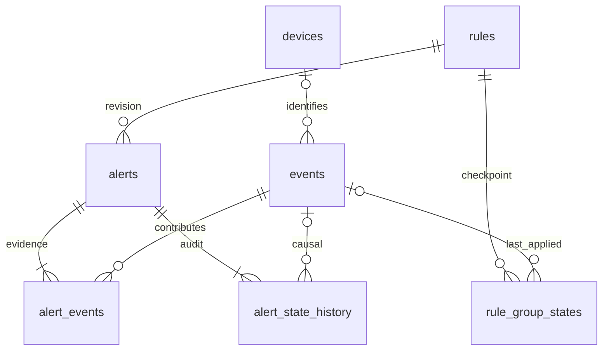

# thiết kế database đề xuất

**Dự án:** Thu thập và phân tích cảnh báo syslog từ router, switch, firewall  
**Ngày:** 2026-11-25  
**Trạng thái:** Bản đề xuất để leader review; chưa phải schema đã triển khai hoặc migration.  
**Phạm vi:** PostgreSQL cho prototype. Mô hình gốc ở [001](data-model.md); vòng đời cảnh báo ở [002](../002-alert-lifecycle/lifecycle-design.md); worker/rule ở [003](../003-rule-dispatch-correlation/engine-design.md); hợp đồng đầu vào đang dự thảo ở [006](../006-correlation-input-contract/spec.md).

**Đối chiếu biên bản họp mới:** Repo ứng dụng còn đề xuất bảng `alert_events`/`grouped_incidents` trong tài liệu v0.9, chưa có DDL ứng dụng. Hướng đổi sang tên thể hiện `event`/`alert`, thêm `target_ip` và đánh giá dữ liệu thiếu được ghi tại [meeting-schema-alignment.md](meeting-schema-alignment.md). Tên bảng vật lý singular/plural và cách lưu `target_ip` cần TL/BE2/BE3 chốt; các tên `events`/`alerts` bên dưới là tên logic của bản đề xuất này, không tuyên bố migration repo đã chạy.

## 1. Mục tiêu và quyết định thiết kế

1. Một syslog được tiếp nhận là một `events` row. Giữ đầu vào gốc trước chuẩn hóa; lưu cả các field đã tách để tìm kiếm và xét rule. Không xóa log vì parser thiếu field hoặc chưa hỗ trợ hãng.
2. Dùng **bảng sự kiện chung cho mọi hãng**. Field phổ biến, thường lọc và có kiểu ổn định là cột; thuộc tính nghiệp vụ thay đổi theo loại sự kiện ở `attributes` JSONB; phần riêng hãng ở `vendor_fields` JSONB.
3. Một cảnh báo là định danh sự cố trong phạm vi này. Nhiều event có thể góp vào một alert và một event có thể góp vào nhiều alert. Không cần bảng `incidents` riêng.
4. Logic rule ở code; `rules` giữ snapshot cấu hình/phiên bản đã công bố. Một `rule_group_states` row cho một revision/scope/nhóm đang có state, không tạo bảng hoặc tiến trình theo interface.
5. Tín hiệu của hệ thống (`active/recovered`) tách khỏi xác nhận của người giám sát (`new/acknowledged/closed`). Dữ liệu sức khỏe pipeline không giả thành syslog.
6. Chưa chốt chính sách nhận diện **hai lần tiếp nhận có ID khác nhau** là trùng nhau. Schema không UNIQUE theo raw/hash. Xử lý lại cùng một event ID vẫn phải nhất quán.

**Quy ước:** UUID cho thiết bị/rule/alert; BIGINT identity cho event; TIMESTAMPTZ lưu mốc tuyệt đối và kết nối dùng UTC; TEXT + CHECK cho tập trạng thái đang còn thay đổi; JSONB phải là object. NULL nghĩa là chưa biết/không áp dụng, không thay bằng `unknown` nếu `unknown` không phải giá trị nghiệp vụ. FK dùng `ON DELETE RESTRICT`; prototype không tự xóa lịch sử.

## 2. Sơ đồ quan hệ

`pipeline_runtime_status` liên hệ bằng component/scope và quy trình vận hành, không có FK đến một event/alert cụ thể. Có **8 bảng chung**: `devices`, `events`, `rules`, `alerts`, `alert_events`, `alert_state_history`, `rule_group_states`, `pipeline_runtime_status`.

## 3. Danh mục thiết bị: `devices`

**Mục đích:** Danh tính quản lý ổn định; đổi IP/hostname không đổi ID. Event không nhận diện chắc chắn vẫn được lưu với `device_id=NULL`.

| Cột | Kiểu / ràng buộc | Vai trò |
|---|---|---|
| id | UUID PK | ID thiết bị |
| device_code | TEXT NOT NULL UNIQUE, không rỗng | Mã quản lý, ví dụ LAB-R1 |
| display_name | TEXT NOT NULL, không rỗng | Tên hiển thị |
| hostname | TEXT NULL | Hostname trong danh mục |
| management_ip | INET NULL | IP quản trị chính; không đồng nhất với IP gửi syslog |
| vendor, os_family | TEXT NULL | Hãng và họ OS hiện tại |
| device_type | TEXT NULL, CHECK router/switch/firewall | Loại thiết bị |
| is_active | BOOLEAN NOT NULL DEFAULT true | Còn quản lý; không phải trạng thái link |
| created_at, updated_at | TIMESTAMPTZ NOT NULL | Audit danh mục |

Không đặt UNIQUE cho hostname/IP vì NAT, relay hoặc tên trùng miền. Không lưu mật khẩu, token, private key.

## 4. Kho sự kiện: `events`

**Mục đích:** Một row cho một lần tiếp nhận syslog. Raw và kết quả chuẩn hóa cùng ID; log lỗi vẫn tìm được.

| Nhóm | Cột | Kiểu / ràng buộc | Vai trò |
|---|---|---|---|
| Định danh | id | BIGINT GENERATED ALWAYS AS IDENTITY PK | ID tiếp nhận, không là thứ tự phát sinh |
| Nguồn | device_id | UUID NULL FK devices.id | Thiết bị nhận diện có căn cứ |
| Nguồn | ingest_source | TEXT NOT NULL, CHECK udp/api/file | Đường tiếp nhận |
| Nguồn | sender_ip | INET NULL | Đầu gửi trực tiếp, có thể là relay |
| Nguồn | source_metadata | JSONB object NOT NULL DEFAULT {} | Đợt nhập, dòng tệp, nguồn nhận diện, parser/schema revision |
| Raw | raw_message | TEXT NOT NULL | Văn bản đầu vào; khi lỗi byte là bản escape hiển thị |
| Raw | raw_bytes | BYTEA NULL | Bằng chứng byte khi TEXT không bảo toàn được |
| Thời gian | received_at | TIMESTAMPTZ NOT NULL | Giờ hệ thống nhận |
| Thời gian | event_time_raw | TEXT NULL | Chuỗi thời gian trong log |
| Thời gian | event_time | TIMESTAMPTZ NULL | Thời điểm phát sinh có căn cứ |
| Thời gian | time_status | TEXT NOT NULL, CHECK parsed/inferred/unknown | Căn cứ thời gian; unknown đi với event_time NULL |
| Phạm vi | correlation_scope | TEXT NOT NULL | live hoặc replay:<UUID>; file lịch sử không mặc định live |
| Nhận diện | reported_hostname | TEXT NULL | Hostname thực tế trong log |
| Nhận diện | vendor, os_family, device_type | TEXT NULL | Snapshot nhận diện lúc parse; không đổi khi danh mục sửa |
| Header | syslog_priority | SMALLINT NULL, 0..191 | PRI gốc |
| Header | severity | SMALLINT NULL, 0..7 | Severity event; không là severity alert |
| Header | process_name, process_id, event_code | TEXT NULL | Dấu hiệu của nguồn |
| Nội dung | event_type | TEXT NULL | Loại nghiệp vụ chung, ví dụ interface_state_change |
| Nội dung | message | TEXT NULL | Thông điệp đã tách header |
| Nội dung | attributes | JSONB object NOT NULL DEFAULT {} | Field nghiệp vụ chung theo event_type |
| Nội dung | vendor_fields | JSONB object NOT NULL DEFAULT {} | Field riêng hãng còn cần giữ |
| Nội dung | target_ip (đề xuất từ họp) | INET NULL nếu chọn cột chung | IP đích có căn cứ khi log cung cấp; không lấy mặc định từ sender/source IP; có thể chọn attributes thay cột trước migration |
| Parse | parse_status | TEXT NOT NULL, CHECK pending/success/partial/failed | Tiến độ chuẩn hóa |
| Parse | parse_error, parsed_at | TEXT NULL, TIMESTAMPTZ NULL | Lý do và mốc parse |
| Tương quan | correlation_status | TEXT NOT NULL, CHECK pending/processed/failed/skipped | Tiến độ xét rule |
| Tương quan | correlation_error, correlated_at | TEXT NULL, TIMESTAMPTZ NULL | Lý do và mốc hoàn tất |
| Tương quan | correlation_details | JSONB object NOT NULL DEFAULT {} | Diagnostic, độ đầy đủ, retry audit; không thay raw |

**Điều kiện cần kiểm soát:** `time_status=unknown ⇔ event_time IS NULL`; trạng thái kết thúc có timestamp, pending không có timestamp kết thúc; partial/failed hoặc correlation failed/skipped có lý do. Các CHECK/COLUMN constraint kiểm tra phần cục bộ; tính đúng của parser và quyền cập nhật cần đường ghi ứng dụng kiểm soát.

**Đầy đủ dữ liệu:** Chỉ các field tối thiểu để lưu raw/event lifecycle mới bắt buộc toàn hàng. Field nghiệp vụ như `target_ip`, interface_name/state/layer chỉ bắt buộc **theo event_type/rule**; thiếu thì partial/diagnostic và rule disposition riêng, không loại raw hoặc tự điền giá trị giả. Cấu trúc cụ thể theo [006](../006-correlation-input-contract/contracts/input-disposition.md) và bảng quyết định từ họp.

Ví dụ trong `attributes`: `{"interface_name":"GigabitEthernet0/0","interface_state":"DOWN","interface_layer":"physical"}`. Đây là biểu diễn **lưu**; `fields` trong hợp đồng module là projection có kiểu từ `attributes`, không là bảng/cột thứ hai. Alias chưa xác minh, lớp chưa biết và thời gian thiếu căn cứ không được tự điền để rule đạt ngưỡng. JSON chỉ chứa dữ liệu đã chuẩn hóa; raw giữ nguyên riêng.

## 5. Phiên bản rule: `rules`

**Mục đích:** Snapshot cấu hình đã công bố, tham chiếu chính xác từ alert/checkpoint. Không lưu code thực thi.

| Cột | Kiểu / ràng buộc | Vai trò |
|---|---|---|
| id | UUID PK | ID revision |
| rule_key | TEXT NOT NULL, không rỗng | Định danh logic qua các revision |
| version | INTEGER NOT NULL >0 | Số revision |
| name | TEXT NOT NULL, không rỗng | Tên nghiệp vụ |
| description | TEXT NULL | Diễn giải |
| handler_key, handler_revision | TEXT NOT NULL | Logic code đúng phiên bản |
| definition | JSONB object NOT NULL | Subscription, group_by, parameters, recovery |
| alert_severity | SMALLINT NOT NULL 0..7 | Severity alert mặc định |
| is_enabled | BOOLEAN NOT NULL DEFAULT false | Được chọn cho nhóm mới |
| created_at | TIMESTAMPTZ NOT NULL | Tạo revision |
| activated_at | TIMESTAMPTZ NULL trước công bố | Mốc kích hoạt đầu tiên, không tự đổi khi bật lại |

`UNIQUE(rule_key,version)`; unique có điều kiện `rule_key WHERE is_enabled` để một revision đang bật. Nội dung revision bất biến sau công bố; chỉ thay cờ enabled theo đường quản trị. `definition` có schema theo handler, không chứa SQL/Python tùy ý. File cấu hình là nguồn biên soạn prototype; DB giữ snapshot truy vết, không là nguồn chỉnh sửa song song.

## 6. Cảnh báo: `alerts`

**Mục đích:** Snapshot hiện hành của một cảnh báo/sự cố theo rule revision, scope và group. Một alert phải có bằng chứng phát sinh.

| Cột | Kiểu / ràng buộc | Vai trò |
|---|---|---|
| id | UUID PK | ID cảnh báo/sự cố |
| rule_id | UUID NOT NULL FK rules.id | Revision tạo alert |
| correlation_scope | TEXT NOT NULL | live/replay riêng |
| group_values | JSONB object NOT NULL | Giá trị group_by đã xác minh |
| title | TEXT NOT NULL | Tóm tắt |
| severity | SMALLINT NOT NULL 0..7 | Snapshot severity khi tạo |
| signal_status | TEXT NOT NULL, active/recovered | Kết luận của hệ thống |
| workflow_status | TEXT NOT NULL, new/acknowledged/closed | Xác nhận của người giám sát |
| first_event_at, last_event_at | TIMESTAMPTZ NOT NULL | MIN/MAX thời gian trigger, không gồm log recovery |
| signal_event_id | BIGINT NOT NULL FK events.id | Quan sát thật mới nhất làm cơ sở tín hiệu |
| signal_event_at | TIMESTAMPTZ NOT NULL | Thời gian nguồn của quan sát đó |
| rule_result | JSONB object NOT NULL DEFAULT {} | Outcome, end_state, effective_at, reason và cờ review hiện hành |
| last_recovery_effective_at | TIMESTAMPTZ NULL | Mốc recovery logic còn hợp lệ |
| recovered_at | TIMESTAMPTZ NULL khi active | Lúc hệ thống ghi recovered hiện hành |
| acknowledged_at, acknowledged_by | TIMESTAMPTZ/TEXT NULL khi new | ACK đầu tiên |
| closed_at, closed_by | TIMESTAMPTZ/TEXT NULL khi chưa closed | Xác nhận đóng |
| state_version | BIGINT NOT NULL >=1 | Version snapshot/audit |
| created_at, updated_at | TIMESTAMPTZ NOT NULL | Mốc hệ thống |

CHECK: `first_event_at<=last_event_at`; `active` đi với `recovered_at=NULL`; `closed` chỉ khi `recovered` và đủ cặp actor/timestamp ACK/CLOSE, thứ tự thao tác hợp lệ. Operator không được tự đặt signal_status. Tái phát trước CLOSE giữ cùng alert ID và ACK; sau CLOSE tạo episode mới khi đủ ngưỡng. Closed và history cũ bất biến.

**Khóa chưa đóng hiện có trong thiết kế 001:** unique có điều kiện `(rule_id,correlation_scope,group_values) WHERE workflow_status<>'closed'`. Với prototype, phạm vi chống trùng **giữa các revision hoặc giữa các ID đầu vào khác nhau chưa được leader chốt**; không diễn giải index này là đã giải quyết toàn bộ bài toán đó. Worker vẫn cần đọc owner revision hiện hành theo 003. Nếu leader quyết định thêm bảo đảm ở mức rule logic, sẽ cần quyết định riêng về khóa và migration.

## 7. Bằng chứng: `alert_events`

| Cột | Kiểu / ràng buộc | Vai trò |
|---|---|---|
| alert_id | UUID NOT NULL FK alerts.id | Cảnh báo |
| event_id | BIGINT NOT NULL FK events.id | Syslog gốc |
| evidence_role | TEXT NOT NULL, trigger/recovery/correction | Vai trò |
| is_current | BOOLEAN NOT NULL DEFAULT true | Còn hiệu lực cho nhận định hiện hành |
| linked_at, updated_at | TIMESTAMPTZ NOT NULL | Lúc gắn và lúc đổi hiệu lực |

PK `(alert_id,event_id,evidence_role)`. Một event có thể góp nhiều alert; raw chỉ lưu một lần. Khi correction, giữ row cũ và đổi `is_current` trong cùng giao dịch với audit; không sửa evidence của alert closed. Số trigger hiện hành = `COUNT(DISTINCT event_id)` với `evidence_role='trigger' AND is_current`, không mặc định lưu counter riêng.

## 8. Lịch sử vòng đời: `alert_state_history`

| Cột | Kiểu / ràng buộc | Vai trò |
|---|---|---|
| alert_id | UUID NOT NULL FK alerts.id | Alert được audit |
| state_version | BIGINT NOT NULL >=1 | Thứ tự/version; cùng alert_id là PK |
| action | TEXT NOT NULL | created/acknowledged/recovered/reactivated/closed/evidence_corrected |
| from_signal_status, to_signal_status | TEXT NULL/NOT NULL | Trước/sau tín hiệu |
| from_workflow_status, to_workflow_status | TEXT NULL/NOT NULL | Trước/sau workflow |
| actor_type, actor_id | TEXT NOT NULL/TEXT NULL | system hoặc operator; operator cần ID xác thực |
| causal_event_id | BIGINT NULL FK events.id | Syslog gây thay đổi; timer/operator có thể NULL |
| decision_source | TEXT NOT NULL | syslog/timer/correction/operator |
| effective_at, recorded_at | TIMESTAMPTZ NOT NULL | Mốc logic và mốc ghi |
| details | JSONB object NOT NULL DEFAULT {} | Outcome, bằng chứng, mốc chốt, diff correction |
| reason | TEXT NULL | Tóm tắt không chứa raw/secret |

History append-only cho thay đổi có ý nghĩa; no-op không thêm hàng. `alerts.state_version` khớp dòng cuối. Timer không tạo event giả. Thao tác CLOSE trên alert chưa ACK có thể ghi ACK và CLOSE thành hai version trong **một giao dịch**, theo 002.

## 9. Checkpoint theo nhóm: `rule_group_states`

| Cột | Kiểu / ràng buộc | Vai trò |
|---|---|---|
| rule_id | UUID NOT NULL FK rules.id | Revision sở hữu |
| correlation_scope | TEXT NOT NULL | live hoặc replay cụ thể |
| group_values | JSONB object NOT NULL | Khóa nhóm đã xác minh |
| state_schema_version | INTEGER NOT NULL >0 | Version payload handler |
| state_payload | JSONB object NOT NULL | Envelope engine + state handler, baseline/quan sát/ranh giới/coverage cần khôi phục |
| last_event_id | BIGINT NOT NULL FK events.id | Event thực áp dụng gần nhất; không là cursor MAX-ID |
| last_event_time | TIMESTAMPTZ NULL | Mốc nguồn gần nhất có căn cứ |
| checkpoint_version | BIGINT NOT NULL >0 | Version thay đổi checkpoint |
| next_check_at | TIMESTAMPTZ NULL | Deadline nguồn cho scheduler; không cộng đệm 3 giây vào cột |
| updated_at | TIMESTAMPTZ NOT NULL | Lúc ghi checkpoint |

PK `(rule_id,correlation_scope,group_values)`. Payload phải có schema/version và giới hạn kích thước. Không lưu ACK/CLOSE như nguồn chuẩn trong state. Prune/evict chỉ bỏ dữ liệu RAM an toàn; checkpoint/raw/evidence còn để cold-load. Giá trị ID nằm **bên trong JSONB** không được FK tự bảo vệ; prototype không tự retention. Cần kiểm chứng tham chiếu trước khi bật chính sách xóa.

## 10. Sức khỏe và work receipt: `pipeline_runtime_status`

| Cột | Kiểu / ràng buộc | Vai trò |
|---|---|---|
| component | TEXT NOT NULL | collector/normalizer/correlator hoặc nguồn quan sát cấu hình |
| correlation_scope | TEXT NOT NULL | Phạm vi của component; cùng component là PK |
| instance_id | UUID NOT NULL | Writer hiện hành |
| status | TEXT NOT NULL, starting/healthy/degraded/error/stopped | Sức khỏe pipeline, không là trạng thái thiết bị |
| heartbeat_at | TIMESTAMPTZ NOT NULL | Mốc báo gần nhất |
| coverage_started_at | TIMESTAMPTZ NULL | Đầu đoạn quan sát healthy liên tục khi có căn cứ |
| details | JSONB object NOT NULL DEFAULT {} | Lý do, backlog/freshness; correlator có receipt inflight |
| updated_at | TIMESTAMPTZ NOT NULL | Mốc ghi gần nhất |

PK `(component,correlation_scope)`. CHECK `coverage_started_at<=heartbeat_at` và chỉ khác NULL khi healthy. Heartbeat stale phải được người đọc coi là unsafe dù row chưa tự chuyển sang error. Health update không được ghi đè `details.inflight`; receipt gồm batch ID, đúng danh sách event ID, revision registry và owner instance. Bảng này không chứng minh UDP không mất gói.

## 11. Index và đường truy vấn đề xuất

| Nhu cầu | Index đề xuất |
|---|---|
| Danh mục thiết bị | `devices(device_code) UNIQUE` |
| Log mới, phân trang ổn định | `events(received_at DESC,id DESC)` |
| Lịch sử theo thiết bị | `events(device_id,event_time DESC,id DESC)` |
| Theo scope/loại/thời gian | `events(correlation_scope,event_type,event_time DESC,id DESC)` |
| Chuẩn hóa đang chờ | `events(id) WHERE parse_status='pending'` |
| Tương quan đang chờ | `events(received_at,id) WHERE correlation_status='pending' AND parse_status IN ('success','partial')` |
| Revision rule | `rules(rule_key,version) UNIQUE`, `rules(rule_key) WHERE is_enabled UNIQUE` |
| Alert chưa đóng trong cùng revision | `alerts(rule_id,correlation_scope,group_values) WHERE workflow_status<>'closed' UNIQUE` — phạm vi bảo đảm ghi rõ ở mục 6 |
| Danh sách/hàng chờ alert | `alerts(created_at DESC,id DESC)`; xem thêm `(workflow_status,created_at DESC,id)` và `(signal_status,created_at DESC,id)` sau khi đo |
| Bằng chứng ngược từ event | `alert_events(event_id,alert_id)` |
| Checkpoint và history | PK tương ứng; thêm index `rule_group_states(next_check_at)` chỉ khi số deadline và EXPLAIN chứng minh cần |

**Điểm cần đo trước khi chốt index JSONB:** tra/tính bù theo `device_id + interface_name + interface_layer + event_time` có thể cần expression/generated-column index cho interface fields; index `(scope,event_type,event_time)` một mình không giải quyết truy vấn theo interface. Chỉ thêm sau khi định dạng truy vấn và benchmark với dữ liệu lab/tải mục tiêu. Không GIN toàn bộ JSONB theo mặc định. Tìm kiếm text trong `message/raw_message` cũng cần kế hoạch riêng sau khi xác định kiểu tìm kiếm; B-tree thời gian không đảm bảo tìm toàn văn nhanh. Mỗi index tăng chi phí INSERT/UPDATE/WAL.

## 12. Giao dịch và quyền ghi

1. **Tiếp nhận:** INSERT raw, `received_at`, scope và `parse_status=pending`; commit trước khi báo tiếp nhận thành công. UDP không có xác nhận ứng dụng.
2. **Chuẩn hóa:** UPDATE đúng event đang chờ với các field đã tách, `parse_status`, diagnostic và `parsed_at`; raw/ID giữ nguyên. File lịch sử mang scope replay từ lúc INSERT và mặc định không xét live.
3. **Worker tương quan:** chỉ lấy event parse success/partial + pending + đủ chốt. Trước đánh giá ghi receipt bền vững; kết quả theo đúng tập ID được đánh giá.
4. **Commit kết quả:** Trong một giao dịch ghi checkpoint, alert, bằng chứng, history, diagnostic/progress cho đúng event ID và xóa receipt. Cache chỉ thay sau commit. Lỗi rollback giữ pending; lỗi logic/không còn retry giữ failed và barrier theo 003. Không dùng MAX(event_id) làm cursor.
5. **ACK/CLOSE:** kiểm tra quyền và `expected_state_version`, khóa/so lại trạng thái hiện hành rồi ghi snapshot và history trong một giao dịch. Recovered không tự ACK/CLOSE; closed không bị sửa bởi log trễ.
6. **Quyền DB:** đường ingest không được ghi alerts/checkpoints; worker không được sửa raw; đường operator không được tự đặt signal_status. Đây là yêu cầu phân quyền đề xuất, cần map thành role/grant thực tế trong kế hoạch triển khai.

## 13. Giới hạn prototype và điểm leader cần duyệt

| Quyết định | Phương án hiện tại / điều cần duyệt |
|---|---|
| Lưu field nghiệp vụ | Cột chung + `attributes` JSONB + `vendor_fields` JSONB; projection có kiểu trong worker, không lưu bản `fields` thứ hai |
| Nguồn cấu hình rule | File được kiểm tra rồi công bố snapshot bất biến vào `rules`; chưa có UI sửa rule |
| State | Một bảng checkpoint chung, RAM là cache; một worker tương quan trong prototype |
| Chống trùng giữa hai lần tiếp nhận khác ID | **Chưa chốt**; không UNIQUE raw/hash, không tuyên bố exactly-once đầu vào |
| Chống tạo alert đồng thời trong một revision/group | Unique hiện đề xuất theo rule_id/scope/group; owner qua revision khác do worker giải quyết, chưa coi là bảo đảm cross-revision đã được duyệt |
| Retention/partition | Lab không tự xóa; chưa partition; phải đánh giá FK/JSON refs trước khi bật retention |
| Index interface và tìm full-text | Chờ truy vấn cụ thể + EXPLAIN/bài đo; không index mọi JSONB field |
| Hiệu năng | Cần đo p95/p99 nhận→đủ chốt và đủ chốt→hiển thị cùng CPU/RAM, WAL, write amplification, số group; tài liệu chưa có kết quả benchmark |

**Phê duyệt đề nghị:** xác nhận 8 bảng và trách nhiệm ghi, quy ước JSONB/cột, cách lưu checkpoint và receipt, cùng danh sách điểm chưa chốt ở trên. Tài liệu này không thay thế DDL/migration hoặc kiểm thử tải.

