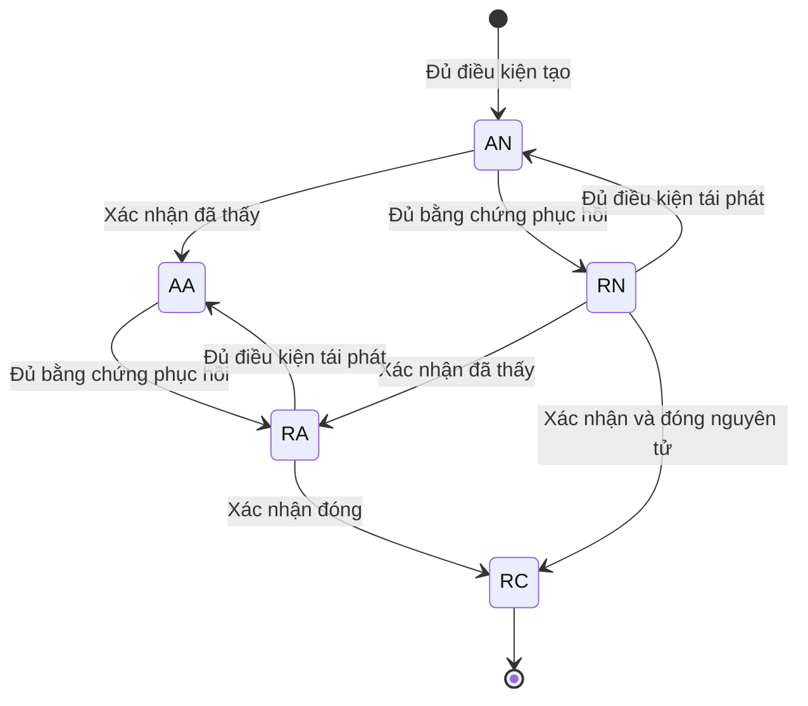

# Thiết kế trạng thái cảnh báo giám sát syslog

Ngày: 2026-11-19. Trạng thái: bản nháp hoàn chỉnh để review, chưa tạo bảng hoặc triển khai. [Đặc tả nghiệp vụ](spec.md). Chỉ giám sát qua syslog; thao tác người dùng là xác nhận thông tin, không vận hành hay khắc phục thiết bị.

[Thiết kế module 003](../003-rule-dispatch-correlation/engine-design.md) chọn Registry/Dispatcher dùng chung, handler tách state và checkpoint `rule_group_states`. Rule chỉ đề nghị kết luận; Lifecycle ở tài liệu này kiểm tra snapshot hiện hành trước ghi và không tin trạng thái xác nhận trong cache.

## 1. Hai chiều trạng thái

| Field | Giá trị | Chủ thể thay đổi | Ý nghĩa |
|---|---|---|---|
| `signal_status` | `active`, `recovered` | Hệ thống theo rule/bằng chứng và timer đã khai báo | Bất thường hoặc đã kết thúc điều kiện theo quan sát, không bảo đảm thiết bị bình thường. |
| `workflow_status` | `new`, `acknowledged`, `closed` | Người giám sát có quyền | Chưa xác nhận đã thấy, đã xác nhận hoặc đã xác nhận đóng. |

Không lưu thêm display_status thứ ba vì dễ mâu thuẫn. Hiển thị bằng cách kết hợp hai field, không coi recovered đồng nghĩa closed hoặc acknowledged.

| Mã tổ hợp | signal_status | workflow_status | Hiển thị |
|---|---|---|---|
| `AN` | active | new | Mới phát sinh — chưa xác nhận |
| `AA` | active | acknowledged | Đang bất thường — đã xác nhận |
| `RN` | recovered | new | Đã ghi nhận phục hồi — chưa xác nhận |
| `RA` | recovered | acknowledged | Đã ghi nhận phục hồi — chờ đóng |
| `RC` | recovered | closed | Đã đóng |

Tổ hợp active+closed bị cấm. Chưa đóng nghĩa workflow_status != closed, bao gồm cả recovered. Active chỉ là nhận định theo bằng chứng đã xử lý, không phải kết quả kiểm tra trực tiếp thiết bị.

## 2. Sơ đồ và bảng chuyển

| Hành động | Trước | Sau | Điều kiện và dữ liệu ghi |
|---|---|---|---|
| `created` | Chưa có | AN | Rule tạo thỏa; chưa có cảnh báo chưa đóng cùng khóa; ghi đủ bằng chứng phát sinh. |
| `acknowledged` | AN | AA | Có quyền, phiên bản trạng thái còn đúng; ghi người/thời điểm đầu tiên. |
| `acknowledged` | RN | RA | Tương tự; không đổi tín hiệu recovered. |
| `recovered` | AN | RN | Đúng revision/group/scope; syslog hoặc quiet-period timer đã khai báo, mốc chốt an toàn và evidence thật. |
| `recovered` | AA | RA | Như trên; giữ người/thời điểm xác nhận. |
| `reactivated` | RN | AN | Chuỗi bằng chứng mới thỏa điều kiện tái phát; cùng id, vẫn chưa xác nhận. |
| `reactivated` | RA | AA | Như trên; giữ xác nhận đầu tiên. |
| `closed` | RA | RC | Có quyền, trạng thái còn recovered, phiên bản còn đúng. |
| `acknowledged` rồi `closed` | RN | RC | Một thao tác xác nhận và đóng: ghi RN→RA rồi RA→RC trong cùng giao dịch, cùng actor/thời điểm. |

**Hành động lặp và bị chặn**:

- ACK trên AA/RA/RC của người có quyền: no-op, trả trạng thái hiện tại, không đổi người/thời điểm hoặc tăng version.
- CLOSE trên RC của người có quyền: no-op tương tự. Kiểm tra quyền trước khi trả thông tin.
- CLOSE trên AN/AA: từ chối vì chưa có bằng chứng phục hồi; không có force-close trong feature này.
- Syslog không liên quan hoặc cùng định danh đã xử lý: không ghi thêm lần chuyển. Nhiều log xác nhận cùng trạng thái không đồng nghĩa nhiều lần phục hồi.
- Không có chuyển RC trở lại trạng thái khác. Nếu chuỗi bằng chứng mới đủ điều kiện sau đóng thì tạo cảnh báo khác bắt đầu AN.
- Người gửi yêu cầu với version cũ chỉ được no-op nếu hành động đã hoàn tất; nếu còn cần thay đổi thì từ chối và trả trạng thái mới để người giám sát xem lại.

## 3. Điều kiện rule, phạm vi đối tượng và chu kỳ

Mỗi revision rule cần mô tả: điều kiện tạo/tái phát, điều kiện phục hồi, group_by, đối tượng cần theo dõi trong nhóm, quy tắc thời gian. Đây là hợp đồng nghiệp vụ; không yêu cầu rule phải nằm trong bảng thay vì code/file.

- Mỗi cảnh báo gắn đúng revision đã tạo, gồm cả phiên bản logic đánh giá khi logic đó làm thay đổi ý nghĩa điều kiện. Chỉ bật revision mới cho cảnh báo mới; giữ khả năng đánh giá vòng đời của revision cũ đến khi cảnh báo cũ đóng.
- Khóa một cảnh báo chưa đóng là revision rule + correlation_scope + group_values. Không gom khác thiết bị/interface/peer hoặc khác đợt replay nếu rule không định nghĩa cùng nhóm.
- Với nhóm nhiều đối tượng, mặc định mọi đối tượng liên quan phải thỏa điều kiện kết thúc của rule. Ngữ nghĩa kết thúc thuộc rule; recovered không tự chứng minh mọi đối tượng đều UP hoặc kết thúc các rule khác.
- Thứ tự phải kiểm tra trên từng đối tượng: log phục hồi của A có thể cũ hơn log của B nhưng vẫn mới hơn bất thường gần nhất của A. Không loại log A chỉ vì so với một timestamp tổng của nhóm. signal_event_id/at trên alert chỉ là mốc tóm tắt; bộ đánh giá phải đối chiếu tập bằng chứng/nhận định mới nhất của từng đối tượng. Cách truy xuất hoặc duy trì tập đó thuộc kế hoạch, chưa bổ sung bảng trạng thái đối tượng khi chưa đo cần.
- Khi tạo alert, liên kết đủ các event đóng góp vào điều kiện, không chỉ log cuối làm đạt ngưỡng. Khi phục hồi cũng liên kết đủ bằng chứng cần cho điều kiện phục hồi.
- Chỉ một log down chưa chắc đủ tái kích hoạt: phải thỏa lại điều kiện rule. Ví dụ rule 3 lần down/300 giây thì lần tái phát cũng phải đủ ngưỡng, không tự đổi thành rule 1 lần down.
- Sau một lần phục hồi được chấp nhận, bắt đầu chu kỳ đếm mới cho lần tái phát. Không dùng các event trước ranh giới phục hồi để tự đạt ngưỡng lần sau. Bằng chứng của chu kỳ trước vẫn giữ nguyên trong lịch sử.
- Với cảnh báo đã đóng, lấy ranh giới phục hồi cuối của cùng revision/group/scope để loại event cũ khi xét tạo lần mới; không dùng closed_at của người dùng làm thời gian phát sinh trên thiết bị.
- Các log bình thường không gắn với alert chưa đóng không tự tạo alert hoặc sửa cảnh báo đã đóng. Bộ đánh giá vẫn phải xét bằng chứng mới nhất đã biết cho group để tránh dùng một log bất thường trễ đã bị log phục hồi mới hơn phủ định.
- Không tự closed, force-close, polling hoặc cấu hình thiết bị. Rule có thể khai báo quiet period để RECOVER; không phải mọi rule mặc nhiên hết hạn khi im lặng. Phải ngừng suy luận quiet khi pipeline/time không an toàn.

## 4. Thứ tự thời gian và log đến trễ

- Dùng event_time có căn cứ từ thiết bị/ngữ cảnh chuẩn hóa, không dùng event id hoặc received_at để giả định thứ tự xảy ra.
- Với nhóm nhiều đối tượng, chỉ so cũ/mới trong cùng đối tượng rồi tính lại kết luận nhóm. Mốc tóm tắt của alert chọn bằng chứng có thời gian nguồn lớn nhất trong tập chứng minh nhận định; causal_event_id của history là log làm hoàn tất điều kiện và có thể khác event tóm tắt khi log đến lệch thứ tự.
- Lưu riêng thời gian nguồn và thời gian hệ thống chấp nhận chuyển trạng thái. Giữ bản gốc và ghi rõ căn cứ thời gian suy ra.
- Không lấy một log cũ ghi đè nhận định mới. Log trễ trong vùng ảnh hưởng được chèn/tính bù theo 003, gồm đổi baseline và hai cạnh quanh log chèn; cùng timestamp mâu thuẫn không tự suy thứ tự. Clock/order không đủ căn cứ thì giữ diagnostic và không kết luận recovery.
- Khi timestamp bằng nhau và bằng chứng mâu thuẫn, không kết luận phục hồi. Đối với alert chưa đóng, nếu điều kiện bất thường đã thỏa thì giữ/chuyển về active theo chính sách bảo thủ; log cùng thời điểm không đủ để tạo một incident mới sau đóng.
- Log thiếu năm/múi giờ nhưng có ngữ cảnh được xác thực có thể dùng sau chuẩn hóa; time_status=unknown hoặc xung đột đồng hồ chưa giải quyết thì lưu để tra cứu, không tự đổi tín hiệu.
- Ranh giới chu kỳ là effective_at của quyết định kết thúc còn hợp lệ, không mặc định timestamp của log bằng chứng cuối. Với timer là deadline theo điều kiện rule, không phải mặc định thời gian syslog cuối. Nếu correction vô hiệu recovery của alert chưa đóng, quay về ranh giới hợp lệ trước đó với audit; không áp ranh giới sai để bỏ mất bằng chứng.
- Sau đóng, log cũ không sửa bản cũ. Log đến muộn nhưng thực sự mới hơn ranh giới phục hồi và đủ điều kiện có thể tạo cảnh báo mới; hiển thị event_time và received_at để giải thích độ trễ. Không hứa tái dựng mọi incident lịch sử theo log đến muộn trong feature này.
- Nếu CLOSE commit trước khi log tái phát mới được đánh giá, bản cũ vẫn đóng và lần phát hiện tiếp theo tạo bản mới; nếu reactivation commit trước thì version cũ của CLOSE phải bị từ chối. Chỉ bảo đảm nhất quán trên bằng chứng đã xử lý.

## 5. Thay đổi bảng `alerts`

Giữ id, rule reference, group/scope, title, severity và bằng chứng của thiết kế 001. Bỏ status=open/resolved và resolved_at; thay bằng các cột dưới đây. Đây là thiết kế, không phải migration đang chạy.

| Cột | Kiểu | Ràng buộc / vai trò |
|---|---|---|
| `signal_status` | TEXT | NOT NULL, active/recovered; ban đầu active. |
| `workflow_status` | TEXT | NOT NULL, new/acknowledged/closed; ban đầu new. |
| `state_version` | BIGINT | NOT NULL, >=1; tăng với đổi trạng thái hoặc hiệu chỉnh cơ sở/outcome có ý nghĩa, ban đầu 1; không tăng cho no-op. |
| `signal_event_id` | BIGINT | FK events.id, NOT NULL; bằng chứng nguồn mới nhất được dùng cho nhận định hiện hành. |
| `signal_event_at` | TIMESTAMPTZ | NOT NULL; thời gian nguồn của bằng chứng đó, không phải thời gian bấm xác nhận. |
| `last_recovery_effective_at` | TIMESTAMPTZ | NULL được; effective_at của kết thúc còn hợp lệ, giữ khi tái phát bình thường, hiệu chỉnh có audit nếu recovery cũ bị vô hiệu. |
| `recovered_at` | TIMESTAMPTZ | NULL khi active; khi recovered là lúc hệ thống ghi lần chuyển phục hồi hiện hành, giữ nguyên khi đóng. Lần cũ xem trong history. |
| `acknowledged_at` | TIMESTAMPTZ | NULL khi new; thời gian ghi xác nhận đầu tiên khi acknowledged/closed. |
| `acknowledged_by` | TEXT | NULL khi new; định danh chủ thể ổn định từ danh tính đã xác thực, không dùng tên hiển thị tự khai. |
| `closed_at` | TIMESTAMPTZ | NULL khi chưa đóng; thời gian hệ thống ghi thao tác đóng. |
| `closed_by` | TEXT | NULL khi chưa đóng; định danh người xác nhận đóng. |
| `created_at` | TIMESTAMPTZ | Giữ cột sẵn có: lúc tạo alert. |
| `updated_at` | TIMESTAMPTZ | Lần cập nhật gần nhất của trạng thái/bằng chứng. |
| `rule_result` | JSONB object, {} | Outcome, end_state, effective_at/reason và cờ review hiện hành; không tạo cột/bảng riêng mỗi rule. Bản cũ giữ trong history.details. |

**Ràng buộc**:

1. workflow_status=closed chỉ khi signal_status=recovered; cặp timestamp/actor phải cùng có hoặc cùng NULL.
2. New: acknowledged_at/by và closed_at/by đều NULL. Acknowledged: có acknowledged_at/by, chưa có closed_at/by. Closed: có đủ cả hai cặp, closed_at >= acknowledged_at >= created_at.
3. Active: recovered_at=NULL. Recovered: recovered_at khác NULL và >= created_at, có bằng chứng recovery hợp lệ. Không so sánh trực tiếp signal_event_at với created_at để áp đặt quan hệ vì đó là hai đồng hồ khác nhau.
4. updated_at >= mọi timestamp thao tác hệ thống; last_recovery_effective_at là thời gian logic nguồn, không so đồng hồ trực tiếp với created_at. Khi active lại, recovered_at hiện hành trở NULL; các kết quả cũ giữ trong history. Trường này thay tên last_recovery_event_at của bản nháp cũ vì timer không có event mới.
5. Unique có điều kiện `(rule_revision_ref, correlation_scope, group_values) WHERE workflow_status <> 'closed'`. Với phương án rules trong 001, rule_revision_ref được biểu diễn bằng rule_id. Không dùng WHERE signal_status='active' hoặc WHERE status='open': alert recovered chưa đóng vẫn chiếm khóa nhóm.
6. state_version là audit revision của snapshot alert: tăng khi cặp trạng thái hoặc cơ sở kết luận/outcome thay đổi có ý nghĩa. Append thông thường không đổi facts, timer lặp hoặc tính bù ra cùng facts không tăng revision/history. Lượt ghi vẫn tuần tự hóa, thao tác CLOSE dùng expected_state_version để không đóng trên bằng chứng đã được sửa.
7. CHECK/FK không tự bảo đảm actor có quyền, log thỏa rule, revision bất biến, group/scope đúng hoặc trạng thái closed không bị sửa. Cần đường ghi giao dịch/quyền ghi được kiểm soát; kế hoạch chọn cơ chế cụ thể.

Không thêm processing_started_at hoặc assignee, vì không có tiến trình khắc phục thiết bị trong phạm vi.

## 6. Bảng `alert_state_history` và bằng chứng

Bổ sung một bảng lịch sử cho các lần chuyển thực. Không lưu một hàng history cho mọi log nhận được.

| Cột | Kiểu | Vai trò |
|---|---|---|
| `alert_id` | UUID | FK alerts.id, RESTRICT. |
| `state_version` | BIGINT | >=1; cùng alert_id tạo PK, thứ tự duy nhất. |
| `action` | TEXT | created/acknowledged/recovered/reactivated/closed/evidence_corrected. Action cuối là hiệu chỉnh có ý nghĩa, không phải no-op. |
| `from_signal_status` | TEXT, NULL được | NULL chỉ ở created. |
| `to_signal_status` | TEXT | Trạng thái tín hiệu sau. |
| `from_workflow_status` | TEXT, NULL được | NULL chỉ ở created. |
| `to_workflow_status` | TEXT | Trạng thái xác nhận sau. |
| `actor_type` | TEXT | system/operator. |
| `actor_id` | TEXT, NULL được | Bắt buộc với operator, NULL với system. |
| `causal_event_id` | BIGINT, NULL được | FK events.id, RESTRICT; có ở quyết định syslog/correction từ log mới, NULL cho timer/operator. Evidence gốc vẫn bắt buộc cho quyết định hệ thống; không tạo event giả. |
| `decision_source` | TEXT | syslog/timer/correction/operator; phải khớp actor_type. |
| `effective_at` | TIMESTAMPTZ | Mốc điều kiện đạt theo dữ liệu; timer là deadline, correction có thể phát hiện muộn; operator dùng mốc thao tác. |
| `details` | JSONB object, {} | Outcome/reason, mốc chốt/khoảng yên, facts trước/sau và supersedes_version nếu hiệu chỉnh. Không sửa row cũ. |
| `recorded_at` | TIMESTAMPTZ | Thời gian hệ thống ghi lần chuyển hoặc hiệu chỉnh. |
| `reason` | TEXT, NULL được | Tóm tắt điều kiện/nguồn quyết định; không chép raw/credential/stack trace. |

- Created có version=1, from đều NULL, to=AN, actor system. Lịch sử tiếp theo phải khớp trạng thái trước của dòng liền trước; version liên tục, trạng thái hiện tại khớp dòng cuối.
- Tạo RN→RC bằng thao tác đóng kết hợp phải ghi hai dòng RN→RA và RA→RC với version liên tiếp, cùng actor/recorded_at; alerts kết thúc ở version thứ hai. Không ghi hai giao dịch rời có thể thất bại giữa chừng.
- System tạo/recover/reactivate hoặc evidence_corrected; operator acknowledge/close. Lịch sử append-only; correction thêm bản mới với facts trước/sau/supersedes_version, không sửa/xóa row cũ. evidence_corrected được phép giữ cùng cặp from/to nếu cơ sở kết luận thực sự đổi.
- alert_events có evidence_role=trigger/recovery/correction và PK (alert_id,event_id,evidence_role). Correction có thể tham chiếu log làm thay đổi baseline, dù log đó không phải một trong năm transition kích hoạt. Cùng vai trò không lặp.
- event_count nếu hiển thị số sự kiện phát sinh là COUNT DISTINCT event_id WHERE evidence_role='trigger' AND is_current=true; không cộng các log phục hồi vào số bất thường. Bằng chứng dùng chung cho nhiều alert vẫn chỉ lưu raw một lần.
- Hiệu lực liên kết dùng is_current/updated_at của alert_events. Correction giữ row cũ và ghi diff added/invalidated/reactivated trong history.details, không xóa raw; no-op không đổi hiệu lực hoặc history. Sau closed giữ nguyên cả flags/liên kết.
- Mọi event ref phải đúng scope/group/revision. causal_event_id khi có phải thuộc bằng chứng thích hợp; timer có thể NULL nhưng vẫn liên kết quan sát gốc cùng details nêu watermark/deadline/khoảng yên. Không gọi effective_at timer là một timestamp log thiết bị.

## 7. Giao dịch, tranh chấp và thao tác lặp

1. Kiểm tra quyền/định danh cho thao tác người. Nhận expected_state_version từ trạng thái người dùng đã xem; không cho người dùng tự đặt signal_status hoặc actor.
2. Nếu hành động đã đạt đích (ACK khi đã acknowledged/closed, CLOSE khi closed), trả snapshot hiện tại mà không ghi thêm. Nếu còn thay đổi, yêu cầu version khớp; khác thì từ chối để tải lại.
3. Khóa/tuần tự hóa cùng alert và kiểm tra lại rule, mốc bằng chứng, group/scope, trạng thái. Chọn cơ chế CAS/row lock ở kế hoạch, không chỉ kiểm tra trên frontend.
4. Trong một giao dịch: lưu bằng chứng, history và snapshot alerts; đổi state_version tương ứng. Đóng kết hợp ACK có hai dòng history trong cùng giao dịch. Rollback toàn bộ khi một bước lỗi.
5. Dùng unique nhóm chưa đóng để chống tạo hai alert cùng lúc; PK evidence/history chống ghi trùng. Retry phải đọc lại trạng thái, không mù quáng áp thao tác cũ lên version mới.
6. Rule đang dùng cho các alert chưa đóng phải được nạp/giữ cùng revision, không đọc và parse lại cấu hình từ kho lưu cho từng log. Chi tiết cache/worker không thuộc spec; đo độ trễ trước khi tối ưu.
7. Không tạo thêm table tài khoản hoặc quản lý công việc trong feature này. actor_id liên kết theo hợp đồng danh tính của hệ thống; không nhận actor_id tự khai như bằng chứng quyền.

## 8. Truy vấn, số đếm và index

| Nhóm hiển thị | Điều kiện |
|---|---|
| Đang bất thường | signal_status=active AND workflow_status<>closed |
| Chưa xác nhận | workflow_status=new, bất kể tín hiệu |
| Đã ghi nhận phục hồi | signal_status=recovered, gồm cả đã đóng nếu không lọc thêm |
| Chờ đóng | signal_status=recovered AND workflow_status<>closed |
| Đã đóng | workflow_status=closed |
| Chưa đóng | workflow_status<>closed |

Các nhóm có giao nhau, không cộng số đếm thành tổng cảnh báo. Hiển thị mốc log gần nhất và nhãn kết luận theo syslog; không đổi silence thành recovered. Chưa thiết kế màu hoặc layout màn hình.

Index đề xuất: unique nhóm chưa đóng như mục 5; `(workflow_status, created_at DESC, id)` cho hàng chờ xác nhận/đóng; `(signal_status, created_at DESC, id)` cho tín hiệu; history PK `(alert_id, state_version)` đã phục vụ timeline; giữ index ngược event_id của bảng bằng chứng. Đo bộ lọc thực trước khi thêm index khác, tránh tăng chi phí ghi không cần thiết.

## 9. Bộ tình huống nghiệm thu tối thiểu

| Mã | Kịch bản | Kết quả mong đợi |
|---|---|---|
| T01 | Tạo mới đủ điều kiện | AN, version 1, history created và đủ trigger evidence. |
| T02 | AN xác nhận | AA; ghi người đầu tiên. |
| T03 | AN phục hồi | RN; acknowledged_at vẫn NULL. |
| T04 | AA phục hồi | RA; giữ người/thời điểm ACK. |
| T05 | RN xác nhận | RA; giữ recovery. |
| T06 | RN xác nhận và đóng | RC; 2 history mới nguyên tử, cùng actor/time. |
| T07 | RA đóng | RC; 1 history mới. |
| T08 | AN/AA đóng | Bị từ chối; không đổi version/history. |
| T09 | RN tái phát đủ ngưỡng | AN; cùng id, recovered_at=NULL. |
| T10 | RA tái phát đủ ngưỡng | AA; cùng id, giữ ACK và mốc recovery chu kỳ cũ. |
| T11 | Tái phát chưa đủ ngưỡng | Giữ RN/RA; không dùng lại event trước ranh giới recovery. |
| T12 | RC gặp chuỗi mới đủ điều kiện | Alert mới AN; RC cũ bất biến. |
| T13 | Log cũ sau RC | Lưu event, không tạo alert mới từ bằng chứng cũ. |
| T14 | Recovery cũ hơn active hiện hành | Không phục hồi. |
| T15 | Timestamp bằng nhau, mâu thuẫn | Không kết luận phục hồi; bảo thủ active cho alert chưa đóng, không tạo incident mới từ mốc cũ sau closed. |
| T16 | Time unknown hoặc log sai group/scope | Lưu để tra cứu, không đổi tín hiệu. |
| T17 | Im lặng hoặc rule bị tắt | Không tự closed; chỉ rule khai báo quiet_period được RECOVER khi an toàn, revision cũ vẫn dùng cho alert cũ. |
| T18 | Nhóm A/B chỉ A phục hồi | Còn active đến khi mọi đối tượng đủ recovery. |
| T19 | ACK/CLOSE lặp 10 lần | Không thêm chuyển thực hoặc đổi actor/time đã ghi. |
| T20 | Hai operator ACK đồng thời | Một ACK, giữ người commit đầu tiên. |
| T21 | Reactivation commit rồi CLOSE version cũ | CLOSE bị từ chối. |
| T22 | CLOSE commit rồi mới nhận chuỗi tái phát | Bản cũ RC; chuỗi mới đủ điều kiện tạo AN khác. |
| T23 | Crash giữa state/history/evidence | Rollback hoặc đủ cả ba, retry không nhân đôi. |
| T24 | Người không có quyền | Không thay đổi; không tin actor/status tự khai. |
| T25 | Đủ 5 tổ hợp dùng các bộ lọc | Tập id/số đếm đúng, không bỏ RN khỏi chưa xác nhận. |
| T26 | Rule mới bật khi alert cũ chưa đóng | Recovery/tái phát bản cũ theo revision cũ. |
| T27 | Replay/search-only chứa log up/down | Không tác động alert live; replay chủ động chỉ trong scope riêng. |
| T28 | Xem history của 100 chuyển/hiệu chỉnh | Truy được thứ tự, actor/source, effective/recorded time và evidence thật; no-op không nhân đôi. |
| T29 | Kết quả kết thúc khác nhau của rule, gồm LinkFlap 004 | Giữ outcome cụ thể, cùng ánh xạ recovered; không ACK/CLOSE hoặc tạo cảnh báo rule khác. |
| T30 | Timer không có raw mới | causal_event_id có thể NULL, có evidence gốc và details; effective=deadline, recorded=thời gian ghi. |
| T31 | Correction đổi end_state mà cặp trạng thái giữ nguyên | evidence_corrected tăng audit revision, giữ before/after và phát hiện CLOSE trên version cũ. |
| T32 | Correction vô hiệu recovery chưa closed | Sửa nhận định episode cũ bằng ranh giới hợp lệ, không đòi 5 mốc sau ranh giới sai. |
| T33 | Correction của activation chưa còn chứng minh được | evidence_review_required, không tự xóa/đóng chỉ vì count<5. |
| T34 | Transition đến đúng deadline hoặc timer cũ | Event được xét trước, timer stale không kết thúc sai. |
| T35 | Log trễ mâu thuẫn với alert closed | Alert/history không đổi; diagnostic ở event, không ghi correction vào bản closed. |

Đây là expected results cho triển khai sau, không phải báo cáo test hệ thống đã chạy. Chưa có SLA độ trễ được chốt; bước plan phải đo nhận-log-đủ-điều-kiện→hiển-thị, tách thời gian chờ có chủ đích của rule.

## 10. Tích hợp với thiết kế dữ liệu 001

- Thay phần alerts.status=open/resolved và resolved_at bằng mô hình mục 5; không diễn giải acknowledged/recovered là đã đóng.
- Thay unique open bằng unique mọi workflow chưa closed; thay mọi truy vấn đếm open bằng định nghĩa cụ thể tại mục 8.
- Thêm alert_state_history; mở rộng alert_events.evidence_role và PK, sửa phép đếm bằng chứng tương ứng. Thiết kế nền 5 bảng có thêm bảng thứ sáu phục vụ lịch sử, không thêm bảng khắc phục hay tài khoản.
- Feature 003 tiếp tục bổ sung bảng thứ bảy rule_group_states để khôi phục thuật toán; đây không phải lịch sử trạng thái hoặc nguồn ACK/CLOSE thứ hai.
- Bổ sung contract điều kiện recovery/revision, actor quyền và mốc thứ tự; giữ raw, thời gian nguồn và scope đã thiết kế.
- Không chuyển mọi field sang JSONB: trạng thái, actor, timestamp và version là cột có kiểu/ràng buộc rõ. Group/rule metadata giữ theo thiết kế nền.
- Không sửa trạng thái dữ liệu cũ bằng suy đoán: nếu sau này đã có hàng open/resolved, cần migration có chính sách ánh xạ riêng vì resolved cũ chưa phân biệt recovery với operator close.
- Nội dung kỹ thuật này là đề xuất để lập kế hoạch, chưa phải schema đã áp dụng hoặc logic đã chạy.

## 11. Kết quả rule và audit thời gian

Điều kiện đếm, kết thúc và hai outcome riêng của LinkFlap chuyển sang [004 — thiết kế LinkFlap](../004-link-flap-rule/link-flap-design.md). Feature 002 không sở hữu ngưỡng/cửa sổ/horizon của từng rule.

Lifecycle nhận kết luận và bằng chứng đã được engine chuẩn bị. rule_result giữ outcome/end_state/reason và mốc hiệu lực theo schema kết quả; recovered không đồng nghĩa interface đã UP. Khi tái phát, kết quả hiện hành thay theo lần mới, kết quả kết thúc trước vẫn ở history.details.

Timer là nguyên nhân riêng với evidence thật, effective_at là deadline điều kiện và recorded_at là lúc hệ thống ghi; không tạo raw giả hoặc ghi lùi thời gian hệ thống. Quiet recovery chỉ hợp lệ nếu rule khai báo và pipeline/mốc chốt an toàn. [003 mục 11/12](../003-rule-dispatch-correlation/engine-design.md) sở hữu hợp đồng và cơ chế thời gian/tính bù.

Log trễ có thể tạo alert phát hiện muộn, đổi outcome hoặc sửa nhận định chưa closed. Hiệu chỉnh có ý nghĩa phải có audit; facts không đổi thì idempotent. Không tự recovered chỉ vì điều kiện phát sinh không còn chứng minh được; điều kiện kết thúc riêng vẫn áp dụng. Chưa có trạng thái hủy: dùng evidence_review_required khi facts chưa đủ; không sửa bản closed hoặc tuyên bố tái dựng chính xác mọi incident quá khứ.
