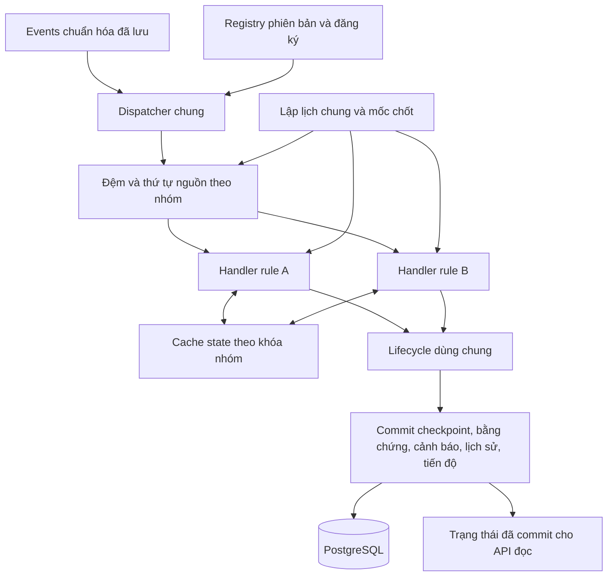

# Thiết kế module điều phối, rule và gom nhóm

Ngày: 2026-11-20. Cập nhật vận hành worker, coverage, retry, owner revision, history context và ngân sách; đồng bộ constitution 2.0.0. Trạng thái: thiết kế để review, chưa triển khai. [Yêu cầu nghiệp vụ](spec.md), [dữ liệu nền](../001-alert-data-model/data-model.md), [vòng đời cảnh báo](../002-alert-lifecycle/lifecycle-design.md).

## 1. Phương án và phạm vi

| Phương án | Đánh đổi |
|---|---|
| Truy vấn kho sự kiện để xét từng rule | Ít runtime state hơn nhưng tăng chi phí truy vấn khi nhiều log/rule; hữu ích cho tra cứu và kiểm chứng. |
| Worker dùng bộ nhớ và checkpoint PostgreSQL | Chọn cho bản đầu: xử lý nhanh trong RAM, giữ dữ liệu để khôi phục; thêm chi phí ghi checkpoint. |
| Broker và nhiều worker phân tán | Cần khi đo thấy nút thắt/năng lực dự phòng; thêm vận hành, phân vùng và kiểm soát thứ tự. Chưa chọn. |

Một Dispatcher logic, một worker tương quan, một bộ lập lịch và một CleanupManager chung thực thi ban đầu. Dispatcher, Registry và các handler là module trong cùng worker, không phải mỗi thành phần một service. Worker tách khỏi FastAPI; tăng số tiến trình phục vụ HTTP không tự tạo thêm bộ tương quan sở hữu cùng state. Không thêm Redis/Kafka hoặc tiến trình/timer riêng cho từng interface.

## 2. Luồng và trách nhiệm



| Thành phần | Trách nhiệm |
|---|---|
| Registry | Nạp/kiểm tra cấu hình, ghép handler, lập chỉ mục sự kiện và giữ các revision cũ còn cần. |
| Dispatcher | Tra event_type, lọc phạm vi/field và tạo khóa; không tự đếm cửa sổ. |
| Handler | Logic riêng, nhận config bất biến + event + state, trả state mới/kết luận/bằng chứng. Không trực tiếp ghi DB hoặc ACK/CLOSE. |
| State cache | State theo nhóm và dữ liệu dẫn xuất theo schema handler. Không sửa cache đã commit trước giao dịch thành công; recovered có thể cold-load theo guard mục 18. |
| CleanupManager | Chạy chung, gọi prune_state/can_evict_state và kiểm tra checkpoint, idle, pending, alert trước thu hồi; không tự kết thúc cảnh báo. |
| Lifecycle | Áp dụng create/append/recover/reactivate theo feature 002, kiểm tra trạng thái hiện tại và tranh chấp với thao tác người. |
| Persistence | Giao dịch, snapshot rule, checkpoint, nguồn pending bền vững và khôi phục. |

Mọi kết luận đưa tới Lifecycle đều là đề nghị: không được dùng alert_id trong cache làm bằng chứng rằng alert vẫn chưa đóng. Lifecycle kiểm tra bản hiện hành khi ghi, không ghi đè ACK/CLOSE từ cache cũ.

## 3. Cấu hình, logic và nơi lưu

- Một handler Python cho một loại thuật toán; mỗi cấu hình/revision có một evaluator được tạo khi nạp. Không tạo evaluator riêng cho mỗi interface.
- Handler giữ cấu hình bất biến, metadata khả năng, schema tham số và phiên bản logic. Không giữ một last_state/window chung trên object handler.
- File cấu hình có phiên bản là nguồn biên soạn bản đầu. Khi công bố, kiểm tra toàn bộ rồi lưu snapshot bất biến trong bảng rules chung để truy vết/khôi phục. Không chỉnh đồng thời cùng định nghĩa qua file và DB/UI.
- Có thể chọn DB làm nguồn biên soạn sau này, nhưng đó là thay đổi quản trị có migration rõ ràng; không vận hành hai nguồn chuẩn đồng thời.
- Giữ field `rules.definition` của thiết kế 001. Thông số riêng nằm tại `definition.parameters`, không thêm một cột parameters khác chứa cùng dữ liệu. Không tạo bảng link_flap_rules, bgp_rules riêng.
- Bổ sung `handler_key`, `handler_revision` dạng TEXT vào snapshot rules. Thay logic hoặc nội dung cấu hình phải tạo rules.version mới và lưu đúng handler_revision; không thay code dưới cùng định danh revision đã công bố.
- Cấu trúc/kiểu tham số được kiểm tra bằng schema do handler cung cấp; thiếu field, sai kiểu/range, field lạ hoặc subscription không tương thích phải bị từ chối. Không chạy code/SQL tùy ý từ cấu hình.
- Nạp và kiểm tra khi khởi động/công bố có kiểm soát, không đọc/parse file hay JSONB cấu hình cho từng log. Bản đầu chưa hot reload hoặc có UI quản trị rule.

Mẫu cấu hình và schema tham số của LinkFlap đã chuyển sang [004 mục 2](../004-link-flap-rule/link-flap-design.md). Điều kiện đếm/kết thúc không là mặc định của engine; handler khai báo schema và outcome của mình. Bản nháp có thể hoàn thiện trước công bố, snapshot đã công bố chỉ thay bằng revision mới.

## 4. Hợp đồng dữ liệu và điều phối

Đầu vào là projection đã kiểm tra của event được lưu: id, event_type, event_time/time_status, device_id, scope, interface_name/interface_state/interface_layer khi có. Projection đọc một lần từ field chuẩn hóa/attributes rồi truyền cho các handler, không yêu cầu mỗi rule tự parse lại raw hoặc JSONB.

- Registry lưu event_type → danh sách revision ứng viên. Mỗi revision là hợp của đăng ký phát sinh/phục hồi và được loại trùng trước gọi.
- Phạm vi có thể kiểm tra bằng filter được hỗ trợ; bộ điều phối không quét regex raw cho mọi rule. Khả năng đọc syslog từng hãng thuộc tầng chuẩn hóa.
- Rule cùng hiện tượng có thể dùng cho router/switch/firewall nếu parser đã chứng minh ánh xạ tương đương; tên hãng không tự bảo đảm tương thích.
- Giữ revision đang bật và revision cũ có alert chưa đóng. Trước gọi handler, resolver chọn duy nhất owner cho mỗi rule_key/scope/group theo mục 16; không gửi cùng nhóm đồng thời vào bản cũ và bản mới của cùng rule_key. Các rule_key khác nhau vẫn fan-out bình thường.
- Thiếu field cho một rule: ghi lý do bỏ qua có thể tổng hợp đếm, không cần log cảnh báo vận hành cho từng sự kiện thiếu giống nhau; event vẫn giữ, rule khác còn đủ field vẫn xét.
- Không có rule phù hợp là kết quả đã xét không khớp, không phải lỗi hệ thống. Lỗi code/DB không được coi như trường hợp này.
- Tập registry cố định trong một batch. Khi có revision mới, bản chưa đánh giá dùng registry công bố ở đầu batch; bản đã hoàn tất không tự đánh giá lại bằng revision mới. Thử lại sau lỗi giữ registry cũ trong cùng lượt vận hành; đổi revision để khắc phục cần thao tác phục hồi có kiểm soát, không lặng lẽ đổi giữa batch.

## 5. Khóa nhóm, instance và quyền sở hữu

Khóa logic:

```text
(rule_key, config_version, handler_revision, correlation_scope, group_values)
```

`rules.id` đại diện cho bộ định danh revision khi lưu checkpoint, còn group_values chỉ chứa các giá trị group_by. Giới hạn kiểu/độ dài key được kiểm tra, không dùng raw message làm khóa. Ví dụ nhóm interface cần device_id + interface_name đã chuẩn hóa; không tự đổi alias hoặc thay device_id bằng sender_ip/hostname có thể trùng. Khóa riêng từng handler nằm trong tài liệu rule.

Một handler phục vụ nhiều group state: A/Gi0/0, A/Gi0/1 và B/Gi0/0 độc lập. Tạo hoặc nạp state khi có event liên quan; không cấp trước window cho toàn bộ inventory. Cùng nhóm chỉ có một luồng cập nhật; bản đầu phải có khóa sở hữu worker để chạy nhầm hai process không xử lý cùng dữ liệu. Cơ chế sở hữu dùng session-level advisory lock theo mục 13; partition nhiều worker là bước sau.

## 6. Các rule sử dụng engine

[Feature 004 — LinkFlap](../004-link-flap-rule/spec.md) và [thiết kế chi tiết](../004-link-flap-rule/link-flap-design.md) là nguồn chuẩn cho thuật toán đếm, cấu hình, payload state, phạm vi tính bù, outcome và chính sách dọn của rule đó.

Engine không chứa ngưỡng/cửa sổ hay điều kiện kết thúc mặc định áp cho mọi handler. Một rule mới tuân hợp đồng mục 11, công bố schema/config hợp lệ và dùng cơ chế chung ở mục 7, 8, 12.

## 7. Checkpoint và khôi phục

Bảng chung `rule_group_states` là checkpoint thuật toán, không bảng riêng theo rule/interface. Bảy bảng dữ liệu/correlation giữ nguyên; 005 bổ sung bảng thứ tám `pipeline_runtime_status` cho health/coverage và work receipt, xem schema 001.

| Cột | Kiểu đề xuất | Vai trò |
|---|---|---|
| `rule_id` | UUID, FK rules.id, RESTRICT | Revision cấu hình/logic đã công bố. |
| `correlation_scope` | TEXT, NOT NULL | live hoặc replay cụ thể. |
| `group_values` | JSONB object, NOT NULL | Giá trị đúng group_by; cùng hai cột trên tạo PK. |
| `state_schema_version` | INTEGER >0 | Phiên bản cấu trúc state; không tự đọc payload cũ như schema mới. |
| `state_payload` | JSONB object, NOT NULL | State riêng theo schema handler, đủ ngữ cảnh/đường khôi phục, ranh giới và kết quả cần tiếp tục; không chỉ dữ liệu dẫn xuất. |
| `last_event_id` | BIGINT, NOT NULL, FK events.id, RESTRICT | Event cuối được áp dụng; chỉ tham chiếu, không phải MAX-id cursor. |
| `last_event_time` | TIMESTAMPTZ, NULL được | Mốc nguồn có căn cứ của nhóm; nhóm nhiều đối tượng vẫn cần mốc từng đối tượng trong payload. |
| `checkpoint_version` | BIGINT >0 | Phiên bản engine tăng sau mỗi thay đổi state có hiệu lực, khác state_schema_version và alerts.state_version. |
| `next_check_at` | TIMESTAMPTZ, NULL được | Deadline theo thời gian nguồn để phục hồi lịch sau restart; không cộng sẵn reorder delay. |
| `updated_at` | TIMESTAMPTZ, NOT NULL | Lần lưu checkpoint thành công gần nhất. |

Schema/giới hạn payload do handler kiểm tra. Cột JSONB này phục vụ lưu/khôi phục, không được truy xuất liên tục để tính rule trong DB; worker tính trên state RAM rồi ghi snapshot nhóm thay đổi. JSONB không miễn chi phí ghi: serialization, WAL, index và cập nhật tuple phải đo.

Các event_id nằm trong payload cũng là bằng chứng cần cho lần đạt ngưỡng sau. FK last_event_id không tự bảo vệ mọi event ref trong JSONB: trước khi có dọn dữ liệu tự động phải kiểm tra các tham chiếu checkpoint hoặc thiết kế lưu refs chuẩn hóa. Bản đầu giữ nguyên chính sách lab không tự xóa; không xóa raw còn được checkpoint/cảnh báo dùng.

Không lưu workflow_status/ACK/CLOSE vào payload như nguồn chuẩn. Tham chiếu alert trong cache nếu có chỉ là gợi ý; Lifecycle kiểm tra trạng thái DB để tránh sửa alert đã đóng. Giữ độc lập thuật toán và xác nhận người dùng.

### Giao dịch batch

1. Kiểm tra failed barrier và quyền sở hữu, chọn batch đủ parse/pending ưu tiên event đủ chốt; ghi work receipt/registry snapshot như mục 13, đăng ký/đệm theo group và chính sách mục 12. Event chưa đủ chốt vẫn pending, không đánh dấu processed chỉ vì đã vào RAM. Khóa quyền xử lý; không dùng MAX(id) làm tiến độ vì thứ tự cấp id không bảo đảm thứ tự commit.
2. Đánh giá tuần tự trên bản state tạm (copy-on-write) của batch. Mọi event trong batch thấy kết quả tạm trước nó, nhưng cache đã commit chưa bị sửa. Các rule đủ field được gọi đủ; skip có lý do không phải exception.
3. Một giao dịch ghi checkpoint cuối của mỗi nhóm đã thay đổi, các alert/evidence/history cần thiết và trạng thái hoàn tất của **đúng các event id** trong batch. Các lần chuyển lịch sử trung gian vẫn ghi đủ; không coalescing mất create/recovery/reactivate.
4. Chỉ sau commit mới thay cache bằng state mới và cho phép API đọc kết quả có hiệu lực; frontend polling theo 005. Nếu bổ sung tín hiệu đánh thức thì chỉ phát sau commit. Crash trước commit: pending + checkpoint cũ để chạy lại; crash sau commit trước cache swap: reload DB, không chạy lại event đã hoàn tất.
5. Ghi cùng một group nhiều lần trong batch có thể chỉ checkpoint state cuối. Batch giảm round-trip/commit, không giảm số row update nếu mọi event thuộc nhóm khác nhau. Batch size/độ chờ phải chốt bằng mục tiêu độ trễ, không chờ hàng giây chỉ để gom nhiều log.

Bộ thực thi trộn event và deadline theo thời gian nguồn, không dồn tất cả timer về cuối batch: deadline d<t chạy trước event t, tại d==t xử lý mọi event t trước timer. Điều này áp dụng cả khi xử lý backlog sau gián đoạn.

Timer, tính bù và prune có thay đổi cần lưu cũng đi qua giao dịch này; timer không tạo raw/event giả. Ghi lại checkpoint_version/next_check_at để lần hẹn lặp không nhân đôi kết quả. State mới phải được serialize–restore kiểm chứng. Không lấy checkpoint rồi append lại toàn bộ log đã có vào nó: khi rebuild phải khởi từ baseline của đoạn và tập ID xác định; không nhận nhầm pending khác thành đã áp dụng.

Khởi động lại nạp snapshot rule và handler revision cần thiết, checkpoint và cảnh báo chưa đóng trước nhận việc. Nhóm lạnh có thể nạp khi truy cập, nhưng thiếu revision/schema hoặc liên kết checkpoint hỏng phải báo lỗi, không mặc định cửa sổ rỗng. Không chỉ replay vài phút để đoán lại trạng thái dài hạn; raw dùng cho điều tra/rebuild có kiểm soát, không phát sinh lại side effect của event đã hoàn tất.

### Lỗi, retry và giới hạn bản đầu

- Lỗi input đã kiểm tra (thiếu field/không hỗ trợ) có kết quả skip. Lỗi handler bất ngờ/DB khiến rollback toàn batch, giữ cache cũ, ghi thông tin lỗi và dừng tiến độ worker; thu thập vẫn lưu raw/normalized vào pending theo sức chứa.
- Không tiếp tục xử lý nhóm sau trong khi đã bỏ qua một event lỗi có thể làm sai cửa sổ; không đánh dấu processed chỉ vì các rule khác thành công. Đây là lựa chọn fail-stop để bảo toàn kết quả của bản đầu.
- Sau lỗi commit có kết quả không rõ, đọc lại receipt/progress/checkpoint trước retry. Lỗi tạm giữ pending, lỗi logic hoặc hết retry ghi failed khi DB cho phép và dừng; đường khôi phục chính thức ở mục 13. Không tự sửa revision cũ.
- Muốn rule lỗi không trì hoãn rule khác cần thêm durable work/receipt theo event–revision và serialization theo group. Đây là bước mở rộng có chi phí ghi và vận hành, chưa có trong giao dịch chung hiện tại.

## 8. CleanupManager chung và quản lý cache

### 8.1. Chính sách và phạm vi

Một CleanupManager trong engine gọi chính sách từng handler; không tạo bộ dọn riêng cho mỗi rule/interface và không bắt buộc kế thừa một class dọn nặng. Handler chỉ đề xuất prune và cho phép evict; engine kiểm tra checkpoint/quyền sở hữu/concurrency. Dọn RAM tách với retention DB, không xóa raw, lịch sử, checkpoint cần khôi phục hoặc đổi tín hiệu.

| Thông số | Giá trị hiện tại | Nguồn |
|---|---|---|
| Reorder delay | 3 giây | Đã chọn |
| cleanup_interval_seconds | 5 giây | Mặc định đề xuất |
| cache_idle_seconds | 60 giây | Mặc định đề xuất |

Timer điều kiện rule đánh thức theo deadline, không bị buộc chờ chu kỳ dọn 5 giây. Idle dùng thời gian truy cập phía engine/đồng hồ đơn điệu; hết hạn cửa sổ dùng watermark nguồn. Dữ liệu nào làm thay đổi thời hạn thuật toán do handler quyết định; truy cập có thể giữ cache nóng dù kết luận không đổi.

### 8.2. Hai mức dọn

- Prune: bỏ dữ liệu hết hạn khi handler xác nhận không còn cần cho tính tiếp/tính bù. Chưa đạt điều kiện phát sinh không đủ lý do xóa. Giữ ngữ cảnh hoặc đường nạp lại đã kiểm chứng.
- Evict: chỉ bỏ toàn bộ entry RAM nếu handler xác nhận không còn dữ liệu thuật toán cần giữ nóng, không pending/in-flight/alert active, đủ idle, checkpoint an toàn và generation không đổi. Recovered chưa closed được evict khi next_check_at=NULL, không còn dữ liệu cần giữ nóng và cold-load đủ; kiểm tra DB vòng đời hiện hành trước eviction.
- Nhóm có alert active có thể prune nhưng giữ entry nóng; recovered chưa closed có thể evict theo constitution 2.0.0/mục 18. Đánh giá kết thúc bằng on_time/Lifecycle trước, không dùng cửa sổ rỗng như một lệnh RECOVER.

### 8.3. Mỗi lượt dọn

1. Xét các group đang trong cache, chia lô nếu cần, không quét toàn inventory.
2. Lấy watermark an toàn, gọi prune_state và kiểm tra schema/baseline.
3. Xem điều kiện handler can_evict_state và các guard chung ở trên.
4. State chưa checkpoint đúng generation thì lưu thành công hoặc giữ lại; không thu hồi khi DB lỗi/commit chưa rõ.
5. Trước xóa entry, xác nhận còn cùng cache entry/generation và không xuất hiện việc mới; nếu đổi thì bỏ quyết định cũ.
6. Evict RAM, tăng metrics. Không cần UPDATE DB cho mọi lần quét; snapshot còn mốc cũ có thể được prune khi đọc, miễn đủ khôi phục.

### 8.4. Nạp lại sau thu hồi

Nạp checkpoint và ngữ cảnh liên quan theo schema/chính sách handler. Không append lại dữ liệu đã có trong checkpoint hoặc coi pending chưa chốt là đã áp dụng. Timeline riêng cho LinkFlap chuyển sang [004 mục 5.1](../004-link-flap-rule/link-flap-design.md).

### 8.5. Quá tải và chỉ số

Queue RAM là tín hiệu tăng tốc; events pending mới là nguồn bền vững. Queue/cache đầy không được âm thầm mất dữ liệu chưa checkpoint. Theo dõi groups/observations, prune/evict/reload, skip theo pending/alert/dirty, thời gian dọn, backlog và RSS. Xóa object không bảo đảm Python trả RSS cho OS ngay.

Khi có nhiều worker, mỗi worker chỉ dọn partition mình sở hữu. Thay đổi TTL an toàn không đổi điều kiện phát hiện; không dùng tự hết hạn cache làm thời gian đóng alert.

## 9. Chi phí và giới hạn ước lượng

CPU/tổng ghi tăng theo E×k (E là sự kiện, k là số rule ứng viên trung bình); thuật toán phức tạp có thêm chi phí riêng. RAM phụ thuộc số nhóm giữ nóng, payload state, đệm chưa chốt và lịch; không nhân thẳng RAM của một state với thời gian chạy.

Đo riêng parse/dispatch/evaluate, số group, serialization/checkpoint, evidence/history, batch/commit, backlog và API/thông báo. JSONB snapshot, WAL và index vẫn có chi phí dù đường tính chính chạy trong RAM. Một cảnh báo mỗi nhóm không đồng nghĩa chỉ ghi một dòng mỗi nhóm trong toàn thời gian sự cố.

[Mô hình 1.000 interface của LinkFlap và giới hạn microbenchmark cũ](../004-link-flap-rule/link-flap-design.md) nằm tại 004 mục 6. Không dùng phép mô phỏng bộ đếm để cam kết ngân sách toàn worker hoặc production.

## 10. Quan sát và nghiệm thu

Đo input/s, evaluated/s, candidates/event, group cache nóng/lạnh, số nạp/evict, kích thước state/checkpoint, RSS/CPU, số ghi event/evidence/state, batch duration, backlog count/oldest age, lỗi từng revision và độ trễ p50/p95/p99.

Đo riêng received→đủ chốt và đủ chốt→hiển thị; SC-006 chỉ đề xuất p95 2 giây/p99 5 giây cho đoạn sau. Tổng độ trễ có khoảng chờ 3 giây/tồn đọng và chưa là SLA. Dùng cả tải đều và tải dồn theo mô hình của rule cần đánh giá, nhiều mức số rule ứng viên và toàn bộ checkpoint/evidence, không suy từ microbenchmark.

| Mã | Tình huống | Expected result |
|---|---|---|
| C01 | Hai config cùng handler khác ngưỡng | Tách identity, state và kết quả. |
| C02 | Sai kiểu/range/field/subscribe | Từ chối công bố, không nạp một phần. |
| C03 | Đổi nội dung giữ version | Từ chối, yêu cầu revision mới. |
| C04 | Một event khớp hai rule và hai selector của cùng rule | Hai revision được xét, mỗi revision một lần. |
| C05 | Log recovery không thỏa trigger | Vẫn đến revision cần theo dõi. |
| C06 | Rule cũ tắt còn alert | Tiếp tục nhóm cũ, không mở nhóm mới. |
| C07 | Thiếu field một rule | Skip có lý do, rule khác đủ field vẫn xét, raw còn. |
| C08 | A/Gi0/0, A/Gi0/1, B/Gi0/0 xen kẽ | Không trộn nhóm. |
| C09 | Cache eviction rồi event mới | Khôi phục baseline/window/chu kỳ từ checkpoint. |
| C10 | Crash trước commit hoặc sau commit trước swap | Rollback hoặc khôi phục bản đã commit, không đếm đôi. |
| C11 | Lỗi một handler trong batch | Rollback batch, dừng tiến độ/báo lỗi, đầu vào vẫn lưu. |
| C12 | Event id nhỏ commit muộn | Không bỏ sót do MAX-id cursor. |
| C13 | Group recovered, ACK/CLOSE và tái phát | Theo feature 002; không ghi đè thông tin người. |
| C14 | Log trễ/cùng timestamp/unknown time | Tính bù khi đủ căn cứ; không đoán thứ tự hay sửa alert đóng, raw còn. |
| C15 | Search-only/replay khác scope | Không tác động live hoặc scope khác. |
| C16 | Thiếu recovery hoặc recovery không tương thích | Draft tắt được giữ; bật bị từ chối. Tham số riêng phải khớp handler. |
| C17 | Hàng chờ/cache đầy | Không âm thầm mất dữ liệu đã lưu; thấy backlog/health. |
| C18 | Hai worker cùng chạy ngoài dự kiến | Chỉ một chủ sở hữu tiến độ, không nhân đôi state. |
| C19 | Tải dồn và tải đều theo kịch bản đã chọn | Đối chiếu đủ event, đo p95/p99 gồm DB/UI. |
| C20 | Handler/schema revision mất khi restore | Báo lỗi, không mặc định state rỗng. |
| C21 | Lệch thứ tự trong 3 giây | Chốt theo event_time, không theo received_at. |
| C22 | Interface không gửi log tiếp | Watermark/lịch vẫn xử lý log cuối và deadline khi dữ liệu an toàn. |
| C23 | Transition mới đúng deadline | Áp event trước timer, dời hạn, không kết thúc thoáng qua. |
| C24 | Pipeline/time không an toàn | Không kết luận quiet recovery theo khoảng không quan sát. |
| C25 | Correction của alert closed | Giữ alert/history; đánh dấu event/diagnostic, không reopen/xóa. |
| C26 | Checkpoint lỗi/generation đổi lúc dọn | Giữ entry, không mất cập nhật hoặc pending. |
| C27 | Cùng CleanupManager phục vụ nhiều handler | Prune/evict theo hợp đồng riêng, guard cuối thuộc engine. |
| C28 | Handler sửa input/cache hoặc ghi IO | Vi phạm hợp đồng bị test phát hiện; rollback không lộ state dở. |
| C29 | Timer sau restart/lặp cùng state | Một quyết định có hiệu lực, ghi timer/effective_at không tạo raw giả. |
| C30 | State serialize–restore và eviction | Đánh giá tiếp tương đương, không cộng lại observations hai lần. |
| C31 | Evidence/outcome đổi nhưng trạng thái chưa đổi | Có correction audit/version có ý nghĩa, không tạo lịch sử cho no-op. |
| C32 | Backlog đủ coverage với deadline 80 và event mới tại 90 | Xét timer hợp lệ 80 trước event 90; coverage thiếu thì áp guard mục 15, không suy khoảng yên. |

Các case C01–C32 và C33–C48 bên dưới kiểm chứng cơ chế chung. Ca thuật toán LinkFlap chuyển sang LF01–LF26 tại [004 mục 7](../004-link-flap-rule/link-flap-design.md). Các case là yêu cầu cho test triển khai sau, chưa được chạy trên ứng dụng. Đặc tả, ví dụ JSON và tính nhất quán tài liệu có thể kiểm tra ngay; không tạo worker hoặc migration ở bước specify.

## 11. Hợp đồng Handler

### 11.1. Metadata và cấu hình chỉ đọc

| Thành phần | Bắt buộc / ý nghĩa |
|---|---|
| handler_key, handler_revision | Loại thuật toán và revision bất biến |
| supported_event_types | Các loại sự kiện chuẩn hóa được phép đăng ký, đủ cả trigger/recovery |
| required_fields | Theo event_type; gồm yêu cầu event_time có căn cứ nếu thuật toán cần |
| required_group_fields | Identity tối thiểu do loại handler quy định |
| history_policy | Horizon/lookback/baseline/field và giới hạn nạp lịch sử cho tính bù; không chứa DB session |
| parameter_schema | Kiểu/range/field và validator liên trường; engine gọi khi nạp |
| state_schema, state_schema_version | Payload và serialize–restore đúng phiên bản |
| supported_outcomes | Outcome cố định được code hỗ trợ, không tùy ý thêm bằng cấu hình |

Metadata do code cung cấp, không cho cấu hình chọn đường import hoặc chạy mã tùy ý. Một evaluator gắn config/revision bất biến, không giữ last_state/window riêng của interface trong object dùng chung.

### 11.2. Kiểu đầu vào

NormalizedEvent gồm event_id, event_type, event_time, received_at, time_status, device_id, correlation_scope và fields projection có kiểu. Raw vẫn ở events, handler không parse lại hoặc tự đọc DB.

RuleState gồm envelope engine sở hữu (rule_ref, group_key, schema/checkpoint version) và payload riêng handler. Handler chỉ đề xuất payload mới; không sửa identity/version/nhóm khác. Snapshot phải thực sự chỉ đọc hoặc copy-on-write; chỉ đóng băng object ngoài mà dict/list bên trong còn sửa được là chưa đủ.

EvaluationContext gồm rule_ref/group_key, parameters và recovery policy đã kiểm tra, watermark nguồn, now hệ thống, mode=live/rebuild; thêm coverage và HistoryContext đã kiểm tra theo mục 15/17. Mốc đếm dùng event_time; timer nguồn dùng watermark; idle TTL thuộc engine dùng clock đơn điệu. Không cung cấp DB session, socket hay callback gửi thông báo cho handler.

State chuẩn lưu phải serialize được (object/list/giá trị JSON có schema, timestamp UTC không mất chính xác, event ID đúng kiểu). Cấu trúc tối ưu tạm trong handler không được trở thành tham chiếu không thể khôi phục. Không thêm hàm IO riêng ở từng rule.

### 11.3. Năm thao tác

~~~python
initial_state(context) -> RuleState
evaluate(event, state, context) -> RuleResult
on_time(state, context) -> RuleResult
prune_state(state, context) -> PruneResult
can_evict_state(state, context) -> EvictionDecision
~~~

| Thao tác | Precondition và trách nhiệm | Cấm |
|---|---|---|
| initial_state | Chỉ khi thực sự không có checkpoint; tạo state ban đầu theo schema handler | Nuốt lỗi restore và khởi tạo rỗng |
| evaluate | Event hợp lệ đã chuẩn bị thứ tự hoặc replay; cập nhật state và mọi điều kiện liên quan | Bỏ toàn bộ lượt vì kết luận chưa đổi, sửa cache đã commit |
| on_time | Watermark an toàn đến deadline; đánh giá kể cả không có log, kết quả lặp an toàn | Tự cộng thêm reorder delay, tự tạo timer/thread, giả làm syslog mới |
| prune_state | Trả state còn đủ semantics tương lai/tính bù hoặc đường khôi phục | Tạo ACTIVATE/RECOVER, xóa raw/alert/checkpoint |
| can_evict_state | Đề xuất allowed + reason từ nhu cầu thuật toán | Tự xóa cache, bỏ qua guard engine |

Default an toàn: on_time=NONE, prune=giữ nguyên, can_evict=false nếu handler chưa định nghĩa chính sách. evaluate và schema không có mặc định giả thành công. Không bắt buộc kế thừa CleanupManager; cùng hợp đồng đủ để manager gọi.

### 11.4. Kết quả

| RuleResult field | Ngữ nghĩa |
|---|---|
| evaluation_status | READY / NEEDS_HISTORY / INCOMPLETE; chỉ READY cho phép áp dụng new_state/decision |
| history_request | Mô tả ngữ cảnh cần thêm nếu NEEDS_HISTORY; engine quyết định truy vấn, không handler IO |
| new_state | Payload/snapshot sau tính toán; NONE vẫn có thể thay state |
| decision | NONE / ACTIVATE / RECOVER |
| evidence_ids | ID syslog hỗ trợ kết luận; phải đúng group/scope/lớp |
| reason_code | Lý do có cấu trúc, không raw/stack trace tùy ý |
| effective_at | Khi điều kiện đạt theo dữ liệu; timer là deadline tính toán, không phải timestamp một log mới |
| outcome | NULL nếu không cần, hoặc một outcome đã khai báo trong metadata |
| next_check_at | Deadline theo thời gian nguồn hoặc NULL; engine giữ lịch |

ACTIVATE là đề nghị: Lifecycle tạo, bổ sung hoặc tái kích hoạt theo bản DB hiện hành. RECOVER không ACK/CLOSE. Engine gắn decision_source=syslog/timer/correction từ cách đánh giá, không tin nguồn tự khai từ client.

PruneResult gồm new_state, removed_items, reason_code; không có decision đổi alert. EvictionDecision gồm allowed, reason_code; engine vẫn kiểm tra dirty/checkpoint, pending/in-flight, idle, alert và generation.

effective_at là mốc đạt điều kiện, recorded_at là lúc hệ thống thực ghi. Evidence timer phải trỏ đến quan sát thật và khoảng/mốc chốt trong audit, không tạo event giả. Ngữ nghĩa outcome cụ thể thuộc handler; không đồng nhất mọi RECOVER với thiết bị đã UP.

### 11.5. Lỗi và kiểm chứng

Thiếu field/không hỗ trợ là skip có lý do do engine phân biệt; schema/result sai hoặc exception handler là lỗi thực thi, không phải NONE. Rollback theo mục 7.

Mỗi handler phải có test metadata/config, nhóm độc lập, input không bị sửa, đầu vào không đổi kết luận, biên thuật toán, timer không log mới/timer lặp nếu hỗ trợ, các outcome khai báo, serialization, prune/restore, eviction, rebuild và rollback. Engine kiểm tra shape/invariant trước ghi, không thể tự chứng minh thuật toán Python đúng chỉ bằng schema.

## 12. Thời gian nguồn, đệm và tính bù chung

### 12.1. Đệm và mốc chốt

event_time là căn cứ thuật toán; received_at dùng đo tiếp nhận/độ trễ. Sắp trong cùng nhóm theo thời gian nguồn; timestamp bằng nhau chỉ dùng sequence nguồn nếu thực sự có căn cứ, không dùng event_id/thứ tự nhận để đoán.

Engine giữ dữ liệu chưa chốt trong DB hoặc đệm có giới hạn khoảng 3 giây, là lựa chọn hiện tại dùng chung. Khi UTC/ngữ cảnh nguồn đủ tin cậy và không backlog ảnh hưởng, mốc tham chiếu là now_UTC-3 giây. Xử lý các event đủ điều kiện trước timer tới mốc đó; mốc tiến cả lúc im lặng khi an toàn. Watermark không bảo đảm sẽ không còn log cũ đến nữa.

Thời gian unknown, quá tương lai hoặc mâu thuẫn phải có diagnostic/guard; không giữ vô hạn trong heap rồi coi là dữ liệu trễ bình thường. Pipeline/time không an toàn thì không dùng khoảng im lặng kết luận recovery. Reorder delay áp một lần, không cộng cả trong handler và scheduler.

### 12.2. Phạm vi theo handler

Handler quy định horizon, dữ liệu ảnh hưởng, baseline/ngữ cảnh cần đọc và cách dựng lại; engine không dùng một cửa sổ cố định cho mọi rule. [004 mục 4](../004-link-flap-rule/link-flap-design.md) quy định cụ thể vùng sống và lookback LinkFlap.

Ngoài phạm vi ảnh hưởng: giữ raw và late_out_of_horizon. Thiếu ngữ cảnh: correction_incomplete; thứ tự mâu thuẫn: ordering_ambiguous. Không suy dữ liệu rỗng hoặc kết luận đã khôi phục chính xác toàn lịch sử. Retention phải bảo vệ mọi ref dùng cho checkpoint/bằng chứng như mục 7.

### 12.3. Dựng lại và hòa giải kết quả

1. Chốt snapshot/vùng ảnh hưởng, đúng revision/scope/group; chỉ dùng dữ liệu đã áp dụng hoặc batch đang xét, không tự coi pending khác đã xử lý.
2. Nạp đủ ngữ cảnh, chèn theo thứ tự nguồn và dựng lại trên state tạm từ đầu đoạn hợp lệ. Không cộng log DB vào buffer đã chứa cùng dữ liệu.
3. Xét mọi điểm/kết luận bị ảnh hưởng theo handler, không chỉ timestamp log vừa đến.
4. mode=rebuild trộn event/deadline theo nguồn: d<t thì timer d trước event t; d==t thì mọi event t trước timer. Handler không IO; không ghi tác động trung gian máy móc.
5. So với kết quả đã công bố; có thể phát hiện muộn hoặc hiệu chỉnh evidence/outcome/nhận định của alert chưa đóng theo 002. effective_at có thể cũ hơn created_at, không ghi lùi thời gian hệ thống.
6. Ghi correction source, before/after, reason, bằng chứng và phiên bản cùng giao dịch state/progress. Facts không đổi thì không tạo audit/version có ý nghĩa.
7. Nếu recovery cũ bị vô hiệu, quay về ranh giới hợp lệ trước đó với audit. Nếu activation cũ chưa chứng minh được và chưa có kết thúc hợp lệ: evidence_review_required, không tự xóa/hủy/đóng.
8. Alert closed bất biến; ghi late_conflict_closed ở diagnostic sự kiện, không reopen. Không cam kết tái dựng mọi incident lịch sử.

Chi phí tính bù phụ thuộc số quan sát/ngữ cảnh và log trễ; phải đo cùng đường ghi/checkpoint. Các test engine ở mục 10 kiểm tra cơ chế; test thuật toán riêng nằm trong từng feature rule.

## 13. Nhận việc, quyền sở hữu, retry và shutdown

### 13.1. Vòng nhận việc

- Một worker tương quan chạy riêng FastAPI; producer commit raw/normalization rồi worker tự polling.
  idle_poll_ms=200, batch_max_events=500 là mặc định thử lab. Có ít xử lý ngay; backlog
  còn việc thì lấy batch tiếp, không ngủ giữa các batch để cố đủ số.
- Poll ưu tiên pending có parse success/partial và event_time đã đủ chốt; loại thời gian
  không dùng được được quyết định skip/diagnostic riêng để không treo mãi.
  Log chưa đủ chốt ở DB; nếu đã đưa vào RAM phải theo dõi ID, không nạp trùng hoặc làm đói log khác.
- Chờ rỗng đến min(lần poll kế, deadline hợp lệ kế, lần cleanup kế, heartbeat kế);
  không giữ giao dịch mở trong thời gian ngủ. deadline/event vẫn trộn theo mục 12.
- Scope lịch sử search-only không được tự chọn; replay chủ động giữ scope riêng và chưa có
  wall-clock quiet recovery ở bản đầu, chỉ replay event-time có điểm kết thúc rõ/coverage tương ứng.
- Không dùng MAX(id) như cursor, không chỉ lấy page đầu pending chưa đủ chốt mãi.
  LISTEN/NOTIFY chưa cần trong bản đầu; nếu thêm chỉ là wake-up, reconnect vẫn poll pending.

### 13.2. Sở hữu và work receipt

- Worker dùng pg_try_advisory_lock cấp session với khóa cố định của correlation engine
  trong database môi trường. Không lấy được thì báo standby/not-owner và không chạy rule/timer.
- Session sở hữu là kết nối dedicated dùng cho các giao dịch ghi state/progress.
  Mất kết nối hoặc không xác nhận còn quyền: bỏ state tạm, dừng ghi, reconnect/giành quyền
  rồi reload checkpoint. Không trả kết nối đang giữ khóa vào pool.
- Trước đánh giá batch, commit receipt ở pipeline_runtime_status.details.inflight:
  batch_id, event_ids chính xác, registry_rule_ids và owner_instance_id. Đây là workset
  bền vững, chưa phải processed. Trạng thái input/claim không dùng id lớn nhất.
- Giao dịch kết quả ghi checkpoint/evidence/alert/history/exact progress và xóa receipt
  cùng lúc. Crash trước receipt commit chưa nhận batch; sau receipt commit dùng đúng
  registry snapshot đó để chạy lại. Crash sau result commit: không đánh giá lại ID đã processed.
- Snapshot cũ/handler bị thiếu khi restart là lỗi, không tự thay registry mới.
  Đổi logic để khắc phục cần migration/rebuild có kiểm soát, không đổi nghĩa retry ngầm.

### 13.3. Trạng thái lỗi

| Loại | Trạng thái dữ liệu | Hành động |
|---|---|---|
| Thiếu field/không tương thích đã kiểm tra | Kết quả skip rule có lý do | Rule khác đủ điều kiện vẫn chạy |
| Lỗi tạm DB/deadlock/timeout | Rollback, giữ pending/receipt | Tối đa 5 lần thử lại sau lần đầu; backoff 0.5,1,2,4,8 giây, không busy-loop |
| Lỗi handler/schema hoặc hết retry | Rollback; ghi failed cho event đang xét khi DB khả dụng | Dừng toàn tiến độ tương quan, health error, giữ receipt |
| Không ghi được failed vì DB lỗi | Pending/receipt chưa hoàn tất | Health/log lỗi bên ngoài DB; không báo đã ghi failed; không tiếp tục như thành công |
| Commit không rõ thành bại | Chưa quyết định retry | Reconnect, đọc receipt/progress/checkpoint rồi mới tiếp tục |

Startup kiểm tra failed/barrier trước pending, không bỏ nó qua restart. Đường quản trị
failed→pending có quyền vận hành, reason, request_id idempotent và audit trong correlation_details;
xóa correlation_error/correlated_at hiện hành cùng giao dịch, giữ raw/id/registry receipt.
Không có nút skip tùy tiện cho event lỗi logic. Không tự sửa nội dung revision đã công bố.

### 13.4. Dừng có kiểm soát

Nhận SIGTERM: ngừng nhận batch, hoàn tất hoặc rollback đơn vị đang chạy trong shutdown_grace_seconds=30
(mặc định thử), ghi status stopped khi DB khả dụng, đóng session để nhả lock. Nếu kill trước
hoàn tất, receipt/pending/checkpoint quyết định lúc restart; không đánh dấu processed để thoát nhanh.
Không đợi xử lý hết backlog. Nếu scope không còn coverage được chứng minh, restart chặn quiet
đến khi có lại đoạn quan sát đủ; không mặc định restart luôn làm mất toàn lịch sử.

## 14. Schema state và projection

- Projection v1: events.id→event_id; các cột chung giữ nguyên; attributes.interface_name,
  attributes.interface_state và attributes.interface_layer thành field cùng tên có kiểu.
  UP/DOWN viết hoa, physical/protocol viết thường. Parser/adapter 005 xử lý tên state cũ một lần.
- Checkpoint state_payload v1 gồm engine và handler. engine có envelope_version=1,
  last_evaluated_source_at, activation_boundary, safe_since/coverage_until (nullable khi unknown),
  coverage_status/reason và owner_alert_id_hint (nullable). handler theo state_schema_version;
  không chứa session/socket/callable/workflow_status làm nguồn chuẩn.
- last_event_id ngoài payload chỉ tham chiếu event thực áp dụng gần nhất, không là watermark/cursor.
  Timer/prune không tạo event giả để cập nhật field đó. Cache generation dùng owner_instance_id,
  checkpoint_version và generation cục bộ để hủy timer/eviction cũ.
- Schema kiểm tra timestamp UTC, số nguyên/event ID không nhầm boolean, enum, null và kích thước.
  Serialize→restore phải tương đương. Payload schema cũ phải có converter được kiểm chứng;
  không có converter thì lỗi rõ ràng, không đọc bằng schema mới hoặc tạo state rỗng.
- Không copy trigger buffer giữa revision. Close/ACK không lưu trong state như nguồn chuẩn;
  cold-load tra alerts/rules và ranh giới history cùng scope.

## 15. Coverage và điều kiện cho phép quiet recovery

### 15.1. Nguồn căn cứ

005 cung cấp pipeline_runtime_status cho collector, normalizer, correlator theo scope.
Heartbeat mặc định thử 1 giây, stale sau 3 giây. Mỗi producer ghi coverage_started_at
của đoạn healthy liên tục; khi có gap heartbeat/DB/nguồn/time chưa đủ căn cứ phải reset,
không lấy now-3 giây là bằng chứng đã quan sát. Giá trị clock/source policy được kiểm tra
lúc cấu hình lab, không polling trạng thái thiết bị.

### 15.2. Tiến mốc chốt

1. Chụp cutoff nhận việc và watermark ứng viên C-3 giây từ giờ server đáng tin cậy.
2. Đọc hết theo batch các event đủ điều kiện trước/đúng mốc ứng viên của scope đang xét,
   kết hợp workset/receipt; chưa đọc hết thì chưa cho timer vượt qua.
3. Nếu còn raw parse-pending thuộc cutoff, failed chưa giải quyết hoặc ambiguity ảnh hưởng
   thì chặn quiet của thiết bị/group xác định được; chưa xác định phạm vi thì chặn scope.
   Parse lỗi/unknown-time không bị im lặng coi như đã chứng minh không chuyển.
4. Chỉ sau khi kết quả đã commit, health/coverage đủ và không còn input liên quan trước
   deadline chưa xét mới chạy timer hợp lệ. Cùng timestamp vẫn event trước timer.
5. Event commit sau vòng chụp hoặc quá đệm 3 giây được xử lý như late input; không tuyên bố
   đã loại trừ mọi log cũ tương lai hay mất gói UDP.

### 15.3. Khoảng mất quan sát

safe_since là đầu đoạn quan sát an toàn hiện hành, lấy bảo thủ theo health/clock/group
và checkpoint. Health correlator quyết định readiness, không tự xóa coverage đầu vào liên tục của collector/normalizer chỉ vì correlator restart. Khi gap không dựng lại được, quiet deadline hiệu lực là:
max(last_relevant_change + quiet_seconds, safe_since + quiet_seconds).
Nếu safe_since unknown, không RECOVER; next_check_at không được quay busy-loop,
đánh giá lại khi health/clock/input đổi. Cache/scheduler có wake-up cho thay đổi health.

Ví dụ mất quan sát 30–100, transition cuối 20, quiet 60: không kết thúc ở 80; healthy
từ 100 thì sớm nhất 160 (chốt khoảng 163 nếu đồng hồ/đệm 3 giây như ví dụ chuẩn).
Nếu chỉ correlator dừng, collector/normalizer có health liên tục và input bền vững
đủ thì dựng lại đoạn có coverage, không tự reset 60 giây chỉ vì process restart.
Không có bằng chứng coverage thì giữ unknown và quan sát lại; không giả định đầy đủ.

Health 1 giây/stale 3 giây là chính sách phát hiện gap của lab, không chứng minh UDP
giao nhận đầy đủ. Thay ngưỡng clock/health phải có config và bộ thử; nguồn không có
time policy được kiểm chứng không đủ để bật quiet recovery.

## 16. Revision owner và kích hoạt

- Trong snapshot registry, resolver trước hết tìm alert chưa closed cùng rule_key/scope/group,
  kể cả recovered và state ngoài cache; revision của alert là owner duy nhất.
  Nhiều rule_key khác nhau cùng event vẫn được xử lý độc lập.
- Không có owner chưa đóng thì dùng revision đang bật. activated_at ghi lần đầu enable,
  giữ nguyên; các transition trigger live phải > max(activated_at, ranh giới phục hồi hợp lệ).
  Có thể nạp baseline <= ranh giới nhưng không tính baseline như một transition mới.
- Nếu revision mới có cùng group_by, nhóm đã ghim không tạo counter/alert song song ở bản mới.
  Khi alert cũ closed, chủ sở hữu lần tiếp theo là revision đang bật; dựng state mới từ baseline,
  không copy buffer đã tính. Nếu không có revision bật thì không mở nhóm/episode mới.
- Đổi group_by khi cùng rule_key còn alert chưa đóng bị từ chối ở bản đầu.
  Đổi lớp chỉ được coi là tương đương identity nếu mapping được xác định; không tự gộp.
- Replay chủ động chọn revision rõ trong yêu cầu và evaluation_start_at theo thời gian dữ liệu;
  dùng ranh giới max(evaluation_start_at, ranh giới phục hồi hợp lệ của scope replay),
  không dùng activated_at wall-clock của live để loại mọi log lịch sử. Không trộn owner live.
- Đổi revision để sửa failed khác với hot activation thông thường: cần quyết định registry
  mới cho receipt cũ, mapping/rebuild và audit, không tự retry bằng code khác.
- DB unique theo rule_id vẫn giữ; owner invariant xuyên revision do đường ghi chung/khóa
  sở hữu và Lifecycle kiểm tra theo rule_key thực thi. Không tuyên bố index cũ tự bảo đảm.

## 17. Hợp đồng nạp lịch sử

- Metadata history_policy được tính từ config lúc nạp: horizon, lookback trước điểm
  bị ảnh hưởng, cần baseline, field/lớp, cách xác định đoạn và giới hạn chi phí.
- HistoryContext chỉ đọc gồm requested_range, observations, baseline, episode_boundaries,
  coverage, completeness=complete/incomplete và reason. Chỉ lấy event đã áp dụng hoặc
  workset đang xét; pending khác không tự thành bằng chứng đã xử lý.
- Handler có thể trả evaluation_status=NEEDS_HISTORY với history_request mô tả range,
  baseline và fields; new_state/decision lúc này chỉ là tạm, engine không commit hoặc
  đổi cache/progress. Engine kiểm tra request trong policy/scope/group rồi nạp và đánh giá
  lại từ snapshot trước lượt, không append hai lần.
- Tối đa 3 vòng nạp mở rộng, 20.000 quan sát mỗi lượt rebuild và timeout truy vấn 2 giây
  là giá trị thử. Request lặp không mở rộng, vượt giới hạn hoặc thiếu baseline:
  INCOMPLETE + correction_incomplete, giữ state/kết luận đã commit; đánh dấu group không
  đủ căn cứ quiet, giữ event diagnostic. Đây là xử lý dữ liệu không đủ, không giả thành count=0.
- Chi tiết limit/timeout có thể cấu hình. Event được ghi nhận đã xét với diagnostic khi
  đã quyết định INCOMPLETE có kiểm soát; muốn tính lại phải có yêu cầu rebuild riêng có audit qua hợp đồng 005, không đổi processed thành pending như một retry thông thường.
- READY mới đưa candidate facts vào hòa giải Lifecycle. Cả event và timer khi rebuild
  có cùng thứ tự nguồn; không gửi/ghi tác động trung gian trong handler.
- LinkFlap cụ thể hóa W/lookback/baseline tại 004; không mặc định mọi handler chỉ cần N mốc.

## 18. Ngân sách, eviction và kiểm chứng vận hành

### 18.1. Ngân sách khởi động

| Thông số | Mặc định thử lab / quy tắc |
|---|---|
| max_cached_groups | 10.000 entry |
| max_buffered_events | 20.000 event chưa chốt trong RAM, DB vẫn là nguồn |
| max_state_payload_bytes | 262.144 byte mỗi checkpoint/group |
| state_cache_budget_bytes | 67.108.864 byte tổng payload serialize ước tính |
| memory_budget_bytes | Bắt buộc khai báo theo tài nguyên container; không có thì từ chối khởi động |
| RSS cảnh báo/dừng nhận | 70% / 85% memory_budget_bytes, kiểm tra cả state tạm |
| Giới hạn tính bù | Theo mục 17, không đọc toàn lịch sử không giới hạn |

Payload serialize chỉ là thước đo phụ, không phải RAM Python/RSS. Bộ đo tính cả cache,
state copy-on-write, buffer, heap và process. Trước batch/restore phải dự trù working set,
giảm batch nếu cần; một entry vượt policy không được nạp vô hạn để vượt ngân sách.

Chạm ngưỡng: dọn entry hợp lệ, giảm batch/đệm; nếu vẫn không đủ thì ngừng lấy thêm event,
giữ pending ở DB, health degraded. Không evict active/bỏ dữ liệu để giả đạt tải.
Ngừng nhận việc đồng nghĩa guard quiet phải xét backlog; không tự recovery khi chưa đọc đủ.
Input đã nhận vẫn giữ theo khả năng lưu; collector/API có cơ chế sức chứa ở 005.

### 18.2. Eviction recovered chưa closed

Giữ entry active. Với recovered chưa closed chỉ evict khi:
handler cho phép, không còn dữ liệu cần giữ nóng, next_check_at=NULL, không pending/in-flight,
đủ idle/checkpoint và generation/DB snapshot còn đúng. Lifecycle tra DB trước ghi và cold-load;
không thay workflow khi evict. Nếu operator CLOSE/engine reactivate hoặc entry đổi thì hủy
quyết định stale. Không xóa checkpoint/raw/history hoặc ranh giới còn cần.

### 18.3. Các ca bổ sung

| Mã | Tình huống | Kết quả |
|---|---|---|
| C33 | Commit normalized rồi producer không gọi worker | Poll tự nhận và xử lý, không cần gọi handler trực tiếp |
| C34 | Rỗng, batch ít, backlog >500 và deadline đến hạn | Chờ có giới hạn, không đợi đầy batch, không làm đói lịch/dọn |
| C35 | Retry DB và commit không rõ | Đọc receipt/progress, không ghi đôi; giữ pending nếu chưa hoàn tất |
| C36 | Failed rồi restart/đưa lại pending | Barrier còn; phục hồi có quyền/audit/idempotency |
| C37 | Hai worker hoặc mất session lock | Chỉ owner xử lý; mất quyền dừng ghi/reload trước tiếp tục |
| C38 | SIGTERM/kill giữa batch | Hoàn tất hoặc rollback; receipt quyết định restart |
| C39 | Raw chưa parse hoặc event trước deadline chưa đọc | Chặn quiet nhóm/scope liên quan |
| C40 | Mất quan sát 30–100, quiet60 | Không RECOVER ở80; sớm nhất160 nếu chỉ healthy từ100 |
| C41 | Collector/normalizer coverage liên tục, correlator restart | Dựng lại đúng đoạn được chứng minh, không reset mù hoặc giả coverage |
| C42 | Mapping field cũ và sai enum/lớp | Projection chuẩn hoặc skip diagnostic, không mặc định physical |
| C43 | Revision mới khi alert cũ active/recovered/cold | Một owner theo rule_key, không tạo đôi |
| C44 | Đổi group_by hoặc bằng chứng trước activated_at | Từ chối thay nhóm chưa có migration; không tính trigger cũ |
| C45 | NEEDS_HISTORY rồi đủ hoặc request lặp/vượt limit | Re-evaluate từ snapshot; hữu hạn, incomplete rõ và không commit tạm |
| C46 | Recovered evict rồi CLOSE/reactivate/correction | Giữ đúng DB lifecycle, baseline/ranh giới và owner |
| C47 | Ngân sách đầy/entry quá lớn | Dọn hợp lệ rồi dừng nhận/degraded, pending còn, không quiet sai |
| C48 | Schema cũ, converter thiếu/sai hoặc receipt handler mất | Báo lỗi, không mặc định rỗng hoặc tự đổi revision |

Các giá trị thử không thay SC hiệu năng thành cam kết đã đo. Bộ C này là yêu cầu
cho triển khai; chưa phải test ứng dụng đã chạy.
