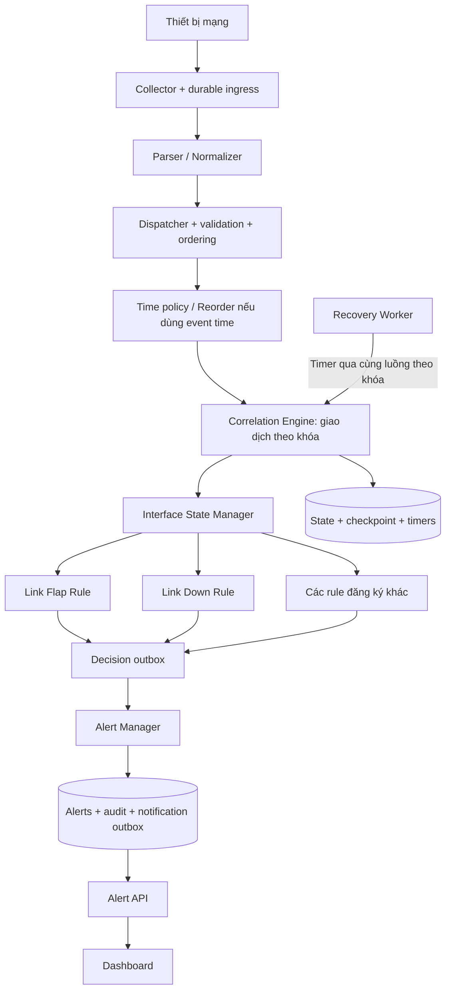

# N4.2 — Đặc tả kỹ thuật Link Flap Detection

**Phiên bản:** 1.0 · **Ngày:** 16/11/2026 · **Ngôn ngữ:** Tiếng Việt  
**Phạm vi:** Luật Link Flap và các hợp đồng tích hợp trong Correlation Engine dùng chung.  
**Trạng thái:** Bản đặc tả để rà soát và triển khai; những giá trị được ghi “đề xuất” chưa phải quyết định đã phê duyệt.

## Mục lục

1. [Nguồn, quyết định và giả định](#1-nguồn-quyết-định-và-giả-định)
2. [Định nghĩa nghiệp vụ và bất biến](#2-định-nghĩa-nghiệp-vụ-và-bất-biến)
3. [Kiến trúc và trách nhiệm từng module](#3-kiến-trúc-và-trách-nhiệm-từng-module)
4. [Hợp đồng dữ liệu](#4-hợp-đồng-dữ-liệu)
5. [Chính sách thời gian và thứ tự](#5-chính-sách-thời-gian-và-thứ-tự)
6. [State và thuật toán Link Flap](#6-state-và-thuật-toán-link-flap)
7. [Vòng đời cảnh báo và liên kết Link Down](#7-vòng-đời-cảnh-báo-và-liên-kết-link-down)
8. [API và giao diện tích hợp](#8-api-và-giao-diện-tích-hợp)
9. [Concurrency, transaction và retry](#9-concurrency-transaction-và-retry)
10. [Recovery Worker, restart và replay](#10-recovery-worker-restart-và-replay)
11. [Lưu trữ, vận hành và dashboard](#11-lưu-trữ-vận-hành-và-dashboard)
12. [Mở rộng cho các luật khác](#12-mở-rộng-cho-các-luật-khác)
13. [Kiểm thử bắt buộc](#13-kiểm-thử-bắt-buộc)
14. [Tiêu chí nghiệm thu](#14-tiêu-chí-nghiệm-thu)
15. [Bàn giao, thứ tự triển khai và các điểm cần chốt](#15-bàn-giao-thứ-tự-triển-khai-và-các-điểm-cần-chốt)

## 1. Nguồn, quyết định và giả định

### 1.1. Cơ sở tài liệu

Tài liệu dựa trên nội dung đọc được từ cuộc trò chuyện [“Giải thích Link Flap”](chatgpt-conversation://6afb0ac6-a3f0-83ec-979e-c2d4e4d1001e), đặc biệt các phần tổng hợp luật, xử lý log cùng trạng thái, recovery và xử lý chênh lệch thời gian. Yêu cầu hiện tại xác định phạm vi phải có của bản đặc tả này.

Chưa có mã nguồn, lược đồ DB hay tài liệu kiến trúc N4.2 được cung cấp để đối chiếu. Vì vậy tên kiểu dữ liệu, API và bảng dưới đây là **hợp đồng thiết kế đề xuất**, không phải mô tả một hệ thống đã tồn tại. Tài liệu không giả định framework, ngôn ngữ hay hãng cơ sở dữ liệu cụ thể.

### 1.2. Ma trận quyết định

| Nội dung | Quy định trong tài liệu | Mức xác nhận |
|---|---|---|
| Ngưỡng Link Flap | Ít nhất **5 chuyển đổi thực trong 60 giây** | Yêu cầu đã nêu |
| Khóa giám sát | Cặp `device_id + interface_id` | Yêu cầu đã nêu |
| Trạng thái lặp | Không tăng số chuyển đổi; không đặt lại recovery | Yêu cầu đã nêu |
| Trạng thái đầu tiên | `UNKNOWN → UP/DOWN` chỉ tạo baseline, không đếm chuyển đổi | Theo nội dung tham chiếu |
| Engine | Một Correlation Engine chung; nhiều luật độc lập | Yêu cầu đã nêu |
| Alert đang hoạt động | Một alert `LINK_FLAP` trên mỗi khóa; chuyển đổi tiếp theo cập nhật alert đó | Yêu cầu đã nêu |
| Biên cửa sổ | Bao gồm hai đầu: `[t − 60s, t]` | Cụ thể hóa khuyến nghị trong cuộc trao đổi |
| Tổng chuyển đổi của đợt | Bao gồm toàn bộ các chuyển đổi trong cửa sổ kích hoạt và các chuyển đổi tiếp theo trước khi kết thúc đợt | Đề xuất được cụ thể hóa |
| Recovery Window | **120 giây** kể từ chuyển đổi thật cuối cùng | **Đề xuất, chưa chốt** |
| Chu kỳ Recovery Worker | **5 giây** | **Đề xuất, chưa chốt** |
| Thời gian MVP | `received_at` do Collector đáng tin cậy gắn; xử lý theo thứ tự nhận có kiểm soát | Phương án MVP được khuyến nghị, chưa phải cam kết đã triển khai |
| Event time nâng cao | Timestamp thiết bị đã kiểm định + reorder buffer; lateness thử nghiệm **10 giây** | Đề xuất cho giai đoạn sau |
| Link Down | Luật độc lập; liên kết cùng interface; DOWN ổn định không được hiển thị là kết nối đã UP | Yêu cầu đã nêu |
| Ngưỡng Link Down | `down_hold_seconds`, ví dụ lab 30 giây | Ngoài quyết định Link Flap; **30s chỉ là ví dụ** |

Các quy định kỹ thuật còn lại là phương án triển khai của bản đặc tả này. Nhóm có thể thay cơ chế lưu trữ hoặc điều phối nếu vẫn giữ các bất biến và vượt qua bộ nghiệm thu.

### 1.3. Phạm vi người phụ trách Link Flap

Người phụ trách luật triển khai: state riêng của luật, cửa sổ 5/60s, quyết định mở/cập nhật/kết thúc đợt, payload kết quả, điều kiện recovery và unit test của luật. Người này không phải tự xây Collector, parser syslog, hàng đợi, kho state, DB alert, gửi thông báo hay dashboard.

Các module dùng chung phải cung cấp hợp đồng trong mục 3–10 để luật hoạt động đúng. Link Flap không thể tự bảo đảm tính đúng đắn nếu pipeline gửi sai khóa interface, mất thứ tự, không chống retry trùng hoặc mất state.

Không triển khai trong phạm vi luật: SNMP polling, xác minh vật lý đường truyền, Device Unreachable, Log Flood, bộ máy biểu thức động hay microservice riêng cho từng rule. Đây là điểm mở rộng, không phải điều kiện để hoàn thành Link Flap MVP.

## 2. Định nghĩa nghiệp vụ và bất biến

### 2.1. Chuyển đổi thực

`status` chỉ nhận `UP` hoặc `DOWN`; `UNKNOWN` là trạng thái nội bộ khi chưa có baseline hoặc state không còn đáng tin cậy.

| Trạng thái trước | Quan sát mới | Phân loại | Số chuyển đổi tăng |
|---|---|---|---:|
| UNKNOWN | UP | INITIAL | 0 |
| UNKNOWN | DOWN | INITIAL | 0 |
| UP | DOWN | TRANSITION | 1 |
| DOWN | UP | TRANSITION | 1 |
| UP | UP | REPEATED | 0 |
| DOWN | DOWN | REPEATED | 0 |

Một chuyển đổi là **một lần đổi chiều**, không phải một chu kỳ DOWN–UP. Sáu quan sát xen kẽ bắt đầu từ baseline tạo năm chuyển đổi. Nếu có baseline UP được khôi phục từ state tin cậy thì quan sát DOWN kế tiếp là chuyển đổi thứ nhất.

`ADMIN_DOWN`, trạng thái giao thức line protocol và trạng thái vật lý không được tự ý trộn thành cùng một luồng. Normalizer phải chỉ rõ loại trạng thái được giám sát. MVP đề xuất theo dõi trạng thái vận hành của interface (`oper_status`); xử lý cổng bị shutdown có chủ đích cần chính sách bảo trì riêng.

### 2.2. Cửa sổ trượt

Gọi `t` là thời gian đánh giá của chuyển đổi đang xử lý và `Q` là tập chuyển đổi đã chấp nhận của **cùng khóa**:

```text
Q(t) = {x | t − 60s ≤ x.evaluation_at ≤ t}
trigger ⇔ |Q(t)| ≥ 5 và chưa có đợt LINK_FLAP đang hoạt động
```

Loại phần tử khi `x.evaluation_at < t − 60s`, không loại khi bằng. Năm chuyển đổi có thời điểm đầu/cuối cách đúng 60s đạt ngưỡng; cách 60s + 1ms không đạt nếu không có thêm chuyển đổi khác trong cửa sổ.

Chỉ giảm số phần tử trong cửa sổ không làm alert kết thúc. Recovery dựa vào khoảng yên lặng kể từ **chuyển đổi thật cuối cùng**, không dựa vào việc số chuyển đổi còn dưới 5.

### 2.3. Bất biến bắt buộc

1. State và cửa sổ của các khóa khác nhau hoàn toàn độc lập.
2. Cùng một sự kiện được retry không gây thêm chuyển đổi, tăng tổng hoặc thêm alert.
3. Bản tin mới cùng trạng thái là quan sát lặp; khác với bản sao cùng `event_id`.
4. Quan sát lặp có thể cập nhật `last_observed_at`, nhưng không đổi `last_transition_at` hay `recovery_due_at`.
5. Tối đa một alert kỹ thuật `ACTIVE` cho `(rule_id, device_id, interface_id)`; không dùng trạng thái xử lý của người vận hành để dedup.
6. Trong một đợt ACTIVE, mọi chuyển đổi thật tiếp theo cập nhật đợt hiện tại, kể cả khi cửa sổ hiện tại có dưới 5 chuyển đổi.
7. Không dùng lẫn `received_at` và `event_timestamp` trong cùng một cửa sổ/đợt mà không có chuyển đổi chế độ được quản lý.
8. Rule không ghi DB alert, gửi email hay điều khiển dashboard trực tiếp.
9. Không có syslog mới chỉ có nghĩa là **không quan sát thấy chuyển đổi**; không chứng minh interface còn hoạt động hay đã phục hồi vật lý.
10. Recovery và xử lý sự kiện phải dùng cùng cơ chế tuần tự hóa theo khóa và kiểm tra phiên bản state.

## 3. Kiến trúc và trách nhiệm từng module

### 3.1. Luồng tổng thể



Các thành phần trên có thể là module/class trong cùng ứng dụng. Không cần tách thành microservice. “State Manager” có hai vai trò cần phân biệt: **Interface State Manager** xác định trạng thái/chuyển đổi dùng chung, còn **State Store** cung cấp lưu trữ, version và transaction. Rule giữ state nghiệp vụ riêng qua State Store.

### 3.2. Hợp đồng trách nhiệm

| Module / nhóm sở hữu | Phải cung cấp | Không thuộc trách nhiệm | Điều kiện bàn giao cho Link Flap |
|---|---|---|---|
| Collector | Thu nhận raw syslog; định danh nguồn; gắn `received_at` UTC và ID ổn định; ghi durable ingress; theo dõi mất kết nối/lag | Đếm flap, quyết định alert | Không tự lấy thời gian từ thiết bị để điền `received_at`; retry giữ nguyên ID và thời gian nhận đầu |
| Parser / Normalizer | Parse vendor; canonical device/interface; chuẩn hóa UP/DOWN và `status_kind`; parse timestamp/timezone; đánh dấu chất lượng; giữ liên kết raw | Tự đoán múi giờ, tự đếm transition, phát alert nghiệp vụ | Sự kiện theo schema; trường thiếu/sai đi quarantine có lý do |
| Event Dispatcher | Validate schema/version; đăng ký rule theo loại sự kiện; partition/sequence theo khóa; backpressure, retry và dead-letter; theo dõi tiến độ ingress | Chạy riêng một bản state cho mỗi lần giao lại | Cùng khóa có thứ tự xác định; có recovery fence và cơ chế chặn backlog |
| Time policy / Reorder | Chọn trục thời gian theo cấu hình; kiểm soát thứ tự, watermark, tie và late event | Quyết định ngưỡng Link Flap | Chỉ phát sự kiện đã chấp nhận với thời gian không giảm trong epoch |
| Interface State Manager | So sánh baseline; tạo INITIAL/REPEATED/TRANSITION một lần; cập nhật snapshot dùng chung | Giữ cửa sổ của từng rule, quản lý hồ sơ alert | Mọi rule nhận cùng snapshot trước/sau bất biến của một sự kiện |
| Correlation Engine / State Store | Unit of work theo khóa; event dedup; load/CAS state; checkpoint; gọi các rule; lưu timers và decision outbox nguyên tử | Chứa if/else đặc thù tất cả rule | Không commit nửa sự kiện; có persistence/replay và fencing đa worker |
| **Link Flap Rule / người dùng phụ trách** | Q 60s; threshold 5; state đợt; tổng đếm; điều kiện recovery; decision payload; unit tests | Parse syslog; tự tạo DB alert; retry hạ tầng | Nhận `RuleInput`, state, config, clock/progress; trả `RuleOutcome` |
| Link Down Rule | Theo dõi DOWN từ INITIAL hoặc TRANSITION; giữ `down_since`; xử lý timer; recovery khi UP; reconciliation sau flap | Suy ra DOWN bằng cách đọc bộ đếm flap | Hoạt động độc lập; INITIAL DOWN cũng bắt đầu theo dõi |
| Alert Manager | Idempotent create/update/recover; unique ACTIVE; liên kết Link Down; audit và notification outbox | Tính lại cửa sổ từ raw syslog; đổi trạng thái interface | Nhận decision có ID/version; retry không tạo alert hoặc thông báo trùng |
| Recovery Worker | Tìm timer đến hạn; gửi timer command vào engine; retry; kiểm tra backlog/health thông qua engine | Trực tiếp sửa alert thành RECOVERED bằng truy vấn DB | Timer có epoch, generation và expected version; timer cũ bị bỏ qua |
| Database / nhóm lưu trữ | Schema, index, transaction, backup, retention, constraint và khôi phục | Chứa logic flap trong trigger DB | Duy trì unique ACTIVE và commit state/checkpoint/outbox đồng bộ |
| Dashboard / API | Hiển thị trạng thái kỹ thuật, workflow, counters/as-of, trạng thái cuối và chất lượng dữ liệu; thao tác có audit | Tự suy đoán recovery bằng đồng hồ trình duyệt | Không hiển thị “đường truyền đã UP” khi flap hết nhưng trạng thái cuối DOWN |

Nếu cùng người triển khai nhiều module, ranh giới trách nhiệm vẫn giữ nguyên. Lỗi một rule không được khiến các rule khác đọc snapshot đã bị sửa một phần.

## 4. Hợp đồng dữ liệu

### 4.1. NormalizedInterfaceEvent v1

```json
{
  "schema_version": 1,
  "event_id": "collector-a:boot-31:1042",
  "event_type": "INTERFACE_STATUS_OBSERVED",
  "device_id": "SW-01",
  "interface_id": "if-0001",
  "interface_name": "Gi0/1",
  "status_kind": "OPER_STATUS",
  "status": "DOWN",
  "event_timestamp": "2026-11-16T10:00:00.000Z",
  "received_at": "2026-11-16T10:00:02.000Z",
  "source_id": "collector-a",
  "source_epoch": "boot-31",
  "source_sequence": 1042,
  "device_sequence": null,
  "device_sequence_quality": "UNAVAILABLE",
  "raw_ref": "raw/collector-a/boot-31/1042",
  "time_quality": "SOURCE_SYNCED",
  "timestamp_origin": "DEVICE",
  "normalizer_version": "n4.2-v1"
}
```

Tên `INTERFACE_STATUS_OBSERVED` được đề xuất vì bản tin đầu tiên và bản tin lặp cũng đi qua luồng này. Nếu N4.2 đang dùng tên `INTERFACE_STATE_CHANGE`, có thể giữ tên qua adapter nhưng **không được mặc định mọi bản tin là một transition**.

| Trường | Kiểu / bắt buộc | Quy định |
|---|---|---|
| `schema_version` | Integer, có | Không hỗ trợ version thì reject rõ ràng |
| `event_id` | String, có trong hợp đồng mới | Duy nhất theo nguồn + epoch + bản tin; không đổi khi retry/replay |
| `event_type` | Enum, có | Dispatcher dùng để chọn subscription |
| `device_id`, `interface_id` | String, có | ID canonical ổn định; không dùng tên hiển thị làm khóa nếu có ID inventory |
| `interface_name` | String, tùy chọn | Tên hiển thị; đổi tên không tạo thực thể mới khi ID không đổi |
| `status_kind`, `status` | Enum, có | v1 chỉ nhận OPER_STATUS và UP/DOWN; loại khác dùng schema/routing riêng |
| `event_timestamp` | UTC instant hoặc null | Cho phép null ở MVP; bắt buộc hợp lệ ở event-time mode |
| `received_at` | UTC instant, có | Collector đáng tin cậy tạo ở lần nhận đầu tiên; không cho thiết bị tự đặt |
| `source_id`, `source_epoch`, `source_sequence` | Có cho luồng MVP có thứ tự | Sequence tăng trong epoch; gap, đổi owner và reset sequence phải được phát hiện |
| `device_sequence`, `device_sequence_quality` | Tùy chọn | Sequence phát sinh trên thiết bị, khác sequence nhận tại Collector; chỉ dùng phá hòa event time khi có epoch/phạm vi và độ tin cậy được xác nhận |
| `raw_ref` | String, có | Truy vết raw; raw không nhất thiết nằm trong payload |
| `time_quality` | Enum, có | SOURCE_SYNCED / UNVERIFIED / MISSING / INVALID / CLOCK_SKEW |
| `timestamp_origin` | Enum, có | DEVICE / INFERRED; không gọi thời gian suy ra là thời gian nguồn đã xác thực |

Sự kiện legacy có `timestamp` phải được adapter ánh xạ rõ sang `event_timestamp`. Không dùng tên `timestamp` mơ hồ trong API mới. ID từng được khuyến nghị trong cuộc trao đổi nay được nâng thành bắt buộc để đáp ứng bảo đảm idempotency.

MVP đề xuất một nguồn có thẩm quyền trên mỗi thiết bị. Nếu nhiều Collector nhận cùng syslog, cần định danh gốc hoặc bộ hợp nhất trước engine. Hai ID khác nhau cho cùng sự kiện vật lý có thể vượt qua event dedup; so sánh cùng trạng thái chỉ giảm một phần lỗi, không giải quyết mọi chuỗi bản sao xen kẽ. `source_sequence` trong ví dụ là thứ tự Collector nhận, không phải thứ tự thiết bị phát. Adapter chỉ gắn `device_sequence_quality=TRUSTED` nếu biết sequence thuộc đúng luồng/epoch thiết bị và xử lý được reset/wrap; nếu không thì UNAVAILABLE/UNVERIFIED.

### 4.2. Envelope sau ordering

Engine bổ sung, không lấy trực tiếp từ thiết bị:

```text
entity_key        = (device_id, interface_id)
ordering_seq      = vị trí tăng theo entity_key trong journal dùng chung
processing_epoch  = epoch của nguồn/chính sách thời gian
time_basis        = RECEIVED_TIME | EVENT_TIME
evaluation_at     = instant dùng để tính cửa sổ và recovery
processed_at      = thời điểm server xử lý, chỉ phục vụ vận hành
quality_flags     = danh sách cờ chất lượng
```

Nếu có nhiều tổ chức dùng chung hệ thống, thêm `tenant_id` vào **mọi khóa, index, quyền truy cập và partition**. Đây là điều kiện triển khai multi-tenant, không phải lý do trộn state giữa các khách hàng.

### 4.3. RuleInput dùng chung

```text
RuleInput {
  event: OrderedNormalizedEvent
  observation_kind: INITIAL | REPEATED | TRANSITION
  before: immutable InterfaceSnapshot
  after: immutable InterfaceSnapshot
  transition: null | {
    transition_id: event.event_id,
    from_status, to_status, evaluation_at
  }
}
```

Snapshot gồm `last_known_status`, `status_since`, `last_transition_at`, `last_observed_at`, `last_source_event_at`, `last_event_id`, `version`, `data_quality`. `status_since` được đặt lúc INITIAL và khi TRANSITION; không đổi khi REPEATED. `last_transition_at` vẫn null sau INITIAL.

### 4.4. RuleOutcome và DetectionDecision

```json
{
  "rule_id": "LINK_FLAP",
  "rule_version": "1.0",
  "action": "ALERT_TRIGGERED",
  "decision_id": "LINK_FLAP:SW-01:if-0001:epoch-1:78:trigger",
  "decision_seq": 1,
  "episode_id": "LF-SW01-if0001-epoch1-78",
  "dedup_key": ["LINK_FLAP", "SW-01", "if-0001"],
  "device_id": "SW-01",
  "interface_id": "if-0001",
  "time_basis": "RECEIVED_TIME",
  "episode_started_at": "2026-11-16T10:00:02.000Z",
  "detected_at": "2026-11-16T10:00:42.000Z",
  "emitted_at": "2026-11-16T10:00:42.030Z",
  "window_transition_count": 5,
  "window_count_as_of": "2026-11-16T10:00:42.000Z",
  "total_transition_count": 5,
  "last_transition_at": "2026-11-16T10:00:42.000Z",
  "last_known_status": "DOWN",
  "recovery_due_at": "2026-11-16T10:02:42.000Z",
  "verification": "LAST_OBSERVED",
  "config_version": "lf-config-v1"
}
```

Action: `NO_ACTION`, `ALERT_TRIGGERED`, `ALERT_UPDATED`, `ALERT_RECOVERED`. Input bị loại có kết quả pipeline riêng `DUPLICATE`, `INVALID`, `LATE`, `AMBIGUOUS_ORDER`, `RETRYABLE_ERROR`; không được giả thành `NO_ACTION` thành công.

`RuleOutcome` chứa `next_rule_state`, `decisions[]`, `timer_changes[]` và `commands[]` dành cho yêu cầu nội bộ bền vững. Có thể có hai decisions cho cùng một lượt xử lý: kết thúc đợt cũ đến hạn rồi xử lý sự kiện mới. Decision là **ý định nghiệp vụ**; `ALERT_TRIGGERED` chưa đồng nghĩa DB alert đã ghi thành công. Alert Manager xác nhận việc áp dụng qua outbox consumer. Command được engine gửi qua command outbox tới module đích, không gửi nhầm cho Alert Manager như một alert action.

Mỗi decision mang `episode_id` và `decision_seq` tăng trong đợt. `decision_id` phải được tạo xác định từ dữ liệu đã commit, không tạo ID ngẫu nhiên mới mỗi lần retry. Dữ liệu đầu ra sử dụng số đếm tuyệt đối, tránh lệnh `increment +1` bị áp dụng hai lần.

## 5. Chính sách thời gian và thứ tự

### 5.1. Không tin mù quáng dữ liệu nơi gọi gửi tới

| Mốc | Ai tạo | Dùng cho |
|---|---|---|
| `event_timestamp` | Thiết bị; Normalizer parse/kiểm định | Event-time mode, điều tra |
| `received_at` | Collector phía server | Received-time MVP, đo độ trễ quan sát |
| `evaluation_at` | Time policy | Cửa sổ và deadline của luật |
| `processed_at` / `emitted_at` | Engine | Đo backlog và thời gian xử lý |

Normalizer kiểm tra định dạng, UTC offset, timezone của nguồn, năm khi syslog thiếu năm, timestamp tương lai và chất lượng đồng hồ. Khi thiếu timezone/năm không đủ căn cứ thì đánh dấu không xác thực, không âm thầm dùng múi giờ máy chạy. MVP vẫn có thể xử lý bằng `received_at`; event-time mode không được dùng giá trị suy đoán chưa đạt chính sách chất lượng.

`received_at − event_timestamp` chỉ là **độ chênh quan sát**; chỉ xem là độ trễ truyền nếu hai đồng hồ đã đồng bộ. Không tự trừ một offset đo từ một bản tin để “sửa đồng hồ” thiết bị.

Rule kiểm tra lại bất biến quan trọng: đúng entity, config hợp lệ, `evaluation_at` không giảm, epoch phù hợp, transition từ State Manager nhất quán. Rule không parse raw syslog lần nữa.

### 5.2. Chế độ A — RECEIVED_TIME cho MVP

1. Một Collector có thẩm quyền trên mỗi thiết bị; durable ingress giữ thứ tự nhận và sequence trong epoch.
2. Normalizer có thể chạy song song nhưng Dispatcher phải khôi phục thứ tự ingress của cùng nguồn/khóa trước khi cập nhật state. Không lấy thứ tự hoàn tất parse làm thứ tự nghiệp vụ.
3. `evaluation_at = received_at`. Khi timestamp bằng nhau, dùng thứ tự ingress/sequence để phá hòa.
4. Nếu `received_at` giảm do đồng hồ server lùi hoặc đổi nguồn không bảo toàn thời gian: chặn luồng ảnh hưởng, gắn lỗi clock/order, không tính số âm hay âm thầm sửa timestamp. Đồng bộ clock rồi resume hoặc chuyển epoch theo mục 5.5.
5. Event timestamp cũ nhưng vừa nhận là dữ liệu mới theo chế độ này; vẫn đếm theo thời gian nhận và gắn cờ nếu cần. Không gọi kết quả là “5 chuyển đổi thực tế tại thiết bị trong 60s”.

Ví dụ năm chuyển đổi xảy ra cách nhau nhiều phút nhưng dồn về Collector trong 10s có thể tạo Link Flap theo received time. Ngược lại log nguồn phát sinh trong 60s nhưng đến rải rác có thể không đạt ngưỡng. Đây là giới hạn có chủ đích của MVP.

Nếu có nhiều nguồn cho cùng interface, chưa được bật bảo đảm MVP trước khi bổ sung hợp nhất, dedup và thứ tự có thẩm quyền. `ordering_seq` chỉ định danh thứ tự đã lựa chọn; tự nó không sửa được sai thứ tự ở upstream.

### 5.3. Chế độ B — EVENT_TIME + reorder có giới hạn

Chỉ bật khi có timestamp nguồn đủ tin cậy, monitoring clock, persistence buffer và hợp đồng lateness. Đề xuất thử nghiệm `allowed_lateness = L = 10s`, `max_future_skew = 2s`; hai giá trị này cần đo từ lab, chưa được coi là mặc định sản xuất đã xác nhận.

**Định nghĩa cụ thể:** L là giới hạn từ lúc sự kiện xảy ra đến lúc Collector nhận, không chỉ khoảng cách giữa hai timestamp lớn nhất. Lateness có thể bị vi phạm; trường hợp đó đi theo chính sách late event bên dưới.

Với mỗi partition nguồn, pipeline công bố frontier `H`: đã xử lý/đưa vào reorder tất cả bản tin nhận đến thời điểm H, không còn raw/normalized event nhận trước hoặc bằng H đang chờ. Frontier dựa trên thứ tự journal và heartbeat/barrier có kiểm soát, không lấy timestamp lớn nhất trong payload làm bằng chứng pipeline đã hoàn tất.

```text
candidate_watermark = min(trusted_utc_now, H) − L
watermark mới không nhỏ hơn watermark đã phát trước đó
```

Điều kiện để frontier tiến: Collector/pipeline khỏe, journal không có gap chưa xử lý, clock đáng tin cậy và không có sự cố mất dữ liệu đã biết. Khi không có syslog mới, heartbeat/barrier của Collector vẫn có thể đẩy H để kết luận theo dữ liệu **đã quan sát**. Heartbeat này không chứng minh thiết bị hay đường truyền UDP khỏe; tính đầy đủ theo event time còn phụ thuộc giả định log được giao trong L. Khi có outage/gap đã biết hoặc backlog chưa xử lý, H không được tiến qua vùng chưa bảo đảm. Phân biệt ingest health và source-delivery health theo mục 10.1.

Mỗi tick/input thực hiện:

1. Kiểm tra dedup và timestamp. Nếu timestamp lớn hơn `received_at + max_future_skew`, quarantine; không cho nó đẩy watermark.
2. So với **watermark đã phát trước khi nhận bản tin này**: `event_timestamp ≤ watermark` là quá trễ cho online state; lưu late event, không chèn ngược state đã chốt.
3. Với dữ liệu còn trong hạn, chèn buffer bền vững theo `(event_timestamp, trusted_device_sequence)` khi sequence thiết bị khả dụng. Khóa sắp xếp nhận tại Collector chỉ phục vụ lưu trữ ổn định, không được thay cho thứ tự nguồn vật lý.
4. Tính candidate watermark mới; hợp nhất các event và timer đủ điều kiện vào cùng lịch theo `(thời gian nghiệp vụ, ưu tiên, thứ tự hợp lệ của mode)`. Timer có ưu tiên trước event ở cùng timestamp. RECEIVED_TIME dùng ingress/source sequence; EVENT_TIME dùng trusted device sequence hoặc chính sách nhóm đồng timestamp bên dưới. Áp dụng toàn bộ mục có thời gian ≤ candidate watermark rồi mới commit watermark đã tiến.
5. Timer tại deadline chỉ chạy khi candidate watermark/frontier chứng minh đầu vào đến deadline đã được tiếp nhận vào lịch có thứ tự, và mọi event có timestamp **nhỏ hơn** deadline đã áp dụng. Event bằng deadline đã nằm trong lịch nhưng chạy sau timer; không yêu cầu áp dụng chúng trước timer.

Nhờ heartbeat, bản tin cuối không bị giữ mãi khi không có sự kiện mới. Không dùng `max_event_time − L` đơn độc vì cách đó có thể kẹt buffer lúc nguồn im lặng hoặc bị một timestamp lỗi kéo đi quá xa.

**Timestamp bằng nhau:** nếu có `device_sequence` đáng tin cậy trong cùng epoch/phạm vi, dùng sequence đó; `source_sequence` của Collector không đáp ứng điều kiện này. Nếu nhiều quan sát cùng trạng thái thì phân loại repetition theo thứ tự ổn định. Nếu UP và DOWN cùng timestamp nhưng không có thứ tự nguồn đáng tin cậy, quarantine cả nhóm xung đột trước khi phát, gắn `AMBIGUOUS_ORDER`, chuyển entity sang trạng thái chất lượng không đủ để tự recovery. Không dùng ID ngẫu nhiên hay thứ tự nhận để bịa thứ tự vật lý.

### 5.4. Log trễ, lỗi và mất dữ liệu

| Tình huống | Received-time MVP | Event-time mode |
|---|---|---|
| Cùng `event_id`, cùng payload | Bỏ qua idempotent | Bỏ qua idempotent, kể cả đang ở buffer |
| Cùng ID nhưng payload khác | Quarantine ID collision; không ghi đè bản trước | Tương tự |
| Timestamp thiết bị thiếu/sai | Giữ raw, flag; tính bằng received_at | Quarantine khỏi luồng online của epoch này |
| Timestamp thiết bị quá tương lai | Flag/quarantine timestamp; received time vẫn dùng được nếu phần khác hợp lệ | Quarantine bản tin; không đẩy watermark |
| Bản tin đến sai thứ tự parse | Dispatcher khôi phục thứ tự ingress | Reorder khôi phục thứ tự event time trong L |
| Timestamp ≤ watermark đã phát | Không áp dụng watermark event time | Lưu late; không sửa live state, không tự mở lại alert cũ |
| Gap sequence, clock lỗi, mất log đã phát hiện | Đánh dấu chất lượng suy giảm và chặn recovery ảnh hưởng | Tương tự; dừng frontier tương ứng |
| Chỉ có syslog, chưa xác minh được đường truyền từ thiết bị | Cho phép kết thúc flap LAST_OBSERVED nếu ingest khỏe và fence đủ; không tự tuyên bố UP vật lý | Heartbeat/barrier ingest có thể đẩy frontier theo giả định lateness; source delivery vẫn UNVERIFIED |
| Collector/pipeline health UNKNOWN hoặc có outage/gap đã biết | Chặn auto-recovery, chờ kiểm tra | Dừng tiến frontier bị ảnh hưởng, chờ kiểm tra |

Late event có thể làm kết quả online thiếu chuyển đổi. Pipeline tăng metric, lưu lý do và liên kết khoảng thời gian bị ảnh hưởng. Nếu xác định late event nằm trong khoảng đợt hiện tại hoặc làm state hiện tại không còn tin cậy, đánh dấu entity `DEGRADED` và **tạm dừng auto-recovery** cho tới reconciliation. Alert lịch sử đã kết thúc được gắn chú thích chất lượng; không âm thầm đổi lifecycle. Offline recompute, nếu cần, chạy như tác vụ riêng với audit và chặn thông báo sản xuất.

Reconciliation là thao tác có audit: sửa nguồn/gap, replay dữ liệu đầy đủ theo thứ tự để dựng lại state, hoặc lấy baseline mới đáng tin cậy và bắt đầu epoch mới. Không tự xóa cờ DEGRADED chỉ vì đã qua thêm 120s. Nếu không có cách xác minh, hiển thị “chờ xác minh”; khả năng kết luận chính xác từ syslog mất mát là có giới hạn.

### 5.5. Thay đổi chế độ thời gian / nguồn

`time_basis`, `processing_epoch` và `config_version` phải được lưu cùng state/đợt. Thay RECEIVED_TIME sang EVENT_TIME không làm giữa một batch đang chạy. Dừng nhận cho entity/partition ảnh hưởng, tạo barrier, drain/checkpoint, ghi audit, tạo epoch mới và lấy baseline phù hợp.

Đợt ACTIVE không được âm thầm đổi cơ sở thời gian hoặc tự RECOVERED vì reset queue. Phương án mặc định: giữ nguyên chế độ/config của đợt hiện tại tới khi kết thúc; cấu hình mới áp dụng cho đợt mới. Nếu bắt buộc chuyển ngay do state/clock lỗi, giữ hồ sơ cũ ở trạng thái cần xác minh và reconciliation có audit. Failover Collector phải giữ timestamp/order hoặc thực hiện quy trình này.

## 6. State và thuật toán Link Flap

### 6.1. State tối thiểu

**Interface state dùng chung, key `(device_id, interface_id)`:** baseline, `last_known_status`, `status_since`, `last_transition_at`, `last_observed_at`, thời gian nguồn cuối, epoch, sequence/checkpoint, version, chất lượng dữ liệu.

**Rule state, key `(rule_id, device_id, interface_id)`:**

```text
LinkFlapState {
  schema_version, version, processing_epoch, config_version, time_basis
  transitions: deque<{event_id, evaluation_at}>  // toàn bộ chuyển đổi còn trong 60s
  active_episode: null | {
    episode_id, episode_started_at, detected_at
    total_transition_count, last_transition_at
    recovery_due_at, timer_generation, decision_seq
  }
}
```

`episode_id` là ID logic tạo ngay trong giao dịch trigger; `alert_id` vật lý có thể được Alert Manager cấp sau. Rule không cần chờ Alert Manager trả về ID để tiếp tục nhận chuyển đổi. Ánh xạ episode → alert được lưu bền vững bên Alert Manager.

`window_transition_count` là độ dài Q tại `window_count_as_of`. `total_transition_count` là số chuyển đổi thuộc đợt, không giảm khi Q được prune. Tại trigger, tổng bằng **toàn bộ** Q, không chỉ cố định bằng 5 nếu đầu vào đang được tái dựng theo batch. MVP đánh giá từng transition nên thường trigger tại 5.

Giữ toàn bộ Q nếu cần số đếm cửa sổ chính xác; không cắt deque còn 5 phần tử. Với nguồn bị flood vượt giới hạn tài nguyên, backpressure/spill hoặc đánh dấu không đầy đủ và báo lỗi vận hành; không bỏ bớt rồi vẫn tuyên bố đếm chính xác.

### 6.2. Các mốc thời gian của đợt

| Trường | Nghĩa |
|---|---|
| `episode_started_at` | Chuyển đổi sớm nhất trong cửa sổ tạo ra đợt |
| `detected_at` | Thời gian đánh giá của chuyển đổi làm đủ ngưỡng |
| `last_transition_at` | Chuyển đổi thật cuối thuộc đợt |
| `recovery_due_at` | `last_transition_at + recovery_window` trên trục thời gian của đợt |
| `recovered_at` | Mốc nghiệp vụ đủ yên lặng, bằng deadline được chấp nhận |
| `recovery_processed_at` | Thời gian server thực sự áp dụng recovery |

Không cộng L vào `recovery_due_at` của event-time mode. Thay vào đó chờ candidate watermark đủ điều kiện đạt deadline và lịch hợp nhất xử lý tới timer; khi pipeline khỏe và L=10s, thời gian thực tối thiểu thường là deadline + 10s. Cộng L vào deadline rồi lại chờ watermark sẽ chờ hai lần. Watermark đã commit chỉ tiến sau khi cả timer và event ở mốc đó đã được áp dụng.

### 6.3. Quy tắc kết thúc đợt tại biên

Với R=120s, “không có chuyển đổi mới trong 120s” bao gồm trường hợp khoảng cách đúng 120s. Sự kiện mới có `evaluation_at ≥ recovery_due_at` phải cho phép xét kết thúc đợt cũ **trước khi** áp dụng trạng thái mới, nếu các điều kiện quality/progress đã đủ. Điều này làm kết quả không phụ thuộc Recovery Worker có kịp chạy hay không.

Tại đúng deadline, snapshot dùng để mô tả kết thúc đợt là snapshot ngay **trước** sự kiện mới; sau đó sự kiện mới được áp dụng như một quan sát mới. Nếu recovery đang bị chặn vì chất lượng chưa đủ, không tự chia đợt chỉ dựa vào khoảng cách; giữ đợt và gắn lý do chờ xác minh. Sau reconciliation mới kết luận lịch sử.

### 6.4. Giả mã quy trình dùng chung

```text
process_ordered_event(event):
  validate schema, entity, epoch, time order
  begin entity unit_of_work with lock/fencing + version
  if event_id already committed: return DUPLICATE
  load shared snapshot + subscribed rule states
  advance time frontier only as authorized by pipeline
  apply eligible due timers before this event, against PRE-EVENT snapshot
    // lịch chung: thời gian tăng dần; timer trước event khi bằng thời gian
    // mọi event sớm hơn timer phải đã áp dụng; event bằng timer được staging, chưa áp dụng
  input = InterfaceStateManager.observe(shared_snapshot, event)
  for each subscribed rule in fixed registry order:
    outcome = rule.process_event(input, its_state, context)
    stage next_state, decisions, timer_changes, internal commands
  atomically commit shared state + all rule states + dedup/checkpoint
    + timers + decision outbox + command outbox
  acknowledge input only after commit
```

Nếu rule lỗi thì rollback unit of work, retry có giới hạn rồi xử lý dead-letter/quarantine có audit và đánh dấu gap; không cập nhật Interface State Manager trước rồi bỏ qua rule lỗi. Nếu engine chọn tách transaction theo rule trong tương lai, phải giữ input snapshot và tiến độ delivery riêng bền vững cho từng rule để không mất transition.

```text
LinkFlap.process_event(input, state, context):
  t = input.event.evaluation_at
  prune state.transitions where time < t − 60s
  if input.observation_kind != TRANSITION:
    return NO_ACTION with pruned state
  append (transition_id, t)
  if active_episode exists:
    total_transition_count += 1
    last_transition_at = t
    recovery_due_at = t + pinned_recovery_window
    replace timer with increased generation
    emit ALERT_UPDATED with absolute counts
  else if len(transitions) >= 5:
    create deterministic episode_id
    episode_started_at = first timestamp in transitions
    total_transition_count = len(transitions)
    detected_at = last_transition_at = t
    recovery_due_at = t + recovery_window
    schedule timer
    emit ALERT_TRIGGERED
  else:
    return NO_ACTION
```

`NO_ACTION` không có nghĩa không lưu state: INITIAL có baseline, REPEATED có thể cập nhật quan sát, transition dưới ngưỡng vẫn phải lưu Q. Tất cả cùng nằm trong giao dịch bên ngoài.

```text
LinkFlap.on_timer(timer, state, snapshot, context):
  if no active episode or epoch/generation/episode mismatch: ignore stale timer
  if deadline not reached on eligible admission frontier: reschedule/wait
  if pending input strictly before deadline or unhealthy/degraded data: wait with reason
  if snapshot unknown/inconsistent: wait and request reconciliation
  emit ALERT_RECOVERED:
    recovered_at = recovery_due_at
    final_observed_status = snapshot.last_known_status
    outcome = STABLE_UP | STABLE_DOWN
    verification = LAST_OBSERVED
  if final status DOWN:
    emit durable LINK_DOWN_RECONCILE command for independent LINK_DOWN rule
  clear active_episode and completed episode window
  cancel timer; persist changes atomically
```

Recovery worker chỉ gọi `on_timer` qua engine. Cửa sổ đợt cũ được xóa khi kết thúc; baseline interface được giữ. Với R=120s > 60s, các chuyển đổi cũ vốn đã nằm ngoài cửa sổ ở deadline. Không cấu hình R≤60s nếu chưa xác định lại chính sách đếm chéo đợt.

### 6.5. Ví dụ đếm và cập nhật

Giả sử có baseline UP tại t=−1s. Các thời gian dưới đây là `evaluation_at`, đơn vị giây:

| t | Status | Kết quả | Q hiện tại | Tổng đợt |
|---:|---|---|---:|---:|
| 0 | DOWN | Transition 1 | 1 | — |
| 10 | UP | Transition 2 | 2 | — |
| 20 | DOWN | Transition 3 | 3 | — |
| 30 | UP | Transition 4 | 4 | — |
| 40 | DOWN | Trigger một alert | 5 | 5 |
| 45 | DOWN | Repeated; deadline vẫn 160 | 5 | 5 |
| 50 | UP | Update cùng alert; deadline=170 | 6 | 6 |
| 100 | DOWN | Update cùng alert dù Q chỉ còn 3 | 3 | 7 |
| 219.999 | DOWN | Repeated; không reset deadline 220 | 0 | 7 |
| 220 | Không có event | Recovery nếu progress/health đủ | 0 | 7 |

Tại t=100, Q gồm 40, 50, 100. Tổng 7 vẫn giữ đến hết đợt. Nếu không có baseline UP tại t=−1 thì DOWN tại t=0 chỉ là INITIAL, các số đếm giảm một.

## 7. Vòng đời cảnh báo và liên kết Link Down

### 7.1. Trạng thái tách biệt

| Nhóm | Giá trị | Quy định |
|---|---|---|
| Kỹ thuật | ACTIVE / RECOVERED / UNKNOWN | Rule/engine cập nhật. UNKNOWN là thiếu tin cậy, không phải đã phục hồi |
| Xử lý của người vận hành | OPEN / ACKNOWLEDGED / IN_PROGRESS / RESOLVED / CLOSED / DISMISSED | Thao tác có audit, không sửa state kỹ thuật hoặc dừng rule |
| Xác minh | LAST_OBSERVED / VERIFIED / UNVERIFIED | Syslog MVP chỉ sử dụng LAST_OBSERVED; VERIFIED cần cơ chế xác minh độc lập |
| Chất lượng | GOOD / DEGRADED / UNKNOWN | Dùng để đánh giá khả năng tự recovery và hiển thị giới hạn |

Đợt đang có vấn đề chất lượng có thể giữ `technical_status=ACTIVE`, `data_quality=DEGRADED`, `recovery_blocked_reason=...`. UNKNOWN dùng khi không thể xác định trạng thái kỹ thuật; các alert ACTIVE hoặc UNKNOWN chưa kết thúc phải cùng được coi là đang chiếm khóa đợt mở. Unique constraint do đó áp dụng cho **đợt chưa kết thúc**, tránh mở alert mới khi alert cũ chỉ đổi sang UNKNOWN.

Đánh dấu RESOLVED/CLOSED từ dashboard không được xóa `active_episode`, reset counter hay bỏ unique key. Nếu người vận hành đóng hồ sơ khi kỹ thuật vẫn ACTIVE, UI phải thể hiện rõ; transition mới vẫn update hồ sơ kỹ thuật hiện tại, có audit/chính sách thông báo đã thống nhất.

### 7.2. Dedup và update

- Khóa đợt mở: `(rule_id, device_id, interface_id)`; không bao gồm severity, workflow, tên hiển thị hoặc config version.
- Trigger khi không có đợt mở: tạo alert và liên kết `episode_id`. Retry cùng episode trả lại alert cũ.
- Update: áp dụng payload tuyệt đối có version/decision sequence; không tạo đợt mới chỉ vì Q vượt ngưỡng nhiều lần.
- Recovery: chỉ kết thúc đúng `episode_id`, không để decision cũ kết thúc đợt mới.
- Sau khi đã recovery, một chuỗi mới đủ 5/60 tạo episode/alert mới; có thể lưu liên hệ “tái diễn”, không mở lại đợt cũ mặc định.
- Thông báo: đề xuất gửi ở trigger và recovery; update vẫn lưu DB nhưng mặc định không gửi mỗi transition. Throttle/escalation nếu cần là chính sách Alert Manager.

### 7.3. Phối hợp LINK_DOWN

Link Down nhận cùng RuleInput và snapshot. Nó bắt đầu `down_since` ngay cả khi INITIAL DOWN; DOWN lặp không reset bộ đếm này. UP kết thúc trạng thái DOWN theo chính sách Link Down. Không đợi Link Flap recovery mới chạy Link Down.

| Khi Link Flap đủ recovery | Xử lý Link Flap | Xử lý Link Down / UI |
|---|---|---|
| Trạng thái cuối UP, dữ liệu đủ tin cậy | RECOVERED, `outcome=STABLE_UP` | Link Down phải được kết thúc theo bằng chứng UP; UI ghi “ổn định theo quan sát” |
| Trạng thái cuối DOWN, dữ liệu đủ tin cậy | RECOVERED, `outcome=STABLE_DOWN` | Giữ/cập nhật hoặc yêu cầu reconciliation tạo đúng một LINK_DOWN khi đủ down-hold; UI ghi “hết dao động, interface vẫn DOWN” |
| UNKNOWN / state mất / pipeline suy giảm | Không tự xác nhận recovery | Chờ reconciliation, không tự tạo khẳng định UP/DOWN |

Reconciliation Link Down dùng command bền vững tại mục 8.2a. Khi xử lý phải **đọc lại snapshot hiện tại** trong transaction entity, không tạo DOWN từ snapshot đóng flap đã cũ: nếu hiện UP thì không tạo alert DOWN; nếu hiện DOWN và `eligible_frontier − status_since ≥ down_hold_seconds`, bảo đảm có đúng một alert Link Down qua rule và Alert Manager. Nếu chưa đủ down-hold thì lịch timer Link Down tiếp tục. Nếu `down_hold_seconds > 120s`, có thể flap kết thúc trước khi Link Down đủ ngưỡng; hiển thị DOWN đang chờ ngưỡng, không bỏ qua cấu hình của luật kia.

Liên kết hai alert bằng `related_alert_ids`/bảng quan hệ và cùng `correlation_key=(device_id, interface_id)`. MVP đề xuất giữ đầy đủ hai hồ sơ kỹ thuật, hiển thị chúng cùng nhóm; không tự ẩn Link Down. Nếu chọn suppress thông báo khi đang flap, chỉ suppress kênh thông báo, không bỏ state hay xóa alert; khi flap kết thúc mà DOWN còn tồn tại phải phát được thông báo cần thiết.

## 8. API và giao diện tích hợp

### 8.1. Giao diện nội bộ của engine

Các chữ ký dưới đây là trung lập về ngôn ngữ; có thể hiện thực bằng interface/class/function theo dự án. Không bắt buộc REST giữa các module trong cùng tiến trình.

```text
CorrelationEngine.process_event(event: NormalizedInterfaceEvent) -> ProcessingReceipt
CorrelationEngine.process_timer(command: TimerCommand) -> ProcessingReceipt
CorrelationEngine.process_command(command: InternalCommand) -> ProcessingReceipt

InterfaceStateManager.observe(snapshot, ordered_event) -> RuleInput

Rule {
  descriptor() -> RuleDescriptor
  process_event(input: RuleInput, state: RuleState, context: RuleContext) -> RuleOutcome
  on_timer(timer: TimerCommand, state: RuleState, context: RuleContext) -> RuleOutcome
}

RuleContext {
  entity_snapshot, config, config_version, processing_epoch
  progress_frontier, data_health, clock
}

StateStore.with_entity_transaction(key, fencing_token, callback) -> CommitResult
StateStore.load_rule_state(rule_id, key) -> VersionedState
TimerStore.upsert(timer_key, due_at, episode_id, epoch, generation)
DecisionOutbox.append(decision)
CommandOutbox.append(command)
AlertManager.apply(decision: DetectionDecision) -> AlertApplyResult
```

`LinkFlapDetector.process_event(event)` được nhắc trong trao đổi là facade tùy chọn: chuyển normalized event vào engine để validate/order/observe, rồi gọi rule. Nó không được tự chạy Interface State Manager lần thứ hai hoặc ghi state song song với engine.

`ProcessingReceipt` có `status`, `event_id`, `ordering_seq`, `committed_version` và mã lỗi nếu có. Thành công chỉ được trả sau commit. Lỗi retryable gồm timeout kho state, lock conflict, lỗi DB tạm thời; lỗi permanent gồm schema không hỗ trợ, enum sai, ID thiếu. DEAD_LETTER phải được theo dõi và thể hiện chất lượng thiếu dữ liệu, không ACK âm thầm như đã tính luật.

### 8.2. TimerCommand

```json
{
  "timer_key": ["LINK_FLAP", "SW-01", "if-0001"],
  "episode_id": "LF-SW01-if0001-epoch1-78",
  "processing_epoch": "epoch-1",
  "generation": 7,
  "due_at": "2026-11-16T10:02:42.000Z",
  "expected_state_version": 91,
  "reason": "QUIET_WINDOW_CHECK"
}
```

Version xung đột yêu cầu load lại và đánh giá lại, không nhất thiết bỏ timer đúng hạn: REPEATED có thể đổi shared version nhưng không đổi generation. Chỉ bỏ hẳn timer khi sai episode/epoch/generation hoặc đợt đã kết thúc.

### 8.2a. InternalCommand cho Link Down reconciliation

```text
InternalCommand {
  command_id: deterministic(recovery_decision_id, "LINK_DOWN_RECONCILE")
  command_type: LINK_DOWN_RECONCILE
  target_rule_id: LINK_DOWN
  entity_key, originating_episode_id
  requested_at, observed_snapshot_version
}
```

Engine ghi command outbox cùng transaction kết thúc flap. Outbox có thể dùng chung bảng vật lý với decision outbox qua `message_kind`, nhưng consumer phải phân biệt loại thông điệp. Dispatcher đưa command về luồng entity và gọi reconciliation handler của Link Down; không để Link Flap tạo trực tiếp LINK_DOWN alert.

Handler chống trùng `command_id`, load snapshot/state/config hiện tại, kiểm tra quality/frontier và `status_since`, rồi quyết định NO_ACTION, giữ timer hoặc phát decision Link Down. `observed_snapshot_version` chỉ phục vụ phát hiện snapshot đã đổi/truy vết; không phải yêu cầu áp dụng snapshot cũ. UP mới đã commit phải ngăn command cũ tạo DOWN; nếu đã có một đợt DOWN mới thì đánh giá từ `status_since` mới. Command và receipt/effects commit cùng unit of work. Nếu rule đích chưa đăng ký, giữ lỗi tích hợp có theo dõi, không ACK như đã bảo đảm Link Down.

### 8.3. API phục vụ dashboard — đề xuất

| API | Chức năng |
|---|---|
| `GET /api/v1/alerts?rule_id=LINK_FLAP&device_id=...&technical_status=ACTIVE&cursor=...` | Danh sách có phân trang; filter và sort được cho phép rõ ràng |
| `GET /api/v1/alerts/{alert_id}` | Hồ sơ, counters/as-of, episode, trạng thái cuối, related alerts, chất lượng |
| `GET /api/v1/alerts/{alert_id}/history?cursor=...` | Audit, decisions, workflow và nguồn event liên quan |
| `GET /api/v1/interfaces/{interface_id}/state?device_id=...` | Snapshot quan sát và tiến độ xử lý |
| `PATCH /api/v1/alerts/{alert_id}/workflow` | Thay workflow; yêu cầu expected version, trạng thái hợp lệ và lý do khi cần |

PATCH chỉ nhận `{workflow_status, expected_version, note}`; danh tính người thao tác lấy từ xác thực phía server, không tin `actor_id` do browser tự gửi. Không có endpoint dashboard tự đổi kỹ thuật thành RECOVERED. Thiếu quyền trả 403; version xung đột 409; input sai 400/422 theo convention của dự án; không tìm thấy 404. Các thao tác cần idempotency key nếu client có retry.

Nếu intake là HTTP, gateway chỉ chấp nhận Collector đã xác thực; thời gian nhận đáng tin cậy do phía hệ thống tạo. Không cần bổ sung public ingest API nếu pipeline nội bộ đã có.

## 9. Concurrency, transaction và retry

### 9.1. Tuần tự hóa theo entity

Các entity khác nhau xử lý song song. Cùng entity dùng một ordered partition và owner hoặc transaction khóa hàng/CAS có fencing token. Trong bản MVP đề xuất, giữ thứ tự ingress trước, sau đó khóa entity để xử lý; mutex trong một process không đủ khi có nhiều instance.

Hai sự kiện cùng interface chạy đồng thời phải có kết quả tương đương thứ tự đã chọn. Hai interface cùng tên trên thiết bị khác không chờ khóa của nhau. Các rule nhận cùng RuleInput, không tự ghi `last_status` riêng làm baseline chung bị thay đổi nhiều lần.

Recovery timer vào cùng luồng theo entity. Worker cũ sau failover có fencing token hết hạn không được commit. Lock timeout/deadlock phải retry bằng ID cũ và snapshot/version mới.

### 9.2. Đơn vị commit

Một lần xử lý sự kiện hoặc timer cần commit nguyên tử:

```text
dedup receipt / checkpoint
+ interface snapshot
+ subscribed rule states
+ timer changes
+ detection decisions trong outbox
+ internal commands trong command outbox
```

Cơ chế tối thiểu đề xuất là kho giao dịch chung cho metadata này. Có thể dùng DB transaction hoặc cơ chế log giao dịch tương đương. Nếu dùng Redis state + DB alert mà không có giao thức commit bền vững/outbox tương đương, chưa đạt bảo đảm chống mất hoặc nhân đôi quyết định.

Outbox → Alert Manager là **at-least-once delivery + idempotent effect**, không tuyên bố exactly-once end-to-end cho syslog. Alert Manager commit cùng transaction: applied decision, alert/episode mapping, audit và notification outbox. Gửi thông báo ra ngoài retry riêng; adapter dùng idempotency key khi nhà cung cấp hỗ trợ. Nếu nhà cung cấp không hỗ trợ, vẫn có khả năng thông báo trùng ở ranh giới crash sau gửi trước ACK; phải ghi rõ giới hạn.

### 9.3. Thứ tự decision và constraint DB

1. Outbox giao theo entity/episode và sequence. Consumer phát hiện sequence bị thiếu thì chờ/retry/reload từ outbox, không nhảy qua recovery rồi làm rơi trigger.
2. Decision ID đã áp dụng thì no-op. Decision seq thấp hơn/equal phiên bản đã áp dụng thì không ghi đè giá trị mới.
3. Unique `episode_id`; unique `decision_id` trong applied receipts.
4. Unique đợt mở cho `(rule_id, device_id, interface_id)` với điều kiện chưa có `recovered_at`/`ended_at`, bao gồm ACTIVE và UNKNOWN. DB không hỗ trợ partial unique thì dùng bảng khóa `open_alert_slots` với PK cùng bộ khóa trong transaction.
5. Trigger xung đột cùng episode là retry idempotent. Xung đột khác episode nhưng cùng open slot là lỗi nhất quán cần reconcile, không tự cộng gộp hai đợt.
6. Recovery decision chỉ kết thúc episode đích; replay cũ không được tác động episode mới.

### 9.4. Các điểm crash phải chịu được

| Crash tại điểm | Sau restart |
|---|---|
| Trước commit state | Input được giao lại, xử lý một lần hiệu lực |
| Sau commit, trước ACK input | Dedup/checkpoint nhận ra đã commit; outbox còn nguyên |
| Sau commit state, trước Alert Manager | Outbox được đọc lại và tạo/cập nhật alert |
| Sau Alert Manager commit, trước ACK outbox | `decision_id` ngăn tạo/cập nhật trùng |
| Sau gửi thông báo, trước ghi nhận kết quả gửi | Retry cùng idempotency key; giới hạn nhà cung cấp như mục 9.2 |

## 10. Recovery Worker, restart và replay

### 10.1. Điều kiện recovery đầy đủ

Một timer chỉ được kết luận recovery khi **đồng thời** thỏa:

1. Đúng episode/epoch/generation đang mở.
2. Đã qua `last_transition_at + R` theo trục thời gian của đợt.
3. Mọi sự kiện có thời gian nghiệp vụ **nhỏ hơn** deadline đã được áp dụng cho entity. Event bằng deadline thuộc lịch sau timer, không phải điều kiện bắt timer chờ.
4. Received-time mode: fence chứng minh mọi ingress nhận đến deadline đã được normalize/kiểm định và đưa vào lịch có thứ tự hoặc đã áp dụng; trusted clock đã đến deadline. Mọi event nhỏ hơn deadline phải đã áp dụng; event bằng deadline chạy sau timer.
5. Event-time mode: candidate watermark đủ điều kiện đã đạt deadline; buffer đã được kiểm định và hợp nhất vào lịch tới mốc đó, mọi event nhỏ hơn deadline đã áp dụng. Sau timer mới áp dụng các event bằng deadline và commit watermark.
6. Collector/pipeline không có gap, backlog chưa kiểm soát hoặc cờ chất lượng chặn recovery; snapshot UP/DOWN hợp lệ theo hợp đồng quan sát. Chất lượng đường truyền syslog từ thiết bị có thể vẫn UNVERIFIED theo chính sách dưới đây.

**Chính sách syslog-only của bản đặc tả:** tự kết thúc **hiện tượng dao động đã quan sát**, `verification=LAST_OBSERVED`, không đòi SNMP/probe hoặc heartbeat thiết bị để Gói B hoạt động. Theo dõi riêng `ingest_health` (Collector/queue/parser/DB/progress: GOOD/DEGRADED/DOWN/UNKNOWN) và `source_delivery_health` (VERIFIED_HEALTHY/KNOWN_OUTAGE/UNVERIFIED). Collector heartbeat chỉ chứng minh ingest health. `ingest_health=GOOD` + fence đủ + không có gap/outage/chất lượng lỗi đã biết cho phép recovery LAST_OBSERVED ngay cả khi source delivery UNVERIFIED. Trường hợp ingest UNKNOWN/DEGRADED/DOWN hoặc source KNOWN_OUTAGE thì chặn recovery liên quan. Việc không có probe không tự trở thành cờ lỗi vô hạn.

Đây là phương án đề xuất phù hợp MVP syslog; nó chấp nhận không phát hiện được chuyển đổi bị mất mà hệ thống chưa biết. UI phải hiển thị “không quan sát thấy dao động mới”, trạng thái cuối được ghi nhận và đường truyền nguồn chưa được xác minh. VERIFIED recovery vật lý nằm ngoài phạm vi. Event-time mode cũng chỉ đúng trong giả định timestamp/lateness và nguồn giao log đủ; heartbeat ingest không chứng minh giả định đó đúng trong mọi tình huống.

**Recovery fence:** Worker yêu cầu barrier từ ingress/dispatcher. Barrier phải bao phủ cả raw chưa parse, normalized đang chờ và reordered input, không chỉ hàng đợi đã vào rule. Fence xác nhận sự đầy đủ của **đầu vào đã tiếp nhận vào lịch**, khác với checkpoint xác nhận sự kiện đã áp dụng cho state. Event có thời gian nghiệp vụ trước deadline chưa áp dụng khiến timer chờ; event bằng deadline chạy sau timer theo quy tắc ưu tiên. Trong event-time mode, bản tin nhận sau barrier nhưng có timestamp ≤ watermark đã chốt là late theo mục 5.4. Nếu không cung cấp được fence/progress, không bật auto-recovery với bảo đảm này.

MVP một nguồn có thẩm quyền giúp tạo barrier theo source sequence; partition có nhiều entity dùng frontier chung an toàn nhưng có thể tăng độ trễ. Một interface nhàn rỗi không được tự cho rằng nguồn đã xử lý hết nếu partition còn backlog.

### 10.2. Chu kỳ và độ trễ

Worker đề xuất mỗi 5s, truy vấn timer đến hạn theo index, batch có giới hạn; nhiều worker có claim/lease, cuối cùng vẫn kiểm tra bằng transaction entity. Không quét toàn bộ bảng alerts mỗi vòng nếu có thể dùng bảng timers.

Trong điều kiện pipeline khỏe và không backlog, mục tiêu lab đề xuất:

- Received time: áp dụng recovery trong `[deadline, deadline + 5s + scheduling_budget]`.
- Event time L=10s: khoảng `[deadline + 10s, deadline + 10s + 5s + scheduling_budget]` khi bound lateness đúng và heartbeat đủ nhanh.
- `scheduling_budget` lab đề xuất 2s; cần đo và thống nhất. Khi backlog hoặc health xấu, ưu tiên đúng dữ liệu; không hứa deadline trên.

Clock chạy lùi/nhảy tới bất thường phải phát cảnh báo vận hành và chặn tiến frontier bị ảnh hưởng. Dùng đồng hồ monotonic cho lịch sleep trong process, UTC instant cho timestamp bền vững; không dùng monotonic value từ process trước sau restart.

### 10.3. Khôi phục sau restart

Trước khi nhận timer mới:

1. Khôi phục schema/config version, ownership/fencing, checkpoint và dedup.
2. Load hoặc lazy-load shared state, rule state, episode đang mở, timer và reorder buffer nếu có.
3. Tiếp tục xử lý ingress từ checkpoint; drain outbox chưa ACK.
4. Đối chiếu episode đang mở với alert mapping/open slot, không tạo ID episode mới cho cùng đợt đã có.
5. Bắt kịp backlog và xác lập frontier/health rồi mới kết luận timer quá hạn.

Không tự RECOVERED ngay khi ứng dụng khởi động lại và thấy deadline nằm trong quá khứ. Thời gian ứng dụng ngừng chạy không phải bằng chứng không có chuyển đổi.

**Nếu chỉ có RAM:** chỉ chấp nhận cho demo có ghi rõ giới hạn; không đạt nghiệm thu restart đầy đủ. Phải có journal đủ để replay xác định từ checkpoint tin cậy. Nếu thiếu state/journal, đánh dấu UNKNOWN/DEGRADED, giữ alert mở, yêu cầu reconciliation và lấy baseline mới; không diễn giải bản tin sau restart thành transition dựa trên baseline đã mất.

### 10.4. Replay

Replay vận hành để khôi phục giữ nguyên ID, epoch, config đã pin, thứ tự và `received_at` gốc; không lấy thời gian replay làm thời gian nhận. Checkpoint/outbox ngăn lặp tác động. Input có sequence đã commit không được tính lại chỉ vì bản ghi dedup theo TTL đã hết.

Replay phân tích với rule/config mới chạy namespace/store riêng và mặc định tắt notification. Muốn sửa kết quả lịch sử cần quy trình có audit, không nhập thẳng kết quả phân tích vào active production state.

## 11. Lưu trữ, vận hành và dashboard

### 11.1. Mô hình dữ liệu logic

| Tập dữ liệu | Khóa / index chính | Nội dung và yêu cầu |
|---|---|---|
| `raw_ingress` | source + epoch + sequence; received_at | Raw ref, timestamp nhận, durability, barrier/progress |
| `normalized_events` | event_id unique; entity + evaluation_at | Payload đã chuẩn hóa, chất lượng, parser version, raw_ref |
| `interface_states` | entity PK | Baseline, status_since, timestamps, version, epoch |
| `rule_states` | rule_id + entity PK | Versioned state/Q/episode/config |
| `reorder_events` | entity + event_time + sequence | Buffer bền vững ở event-time mode; ID unique |
| `processed_events` / checkpoint | event_id; partition/entity cursor | Idempotency và tiến độ; nhận diện payload collision |
| `rule_timers` | rule + entity; due_at index | Due, generation, episode, epoch và lease |
| `decision_outbox` | decision_id unique; delivery state | Payload quyết định, seq, retry và ACK |
| `internal_command_outbox` / receipts | command_id unique; target/entity | Reconciliation bền vững, retry và idempotency; có thể chung bảng vật lý với outbox khác |
| `alerts` / `alert_episodes` | alert_id; episode_id unique; open slot unique | Technical/workflow, các mốc, counters/as-of, final status, quality |
| `alert_relations` | cặp alert + relation type unique | Liên kết Link Flap/Link Down/tái diễn |
| `alert_history` | alert_id + thời gian/version | Quyết định, workflow, actor server-side, lý do |
| `notification_outbox` | notification idempotency key | Kênh, trạng thái gửi, retry, error |

Chọn bảng vật lý, JSON state hay cột riêng theo DB sẵn có. Không bắt buộc mỗi dòng logic là một bảng nếu vẫn bảo đảm transaction, truy vết và index cần thiết. Cửa sổ state phải lưu được event ID/thời gian phục vụ kiểm tra nguyên nhân trigger.

### 11.2. Retention và dọn state

- Đề xuất lab lưu normalized/raw tối thiểu 7 ngày; alert/audit theo yêu cầu dự án. Đây chưa phải chính sách retention đã duyệt.
- Thời gian giữ dedup ít nhất bằng replay/redelivery horizon đã cam kết; không tự chọn TTL ngắn hơn khả năng retry của broker. Sequence/checkpoint bền vững vẫn phải chặn replay cũ sau TTL.
- Không xóa state khi còn episode mở, timer, outbox chưa gửi, reorder buffer hoặc input chưa commit.
- Có thể prune Q theo progress/tại lần truy cập; không xóa baseline của interface đang quản lý chỉ vì không có syslog. Nếu muốn expire baseline, phải công bố nó trở về UNKNOWN và cần INITIAL mới.
- Khi xóa interface/inventory hoặc hết bảo trì, có quy trình giải phóng timer/state và kết thúc hồ sơ bằng lý do quản trị; không gọi đó là recovery theo quan sát.
- Giới hạn kích thước raw/string, xác thực nguồn và phân quyền query để tránh log độc hại, lộ dữ liệu hoặc truy cập chéo thiết bị/tenant. Dashboard escape nội dung raw/ghi chú trước khi hiển thị.

### 11.3. Monitoring tối thiểu

Counter: received/normalized/invalid/duplicate/ID-collision/repeated/transition/late/quarantined; trigger/update/recover; timer stale/blocked; rule errors/retries/dead-letter; alert dedup conflict.

Gauge/histogram: ingress/normalizer lag; outbox lag; event-time chênh với received time và cờ clock; buffer size; watermark/progress lag; timer overdue; số episode mở; thời gian xử lý và lock contention. Không dùng device/interface làm label metric không giới hạn; chi tiết entity để trong log/tracing.

Log quyết định có `event_id`, entity, rule/epoch/config version, episode, decision ID, observation kind, số đếm trước/sau và lý do reject/block. Không log toàn bộ raw hoặc bí mật nếu không cần.

### 11.4. Dashboard phải hiển thị gì

Device/interface, rule, technical status và workflow ở hai trường riêng; episode start/detected/last transition/deadline/recovered; total count; window count **kèm as-of**; last known status và thời điểm quan sát; time basis; chất lượng/xác minh; related Link Down; lịch sử và raw references có kiểm soát quyền.

`window_transition_count` trong alert là snapshot tại quyết định gần nhất; nó không tự giảm theo đồng hồ trình duyệt. Nếu UI cần “số chuyển đổi trong 60s hiện tại”, backend truy vấn state/evidence theo frontier hiện tại và trả `as_of` mới, tách khỏi snapshot điều tra. Không làm sai lịch sử trigger để cập nhật con số hiển thị.

Khi cuối cùng DOWN, dòng kết quả phải nói rõ “Link Flap đã hết; trạng thái quan sát cuối: DOWN”. Khi pipeline lỗi/backlog, hiện “đang chờ xác minh dữ liệu”, không dùng biểu tượng xanh khẳng định đường truyền đã phục hồi.

## 12. Mở rộng cho các luật khác

### 12.1. Registry chung, state riêng

```text
RuleDescriptor {
  rule_id, rule_version, state_schema_version
  subscribed_event_types
  entity_key_selector
  config_schema
  supports_timers
}
```

Registry ánh xạ event type → các rule đăng ký. Link Flap và Link Down dùng entity interface. BGP Neighbor Down có thể dùng `(device_id, vrf_id, neighbor_ip)`; Device Unreachable dùng device. Không ép mọi luật dùng `interface_id`, UP/DOWN hay cửa sổ 60s. Interface State Manager chỉ dùng cho rule cần interface; engine không đặt tên state chung là `link_flap_state`.

Các thành phần dùng lại: validation, normalized envelope, entity sequencing, clock/time policy, transaction/version, state namespace, timer, dedup, outbox, alert lifecycle, audit và monitoring. Logic đặc thù nằm trong rule. Không cần xây DSL hoặc lớp “generic sliding window” riêng trước khi có rule thứ hai cần đúng hành vi đó; deque chuẩn của ngôn ngữ đủ cho Link Flap.

Rule nhận input/snapshot immutable, không có biến mutable dùng chung toàn hệ thống. Enable/disable, thêm rule hoặc nâng schema phải có version/config migration và audit; không để rule mới tự replay tất cả log vào production alerts.

### 12.2. Hợp đồng cấu hình đề xuất

```yaml
rule_id: LINK_FLAP
rule_version: "1.0"
config_version: lf-config-v1
enabled: true
threshold_transitions: 5
window_seconds: 60
recovery_seconds: 120       # Đề xuất, chưa chốt
recovery_tick_seconds: 5   # Thuộc cấu hình worker, đề xuất
time_basis: RECEIVED_TIME
# EVENT_TIME mới cần allowed_lateness_seconds: 10 và chính sách clock/frontier
```

Validate: threshold integer ≥1; window >0; recovery > window theo mô hình tách đợt của bản này; tick >0; giá trị lateness/skew không âm và chỉ áp dụng đúng mode. Các giá trị 5/60 là yêu cầu của N4.2 trong bản này, không được thay chỉ vì cấu hình cho phép. Version config được pin cho đợt ACTIVE; cấu hình mới áp dụng theo barrier/epoch như mục 5.5.

Thêm rule mới cần: descriptor + schema config/state; logic process/timer; tests; đăng ký event types và entity key; payload alert. Không phải sửa Collector, Alert Manager hay Recovery Worker nếu đã dùng loại sự kiện và lifecycle được hỗ trợ. Rule khác loại event có thể cần adapter Normalizer mới; đó là thay đổi hợp đồng dữ liệu có version.

## 13. Kiểm thử bắt buộc

### 13.1. Quy ước fixture

Dùng clock giả lập và kho state/timer kiểm soát được, không đợi sleep 120s trong unit test. Thời gian chính xác tới ms hoặc tốt hơn, không làm tròn về giây trước khi so biên. Mặc định `K=(SW-01, if-0001)`, baseline UP tại t=−1s; danh sách thời gian là các **transition xen kẽ** DOWN/UP bắt đầu bằng DOWN, trừ khi ghi khác. R=120s và tick=5s là cấu hình kiểm thử đề xuất. Tất cả input có ID riêng trừ test duplicate.

Kiểm tra cả output decisions, shared snapshot, Q, tổng đợt, timer generation và DB/outbox sau commit; không chỉ so một boolean “có flap”.

### 13.2. Unit test luật và State Manager

| ID | Input / tình huống | Kết quả bắt buộc |
|---|---|---|
| U01 | Không có baseline, nhận DOWN lần đầu | INITIAL, count=0; status_since được đặt; Link Down được phép theo dõi |
| U02 | Không baseline; 6 quan sát DOWN/UP xen kẽ ở 0,10,20,30,40,50 | Đủ 5 transition tại 50; đúng một trigger |
| U03 | Có baseline; transitions 0,10,20,30,40 | Trigger tại 40; total=5; episode_start=0; due=160 |
| U04 | Chỉ 4 transitions trong 60s | Không trigger |
| U05 | Transitions 0,15,30,45,60 | Trigger, bao gồm phần tử t=0 |
| U06 | Transitions 0,15,30,45,60.001 | Không trigger tại 60.001; Q còn 4 |
| U07 | Transitions 0,20,40,60,61 | Không trigger tại 61; Q=20,40,60,61 chỉ có 4 |
| U08 | Tiếp U07, thêm transition tại 62 | Q=20,40,60,61,62; trigger tại 62; episode_start=20 |
| U09 | 10 DOWN khác ID sau INITIAL DOWN | Không transition, không flap; last_observed cập nhật |
| U10 | ACTIVE tại 40; repeated DOWN tại 45,100,159 | Total không tăng; due vẫn 160; không kéo dài đợt |
| U11 | ACTIVE tại 40; transition 50 và 100 | Một alert; total=7, Q=3 tại 100, due=220 |
| U12 | Cùng interface name nhưng SW-01 và SW-02 | State, counters, alerts độc lập |
| U13 | Hai interface cùng thiết bị, mỗi bên <5 | Không cộng dồn để tạo flap |
| U14 | Q từng có >5 khi ACTIVE | Giữ toàn bộ phần tử hợp lệ, total và Q không bị cap ở 5 |
| U15 | Timer tại 159.999 và 160 cho due=160 | Trước hạn không recover; đúng hạn recover nếu progress/health đủ |
| U16 | Sau trigger 40 thêm UP tại 50; yên lặng tới 170 | Recover STABLE_UP; total=6 |
| U17 | Trigger 40 cuối DOWN; yên lặng tới 160 | Recover STABLE_DOWN; yêu cầu Link Down reconciliation |
| U18 | Snapshot UNKNOWN/DEGRADED khi đến hạn | Không kết luận UP/recovery; ghi lý do block |
| U19 | ACTIVE due=160; transition tại 159.999 | Cùng đợt, total tăng; due=279.999 |
| U20 | ACTIVE due=160; transition tại đúng 160, health/progress đủ | Kết thúc đợt cũ trước event; event là chuyển đổi 1 cho theo dõi mới |
| U21 | ACTIVE due=160; worker chưa chạy; event tại 200 | Kết quả tách đợt tương đương worker đã chạy đúng hạn |
| U22 | Sau recovery thêm 5 transition trong 60s | Episode/alert mới; baseline vẫn được giữ |
| U23 | Workflow RESOLVED trong lúc ACTIVE rồi có transition | Kỹ thuật vẫn ACTIVE và update episode cũ |
| U24 | Config không hợp lệ, status không hỗ trợ, khóa rỗng | Reject có mã lỗi; không mutate state |
| U25 | RuleInput chuyển đổi không khớp before/after | Reject invariant violation; rollback |
| U26 | Rule NO_ACTION vì transition dưới ngưỡng | Q vẫn được lưu; input kế tiếp nhìn thấy Q trước |

U07 cố ý kiểm tra cửa sổ trượt: “5 lần trong tổng 61s” tự nó không đủ kết luận cho mọi chuỗi; phải đếm từng cửa sổ thực tế. Với fixture cụ thể này cửa sổ cuối chỉ có 4.

### 13.3. Thời gian, duplicate và thứ tự

| ID | Tình huống | Kết quả bắt buộc |
|---|---|---|
| T01 | Giao lại cùng ID/payload trước và sau restart | Không tăng count/tổng, không thêm decision effect |
| T02 | Cùng ID, payload status hoặc entity khác | Quarantine collision; giữ state đã commit |
| T03 | Hai ID khác nhau cùng DOWN liên tiếp | REPEATED, không bị nhầm là duplicate record |
| T04 | MVP: source timestamps rất cũ, received time dồn trong 60s | Tính received time; flag/hiển thị đúng basis và giới hạn |
| T05 | MVP: Normalizer hoàn tất event sequence 3 trước 2 | Dispatcher vẫn observe 2 rồi 3; không mất transition |
| T06 | Received timestamps bằng nhau, sequence rõ | Kết quả xác định theo sequence |
| T07 | Received_at giảm / sequence reset không đổi epoch | Chặn/đánh dấu lỗi; không tạo thời gian âm hoặc recovery sớm |
| T08 | Event time: nguồn 0D,5U,8D,9U,10D; thứ tự nhận 0,5,9,8,10, tất cả trong L và đủ frontier | Phát lại 0,5,8,9,10; đủ 5 transitions với baseline UP; trigger tại event time 10 |
| T09 | Buffer có event cuối, sau đó chỉ heartbeat khỏe | Frontier tiến, buffer được flush không cần log mới |
| T10 | T08 nhưng event 8 đến sau watermark đã chốt ≥8 | Lưu late; không chèn lại online hoặc tự sửa alert lịch sử |
| T11 | Timestamp đúng bằng watermark đã phát trước lúc nhận | Late theo quy định inclusive |
| T12 | Timestamp event > received_at + skew cho phép | Quarantine event-time input; watermark không bị kéo tới tương lai |
| T13 | Thiếu timezone/năm hoặc timestamp null | MVP xử lý received time với quality flag; event-time không lén fallback |
| T14 | UP/DOWN cùng event timestamp, có device_sequence tin cậy | Xử lý đúng sequence thiết bị, không dùng sequence Collector thay thế |
| T15 | UP/DOWN cùng timestamp, không có thứ tự nguồn | Quarantine nhóm; DEGRADED; chặn auto-recovery |
| T16 | Collector/pipeline outage hoặc source delivery KNOWN_OUTAGE | Không dùng thời gian trôi qua để tự nâng frontier/recover |
| T17 | Event cuối lúc 40, due=160, event-time L=10 | Không recovery chỉ vì wall clock=160; chờ watermark≥160, không cộng L hai lần |
| T18 | Late ảnh hưởng đợt ACTIVE | Gắn DEGRADED, block recovery đến reconciliation; không reset counter tùy tiện |
| T19 | Chuyển time mode khi đang ACTIVE | Pin mode cũ hoặc quy trình epoch có audit; không trộn timestamps |
| T20 | Nhiều Collector giao lại cùng physical event bằng ID khác nhau | Test chỉ rõ cần merge/ID gốc; không tuyên bố dedup bảo đảm khi thiếu hợp đồng này |
| T21 | Chỉ syslog; source delivery UNVERIFIED nhưng ingest GOOD, heartbeat/barrier đủ, không gap đã biết | Cho phép LAST_OBSERVED recovery; không hiển thị VERIFIED/UP vật lý |

### 13.4. Tích hợp, crash và đồng thời

| ID | Tình huống | Kết quả bắt buộc |
|---|---|---|
| I01 | Hai event cùng entity xử lý đồng thời | Kết quả tương đương thứ tự đã chọn, không mất transition |
| I02 | Hai worker cùng trigger tại ngưỡng | Một episode/open alert; transaction conflict được retry |
| I03 | Timer cũ và transition mới chạy đua | Generation/version/ordering ngăn timer cũ recover nhầm |
| I04 | REPEATED đổi shared version nhưng không đổi timer generation | Timer load lại state và vẫn có thể recover đúng hạn |
| I05 | Crash trước commit state | Retry tạo một hiệu lực; không lưu một phần baseline/Q |
| I06 | Crash sau state commit trước ACK | Không tăng counter lần hai; outbox vẫn có decision |
| I07 | Alert Manager tạm unavailable | State vẫn có durable outbox; khi phục hồi apply đúng một lần hiệu lực |
| I08 | Crash sau Alert Manager commit trước ACK outbox | Retry decision không tạo alert/audit effect trùng |
| I09 | Decisions duplicate, đảo thứ tự hoặc thiếu seq | Không ghi đè counter mới; gap được giữ chờ/retry theo hợp đồng |
| I10 | Restart khi ACTIVE và còn backlog trước deadline | Phục hồi Q/total/episode/timer; chưa recovery tới khi fence đủ |
| I11 | Raw nhận trước deadline nhưng chưa Normalizer xử lý | Recovery fence phải chờ raw, không chỉ chờ rule queue |
| I12 | Hai timer worker claim cùng due | Chỉ một recovery decision effect |
| I13 | Worker hết lease/fencing sau failover vẫn muốn commit | Bị từ chối |
| I14 | Mất toàn bộ RAM nhưng journal/checkpoint còn đủ | Replay giữ received_at/IDs, kết quả/episode nhất quán |
| I15 | Mất state và thiếu journal | UNKNOWN/DEGRADED, giữ hồ sơ mở; không tự khẳng định recovery |
| I16 | Flap recover cuối DOWN, đã có LINK_DOWN ACTIVE | Liên kết/update đúng một Link Down, không tạo trùng |
| I17 | INITIAL DOWN, down-hold đạt trước khi có flap | Link Down vẫn trigger độc lập |
| I18 | Flap recover cuối DOWN nhưng down-hold >R | Giữ Link Down timer, UI DOWN chờ ngưỡng; không bypass cấu hình |
| I19 | UP tới sau Link Down ACTIVE | Link Down recover theo bằng chứng UP; Link Flap theo R riêng |
| I20 | Rule thứ hai ném lỗi sau Interface observe | Toàn bộ UoW rollback; retry không biến TRANSITION thành REPEATED |
| I21 | DB unique open slot bị xung đột khác episode | Báo reconcile; không merge âm thầm hoặc tạo hồ sơ trùng |
| I22 | Replay input cũ sau khi dedup TTL hết nhưng checkpoint còn | Không tính lại và không phát thông báo mới |
| I23 | API user đổi technical_status trong PATCH workflow | Từ chối trường ngoài hợp đồng; audit actor phía server |
| I24 | Raw/ghi chú chứa HTML/script | Dashboard hiển thị như text an toàn; không thực thi |
| I25 | Thêm dummy rule cùng event type | Nhận đúng immutable snapshot; state namespace riêng; không sửa thuật toán Link Flap |
| I26 | Flap kết thúc cuối DOWN; command reconcile bị trễ; UP đã commit trước khi command áp dụng | Handler load snapshot UP hiện tại, không tạo stale LINK_DOWN; retry command không tạo hiệu lực trùng |

### 13.5. Kiểm thử tính chất và tải

- So deque với mô hình tham chiếu đơn giản: sắp input hợp lệ theo policy, tạo baseline/transition, lọc `[t−60,t]` cho từng entity. Chạy chuỗi ngẫu nhiên có repetition, duplicate và nhiều khóa.
- Retry cùng tập input bất kỳ số lần phải cho cùng snapshot/episode/counters và cùng hiệu lực alert.
- Đổi mức song song giữa các entity không đổi kết quả của từng entity; đổi interleaving giữa timer/event nhưng giữ quy tắc thứ tự phải cho cùng lifecycle.
- `total_transition_count` không giảm trong đợt; repetition không đổi deadline; Q không có phần tử ngoài cửa sổ tại as-of được đánh giá.
- Load test cần nhóm xác nhận số entity, transitions/s và burst. Mốc lab đề xuất để bắt đầu: 1.000 interface, 100 normalized events/s trong 15 phút, burst 500 events/s trong 30s. Đây là **mục tiêu kiểm thử đề xuất, chưa phải năng lực đã đo**.
- Ghi p95/p99 latency, memory/state/buffer size, backlog và thời gian bắt kịp. Không chấp nhận mất event im lặng, state chéo khóa hoặc alert trùng. Mục tiêu latency ingest→decision p95≤2s ở received-time lab khi không backlog là đề xuất cần đo; event-time phải tách phần chờ L khỏi thời gian tính toán.

## 14. Tiêu chí nghiệm thu

### 14.1. Gói A — luật Link Flap do người dùng phụ trách

- [ ] Rule process/timer có input/output và state schema rõ ràng; không phụ thuộc raw syslog hoặc DB alert.
- [ ] Đếm đúng 5 transitions/60s, bao gồm đúng biên, bỏ INITIAL/repetition và cô lập entity.
- [ ] Trigger một đợt; update cùng episode khi có transition mới; total bao gồm cửa sổ trigger và không giảm khi prune.
- [ ] Deadline chỉ reset bởi transition; kết thúc đợt theo R cấu hình và semantics tại đúng deadline.
- [ ] Phân biệt STABLE_UP/STABLE_DOWN; UNKNOWN/DEGRADED không được tự khẳng định UP.
- [ ] Có unit test cho U01–U26 và hợp đồng duplicate/order; fixture clock giả lập, expected payload/state/timer cụ thể.
- [ ] Có tài liệu adapter `process_event()` và mẫu decisions để nhóm Alert Manager tích hợp.

Gói A có thể bàn giao bằng adapter/fake State Store/clock của test; điều này không đồng nghĩa hệ thống tích hợp đã đạt Gói B.

### 14.2. Gói B — tích hợp MVP RECEIVED_TIME

- [ ] Collector/Normalizer cung cấp schema và ID/order/received_at đáng tin cậy; canonical mapping có test vendor/lab.
- [ ] Cùng entity được tuần tự hóa, state+checkpoint+timer+outbox commit nguyên tử; retry/crash không làm đếm hai lần.
- [ ] Alert Manager có unique open slot và applied decision ID; update/recovery chỉ tác động đúng episode.
- [ ] Auto-recovery dùng fence/progress/health; khôi phục backlog sau restart trước khi xét deadline.
- [ ] Link Down được đăng ký hoặc có adapter reconciliation được kiểm thử; cuối DOWN không hiển thị đường truyền đã UP.
- [ ] Dashboard tách technical/workflow, có counter as-of, time basis, quality và lịch sử.
- [ ] Các test U, T áp dụng MVP và I đều vượt qua; không yêu cầu T của event-time cho gói MVP nhưng phải ghi rõ chưa triển khai.
- [ ] Có số liệu load test theo profile đã thống nhất, không công bố năng lực chưa đo; retention/backup/restore được thống nhất và thử khôi phục.
- [ ] Chốt hoặc ghi rõ giá trị tạm dùng R=120s, tick=5s, ngưỡng Link Down, chính sách notification và các giới hạn của nguồn syslog.

Nếu Link Down chưa sẵn sàng, có thể nghiệm thu riêng rule Link Flap; **chưa nghiệm thu luồng tích hợp cuối DOWN đầy đủ** chỉ bằng mock không có chủ sở hữu triển khai.

### 14.3. Gói C — EVENT_TIME nâng cao

- [ ] Chất lượng timestamp/đồng hồ được đo; L/skew có cơ sở và chủ sở hữu cấu hình.
- [ ] Reorder buffer, frontier/watermark/heartbeat được lưu/khôi phục và test im lặng/backlog/future timestamp.
- [ ] Late/tie/epoch policy được áp dụng đúng; không fallback timestamp theo từng event trong cửa sổ.
- [ ] Bộ T01–T21 và test recovery/crash liên quan vượt qua; late ảnh hưởng state có reconciliation/audit.
- [ ] UI hiển thị EVENT_TIME và giới hạn “không bảo đảm đầy đủ nếu log trễ quá L hoặc bị mất”.

## 15. Bàn giao, thứ tự triển khai và các điểm cần chốt

### 15.1. Thứ tự triển khai

1. Chốt event schema, canonical IDs, status kind, ID/order/time policy và người sở hữu từng module.
2. Nhóm engine cung cấp State Store/UoW, fake clock, State Manager và RuleInput; nhóm Link Flap xây luật + unit tests độc lập.
3. Nhóm pipeline hoàn thiện ingress durability, ordering, validation, dedup và health/progress; tích hợp received-time mode.
4. Nhóm Alert Manager cung cấp outbox consumer, unique open slot, audit và API.
5. Tích hợp timers/recovery fence, Link Down và restart/replay; chạy race/crash tests.
6. Dashboard hiển thị đúng semantics, chạy nghiệm thu Gói B và đo tải.
7. Chỉ mở Gói C sau khi đã đo timestamp/độ trễ nguồn và cung cấp reorder/frontier bền vững.

### 15.2. Checklist bàn giao cho người phụ trách Link Flap

| Bên cung cấp | Artifact phải bàn giao |
|---|---|
| Normalizer | Schema v1, enum, quy tắc mapping interface/vendor, mẫu INITIAL/repeated/transition, timestamp lỗi và raw_ref |
| Dispatcher/time policy | Cam kết ordering/dedup, epoch, retry/error codes, progress/fence API; event-time buffer contract nếu bật |
| State/engine | RuleInput/Context/Outcome interfaces, transaction/version/fencing, state migration, fake store/clock và timer adapter |
| Alert Manager | DetectionDecision schema, idempotency/sequence, episode mapping, open slot, Link Down relation và notification policy |
| Recovery Worker | Cách claim/gửi TimerCommand, generation, block reason, retry và restore |
| Link Down | Quy định down-hold, INITIAL DOWN, UP recovery và reconciliation theo snapshot |
| DB/ops | Retention, checkpoint/replay horizon, backup/restore và ngưỡng cảnh báo vận hành |
| Dashboard/API | Trường hiển thị, phân quyền, technical/workflow, as-of, quality và liên kết cảnh báo |

### 15.3. Các quyết định còn cần chủ dự án xác nhận trước production

| Quyết định | Giá trị/phương án của bản đặc tả | Tác động nếu thay |
|---|---|---|
| Recovery Window | 120s đề xuất | Độ nhanh kết thúc đợt; phải giữ R>W hoặc thiết kế lại đếm chéo đợt |
| Chu kỳ recovery | 5s đề xuất | Độ trễ đóng cảnh báo và tải timers |
| Time basis phát hành đầu | RECEIVED_TIME đề xuất | Ngữ nghĩa 60s và thứ tự nguồn; EVENT_TIME cần Gói C |
| Ngưỡng Link Down | Chưa chốt; 30s là ví dụ lab | Thời điểm alert DOWN và phối hợp sau flap |
| Clock/lateness | EVENT_TIME: L=10s, skew=2s đề xuất | False/missed detections, độ trễ và tỷ lệ late/quarantine |
| Nguồn sự kiện | Một Collector có thẩm quyền/device ở MVP | HA/multi-source cần hợp nhất và dedup/order rõ ràng |
| Bảo trì/admin shutdown | OPER_STATUS; policy bảo trì cần nhóm xác định | Tránh cảnh báo từ thay đổi có chủ đích |
| Health và reconciliation | Block auto-recovery khi dữ liệu không đủ tin cậy; không tự hết cờ theo thời gian | Cần chủ sở hữu vận hành xác minh, replay hoặc lấy baseline |
| Notification | Trigger/recovery; update chỉ lưu; không suppress Link Down mặc định | Trải nghiệm vận hành và lượng thông báo |
| DB/retention/load | Dùng hạ tầng dự án; các mốc lab ở mục 11/13 là đề xuất | Khả năng khôi phục, chi phí và mức tải được cam kết |

Các điểm chưa chốt không thay đổi lõi 5/60s hoặc phân công: **Link Flap sở hữu quyết định luật; pipeline/engine sở hữu đầu vào, thứ tự và tính bền vững; Alert Manager sở hữu hồ sơ cảnh báo; Link Down sở hữu mất kết nối kéo dài.** Muốn chứng minh hành vi end-to-end phải nghiệm thu các hợp đồng dùng chung, không chỉ kiểm thử riêng hàm đếm.
