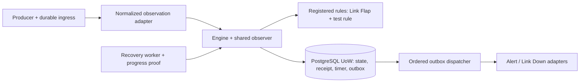

# Implementation Plan: Link Flap và module rule dùng chung

**Branch**: Feature context `001-link-flap-detection`; chưa tạo Git branch. Repository source đang ở `feature/N42-18-deduplication-engine` theo .git/HEAD, không đổi nhánh.
**Date**: 2026-11-16 | **Spec**: [spec.md](spec.md)
**Input**: Đặc tả đã chốt received-time, 5/60s, recovery 120s và module cho rule sau; source theo đường dẫn người dùng cung cấp.

## Summary

Xây Link Flap hoàn chỉnh trên nền Python/FastAPI của N4.2: observation chuẩn hóa → state chung → các rule đăng ký → transaction lưu state/timer/receipt/outbox → adapter cảnh báo. Thêm PostgreSQL persistence để đạt retry/restart; không dùng fixed-window dedup hiện có làm detector. Phần source được lên kế hoạch thay đổi, chưa được sửa trong lượt này.

Tài liệu phát sinh nằm trong workspace Spec Kit hiện tại. Mọi đường dẫn app/, tests/, docker/, docs/, requirements.txt dưới đây tương đối với **implementation root** `C:/Projects/vnpt/telecom-alert-correlation-n42`, không phải workspace tài liệu này.

## Technical Context

**Language/Version**: Python 3.12, theo Dockerfile.
**Primary Dependencies**: Giữ FastAPI≥0.115, Pydantic≥2.9,<3, ruamel.yaml≥0.18.16,<0.19 và asyncio/collections.deque chuẩn. Thêm psycopg[binary]≥3.2,<4 khi implement vì chưa có driver; không thêm ORM/broker/pool.
**Storage**: PostgreSQL16 trong TimescaleDB hiện có; năm bảng metadata thường, JSONB cho snapshot/state rule. Raw ingress/journal do pipeline cung cấp theo contract.
**Testing**: pytest/pytest-asyncio hiện có; fake clock/store cho unit, PostgreSQL thật cho persistence/crash/concurrency; không sleep 120s.
**Target Platform**: Linux container theo Dockerfile; phát triển Windows. DB sync trong asyncio.to_thread để không đổi policy event loop Windows.
**Project Type**: Module backend dùng lại trong cùng FastAPI process, không public ingest API mới.
**Performance Goals**: Chưa cam kết throughput/latency mới. Đo module và báo riêng kết quả với KPI toàn dự án; tick 5s là lựa chọn đề xuất, không SLA recovery.
**Constraints**: RECEIVED_TIME cố định cho bản đầu; threshold/window lấy từ cấu hình được kiểm định bằng 5/60 cho bản phát hành này, R=120>60; deadline chính xác tới microsecond; chỉ dữ liệu giả lập.
**Scale/Scope**: Một nguồn có thẩm quyền/device; đơn vị atomic một entity; registry hỗ trợ loại entity khác nhưng không thực hiện rule chéo entity. Một rule kiểm chứng mở rộng, không thêm business rule production.
**Research**: [research.md](research.md), quyết định R01–R12; đã xác định stack và hành vi, không còn lựa chọn kỹ thuật bỏ trống.

## Constitution Check

*Đánh giá trước research và lặp lại sau design.*

Constitution trong workspace hiện còn placeholder, nên không có nguyên tắc đã ratify để xác nhận compliance. Không ghi một lượt “constitution passed” giả. Điều này không ngăn tạo thiết kế; trước code phải đối chiếu governance của repository nguồn.

| Gate | Trước Phase 0 | Sau Phase 1 |
| --- | --- | --- |
| Đúng phạm vi/ngữ nghĩa người dùng | Đạt: 5/60, received-time, R120, rule module | Đạt về thiết kế: contracts và nghiệm thu giữ đúng |
| Tái sử dụng stack/code hiện có | Đạt: đã đọc source | Đạt: giữ AlertEvent/parser/dedup API; dùng loader/lifespan sẵn có |
| Không làm mất/nhân đôi hiệu lực | Cần thiết kế | Được bao phủ bởi UoW, global receipt, fenced writer và ordered outbox; chưa kiểm thử runtime |
| Hợp đồng giữa nhóm không bị coi là đã có | Nhận diện thiếu pipeline/store/progress | Đạt: dependencies và activation gate rõ; mock không được nghiệm thu production |
| Quy trình trước code trong AGENTS | Chưa làm code | Còn việc cho bước implementation: ticket/owner/test/RTM và record thay đổi contract; không tự tạo trạng thái Jira hoặc ghi team sign-off |
| Hiệu năng/an toàn dữ liệu | Không suy KPI đã đạt | Synthetic fixtures, parameterized SQL, giữ raw_ref; không mở endpoint/retention destructive mới |

Không có vi phạm đã biết cần bỏ qua để tạo các artifact thiết kế. Nếu implementation thiếu producer/proof hoặc durable store thì phải fail activation; đó là gate tính đúng, không phải yêu cầu xin quyền cho việc viết tài liệu.

## Project Structure

### Documentation (this feature)

```text
specs/001-link-flap-detection/
├── spec.md
├── review.md
├── plan.md
├── research.md
├── data-model.md
├── quickstart.md
├── contracts/
│   ├── rule-module.md
│   ├── ingress-and-progress.md
│   └── decision-delivery.md
└── checklists/requirements.md
```

tasks.md do lệnh $speckit-tasks tạo ở bước tiếp theo, không tạo trong lượt plan.

### Source Code (repository root — dự kiến, chưa tạo)

```text
app/
├── main.py                         # nối lifecycle khi runtime đủ capability
├── models/
│   ├── correlation.py             # envelope, snapshots, outcomes và timer/proof DTO
│   └── rule_config.py             # parameters map + LF typed validation khi bind
├── services/
│   ├── rules.yaml                 # migration LF, vẫn disabled mặc định
│   ├── rule_config_loader.py       # giữ validation/checksum; chỉ đổi nếu context cần
│   └── correlation/
│       ├── __init__.py             # exports public tối thiểu
│       ├── engine.py               # registry, thứ tự, UoW và observer chung
│       ├── link_flap.py            # pure process_event/on_timer và state LF
│       ├── adapter.py              # producer contract → immutable envelope
│       └── runtime.py              # bounded worker, timer, restore, ordered outbox
└── store/
    └── correlation.py             # PostgreSQL UoW và metadata queries
docker/migrations/001_correlation_state.sql
tests/
├── correlation/
│   ├── test_contracts.py
│   ├── test_link_flap.py
│   ├── test_engine.py
│   ├── test_runtime.py
│   └── test_postgres.py
├── fixtures/
│   ├── correlation/link_flap_v2.json
│   └── rules/{candidate-0.2.0.yaml,review-cases-0.2.0.json}
├── test_rules_config.py           # regression/migration, giữ strict behavior
└── test_rule_startup.py           # disabled không đòi DB; enabled fail-fast
requirements.txt
docker-compose.yml                 # DSN qua môi trường khi bật runtime, giữ DB service
.github/workflows/ci.yml            # chạy nhóm PostgreSQL bằng service DB đang có
docs/{DECISIONS.md,TECHNICAL_DESIGN_DOCUMENT.md,TEST_CASE_SPECIFICATION.md,
      REQUIREMENTS_TRACEABILITY_MATRIX.md,DATA_AND_API_DESIGN.md}
docs/scenarios/KB-01-link-flap.md
n42-ai-kit/docs/INTERFACES.md
```

**Structure Decision**: Bám app/models, app/services, app/store hiện có; chỉ tạo một package correlation. Registry nằm cùng engine, state interface được tính một lần trong UoW, chưa tạo framework plugin. Các file tài liệu nguồn phải đồng bộ khi thay hành vi; không sửa frontend vì public AlertEvent/API hiện tại được giữ.

### Phạm vi tác động và tương thích

- Giữ RULE_LINK_FLAP_01 và severity MAJOR; không quy đổi nó sang severity số của AlertEvent.
- Thay riêng LF group/match/count sang canonical observation; version catalog đề xuất 0.2.0, fixture semantics version mới.
- Không thay chữ ký parse_syslog_rfc3164, AlertEvent hay DeduplicationWindow. Regression parser/dedup/config/startup vẫn phải chạy.
- Cập nhật caller app/main.py và package exports đúng các public symbols mới; không export toàn bộ implementation.
- Không bật BGP/PSU; không triển khai Alert Manager/Link Down/dashboard mới trong phạm vi module.
- Không tự sửa dữ liệu đang có. Migration chỉ thêm bảng; rollout không dùng down migration phá state và không drop volume lab.

## Phase 0 — Research completed

[research.md](research.md) ghi bằng chứng source, phương án đã chọn và phương án không chọn. Đã đối chiếu driver/transactions/locking/lifespan với nguồn chính thức. Thay mô tả chưa có source ở spec bằng repository người dùng cung cấp; phần nhận định lịch sử trong review giữ nguyên kèm cập nhật.

## Phase 1 — Design & Contracts

1. [data-model.md](data-model.md): các record, năm bảng metadata, invariants và lifecycle.
2. [Rule module](contracts/rule-module.md): producer/rule/store/runtime API và cấu hình.
3. [Ingress/progress](contracts/ingress-and-progress.md): stable identity, ordering, admission proof, health và recovery fence.
4. [Decision delivery](contracts/decision-delivery.md): stream xuyên đợt, consumer idempotency, Link Down reconciliation.
5. [quickstart.md](quickstart.md): lệnh kiểm chứng sau implementation và expected, không báo test đã chạy.



### Thứ tự bàn giao để tạo tasks

| Mốc | Deliverable | Kiểm chứng / yêu cầu |
| --- | --- | --- |
| M1 | DTO, config migration, producer/progress contracts | FR-001/003/012/016; validation/ID collision, disabled regression; fixture có baseline |
| M2 | Lõi Link Flap + observer + fake UoW | FR-002/004–009/011; U01–U26 theo module, 60s/120s ±1ms, workflow độc lập |
| M3 | PostgreSQL store, receipt, ownership và outbox | FR-013–017; rollback rule lỗi, collision đổi entity, stale worker/timer, crash/restart |
| M4 | Runtime + pipeline/outbox adapter integration | FR-008/010/018; raw backlog fence, outbox xuyên đợt, DOWN reconcile sau UP, startup/stop |
| M5 | Regression và evidence | SC-001–006; rule kiểm chứng không sửa Link Flap, full backend suite, DB integration, báo tải riêng |

M1/M2 có thể dùng producer giả hợp đồng; M4 không được ghi đạt tích hợp production chỉ bằng fake. Source hiện chưa có durable raw pipeline, Alert Manager và Link Down thực thi; các bên tích hợp phải cung cấp hoặc ticket liên quan phải triển khai.

### Rủi ro trọng yếu được đưa vào test

- Fixture cũ đếm INITIAL: hai variant có/không baseline và expected riêng, không sửa assertion để giữ kết quả cũ.
- Retry sau cancellation/thread commit: cùng ID không tăng lại; trả lỗi không đồng nghĩa chắc chắn rollback, cần retry idempotent.
- Global event ID collision giữa hai entity: unique receipt và rollback đầy đủ.
- Proof admission cũ trong lúc source lỗi: kiểm tra proof version/health dưới cùng ranh giới khóa lúc commit, không recovery bằng cache cũ.
- A.recovered và B.triggered bị đảo delivery: stream head và consumer gap check; command stream riêng không làm gap decision.

## Complexity Tracking

Không có exception constitution đã ratify để ghi vào bảng. Năm bảng metadata, một DB driver và một package correlation phục vụ trực tiếp durability/registry đã yêu cầu; không thêm ORM, pool, Redis, Kafka, DSL hoặc service mới.

**Kết quả phase design**: Sẵn sàng tạo tasks cho module. Chưa có code, migration đã áp dụng, test runtime, đo tải hay phê duyệt liên nhóm. Git branch cho implementation cần theo ticket thật, không tiếp tục sửa nhánh N42-18 một cách mặc định.

