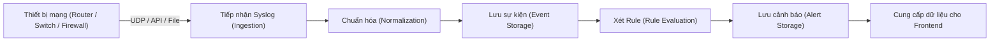
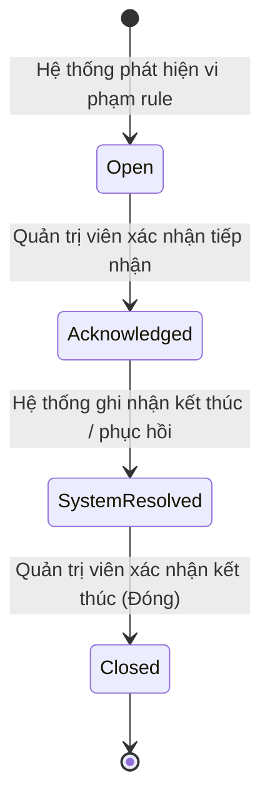

# TÀI LIỆU THIẾT KẾ KỸ THUẬT
## KIẾN TRÚC XỬ LÝ SYSLOG, VÒNG ĐỜI CẢNH BÁO VÀ RULE LINK FLAP

- **Dự án:** Hệ thống Giám sát Mạng qua Syslog (HKDN UTH – VNPT NET)
- **Người thực hiện:** Nguyễn Duy Minh (BE3)
- **Ngày lập:** 17/11/2026
- **Mục đích:** Tài liệu minh chứng kỹ thuật và cơ sở thảo luận thống nhất thiết kế tại buổi họp ngày 18/11/2026

---

## 1. Phạm vi Hệ thống và Luồng Xử lý (Scope & Pipeline)

### 1.1. Phạm vi giám sát
- Hệ thống chỉ thực hiện **giám sát thụ động** thông qua dữ liệu syslog từ các thiết bị mạng (Router, Switch, Firewall).
- Hệ thống **không** thực hiện tác vụ cấu hình (Configuration) hoặc tự động khắc phục sự cố (Auto-remediation) trên thiết bị mạng.

### 1.2. Luồng xử lý dữ liệu (Processing Pipeline)
Dữ liệu syslog được tiếp nhận qua 3 giao thức/kênh đầu vào (**UDP**, **API**, hoặc **File**), sau đó đi qua chuỗi xử lý tuần tự:

---

## 2. Thiết kế Dữ liệu và Cơ sở dữ liệu (Data Model & Database)

- **Bảo toàn dữ liệu gốc và dữ liệu cấu trúc:** Mỗi bản ghi sự kiện lưu trữ đồng thời cả **bản tin syslog thô (Raw Syslog)** và **các trường thông tin đã bóc tách (Parsed Fields)**.
- **Mô hình bảng sự kiện đa hãng (Multi-vendor Event Table):**
  - Thiết kế một bảng sự kiện dùng chung cho nhiều hãng thiết bị nhằm đơn giản hóa truy vấn và mở rộng.
  - **Các cột chuẩn hóa (Normalized Columns):** Lưu các thuộc tính chung phục vụ tìm kiếm, lọc và đánh chỉ mục (index).
  - **Cột `JSONB`:** Lưu trữ các trường dữ liệu mở rộng mang tính đặc thù theo từng hãng/dòng thiết bị.
- **Phạm vi hãng thiết bị giai đoạn đầu:** Tập trung chuẩn hóa và hỗ trợ hai hãng **Cisco** và **Juniper**.

---

## 3. Kiến trúc Rule Engine (Rule Architecture)

| Thành phần | Trách nhiệm thiết kế |
| :--- | :--- |
| **Dispatcher chung** | Tiếp nhận sự kiện đã chuẩn hóa và điều phối đến các rule đã đăng ký. |
| **Tách biệt Logic & Cấu hình** | Logic xử lý rule được cài đặt trong mã nguồn (code); các thông số ngưỡng và cấu hình được quản lý tách biệt bên ngoài. |
| **Quản lý State nhẹ** | Mỗi cặp `(device, interface)` duy trì state độc lập, nhưng **không** cần tạo riêng một tiến trình (process) hay một đối tượng rule đầy đủ cho từng interface. |
| **Engine** | Phụ trách lưu trữ state, quản lý checkpoint, dọn tài nguyên và điều phối vòng đời cảnh báo (Alert Lifecycle). |
| **Rule Handler** | Nhận sự kiện và state tương ứng, thực thi logic đánh giá nghiệp vụ và trả về kết quả đánh giá cho Engine. |

---

## 4. Đặc tả Rule Link Flap (Link Flap Detection Rule)

### 4.1. Logic phát hiện và ngưỡng kích hoạt
- **Định nghĩa sự kiện đếm:** Đếm từng lần chuyển đổi trạng thái **`UP → DOWN`** hoặc **`DOWN → UP`** trên cùng một cặp `(device, interface)`.
- **Chống nhiễu log lặp:** Các bản tin log lặp lại cùng một trạng thái (không có sự thay đổi trạng thái) **không** làm tăng bộ đếm.
- **Ngưỡng kích hoạt (đã chốt):** Tối thiểu **5 lần chuyển trạng thái** trong cửa sổ thời gian **60 giây**.

### 4.2. Cơ chế gom cảnh báo (Alert Aggregation)
- Khi đạt ngưỡng kích hoạt lần đầu tiên: hệ thống khởi tạo **cảnh báo Link Flap (Cảnh báo 1)**.
- Từ các lần thỏa điều kiện tiếp theo trong cùng đợt sự cố: hệ thống **cộng dồn vào cảnh báo hiện có**, **không** sinh cảnh báo hoặc thông báo mới gây nhiễu (Alert Fatigue).

### 4.3. Xử lý thứ tự thời gian và log đến muộn (Event-time & Late Logs)
- **Mốc thời gian đánh giá:** Xét theo **thời gian phát sinh sự kiện (Event Time)** thay vì thời gian máy chủ nhận được log.
- **Bộ đệm sắp xếp thứ tự:** Chờ **3 giây** để sắp xếp lại thứ tự các bản tin log trước khi chốt đánh giá.
- **Tính bù log đến muộn:** Các bản tin log đến muộn nhưng vẫn còn nằm trong phạm vi ảnh hưởng đến cửa sổ đánh giá bắt buộc phải được **tính bù** để đảm bảo tính chính xác.

### 4.4. Điều kiện kết thúc và tách biệt rule
- **Kết thúc Link Flap:** Sau **60 giây** liên tục không ghi nhận lần chuyển trạng thái mới, đợt Link Flap được kết luận kết thúc, đồng thời ghi nhận trạng thái cuối cùng của interface là **`UP`** hoặc **`DOWN`**.
- **Tách biệt nghiệp vụ:** Cảnh báo **Link Down** thuộc về một **rule độc lập**, không gộp chung logic kích hoạt với rule Link Flap.

### 4.5. Bảng tổng hợp thông số Rule Link Flap

| Tham số / Tiêu chí | Giá trị / Quy tắc | Trạng thái |
| :--- | :--- | :--- |
| Điều kiện đếm | Chuyển đổi `UP → DOWN` hoặc `DOWN → UP` (bỏ qua log lặp) | Đã chốt |
| Ngưỡng kích hoạt | Tối thiểu **5 lần** chuyển trạng thái trong **60 giây** | Đã chốt |
| Cơ chế cảnh báo lặp | Cộng dồn vào cảnh báo đầu tiên, không tạo thông báo mới | Đã chốt |
| Thời gian chờ sắp thứ tự log | **3 giây** (theo thời gian phát sinh sự kiện) | Đã chốt |
| Điều kiện kết thúc đợt flap | **60 giây** không phát sinh chuyển trạng thái mới (trạng thái cuối `UP` hoặc `DOWN`) | Đã chốt |

---

## 5. Thiết kế Vòng đời và Phương án Xử lý Cảnh báo (Alert Lifecycle)

### 5.1. Nguyên tắc thiết kế cốt lõi
- **Tách bạch hai chiều trạng thái:** Phân tách rõ ràng giữa **kết luận của hệ thống** (phát hiện bất thường / ghi nhận đã phục hồi theo rule) và **thao tác xử lý của người giám sát** (xác nhận tiếp nhận / đóng cảnh báo).
- Hệ thống chịu trách nhiệm ghi nhận trạng thái phục hồi dựa trên rule; người giám sát (quản trị viên) chịu trách nhiệm xác nhận và đóng cảnh báo.

### 5.2. Các phương án xử lý cảnh báo (Đề xuất thảo luận)

#### Phương án 1 (TH1): Kết hợp đóng tự động và đóng thủ công
- Cho phép cảnh báo được đóng theo hai cơ chế song song: **hệ thống tự động đóng** (khi thỏa điều kiện kết thúc) kết hợp với **quản trị viên chủ động đóng**.

#### Phương án 2 (TH2): Quy trình vòng đời 4 trạng thái có kiểm soát
Cảnh báo đi qua đầy đủ 4 bước chuyển đổi trạng thái rõ ràng giữa hệ thống và quản trị viên:

1. **Mở cảnh báo (`Open`):** Hệ thống phát hiện sự cố và khởi tạo cảnh báo.
2. **Quản trị viên xác nhận tiếp nhận (`Acknowledged`):** Người giám sát xác nhận đã tiếp nhận và đang theo dõi xử lý.
3. **Hệ thống báo kết thúc (`System Resolved`):** Hệ thống ghi nhận tín hiệu bất thường đã chấm dứt theo điều kiện phục hồi của rule.
4. **Quản trị viên xác nhận kết thúc (`Closed`):** Quản trị viên kiểm tra và xác nhận đóng hoàn toàn cảnh báo.

---

## 6. Cơ chế Dọn State và Quản lý Tài nguyên (State Cleanup & Resource Management)

- **Cơ chế dọn tập trung:** Một bộ dọn chung thuộc **Engine** thực hiện loại bỏ các mốc thời gian đã hết hạn và chỉ thu hồi vùng nhớ cache khi đã đảm bảo an toàn dữ liệu.
- **Quyền quyết định dữ liệu cần giữ:** Từng **Rule** tự xác định tập dữ liệu nào vẫn còn giá trị sử dụng và cần được lưu giữ.
- **Đảm bảo khôi phục và tính bù:** Hệ thống phải duy trì đầy đủ 4 nhóm dữ liệu cốt lõi gồm:
  1. **State gần nhất (Latest State)**
  2. **Baseline**
  3. **Log đang chờ xử lý (Pending Logs)**
  4. **Checkpoint**
- **Thông số đề xuất (Chưa chốt):**
  - Chu kỳ chạy bộ dọn (Cleanup Interval): **5 giây** *(đề xuất tham khảo)*.
  - Thời gian nhàn rỗi trước khi thu hồi (Idle Timeout): **60 giây** *(đề xuất tham khảo)*.
  - *Lưu ý: Hai thông số trên được nêu nhằm phục vụ thảo luận kiến trúc vận hành, **không phải** thông số rule đã chốt.*

